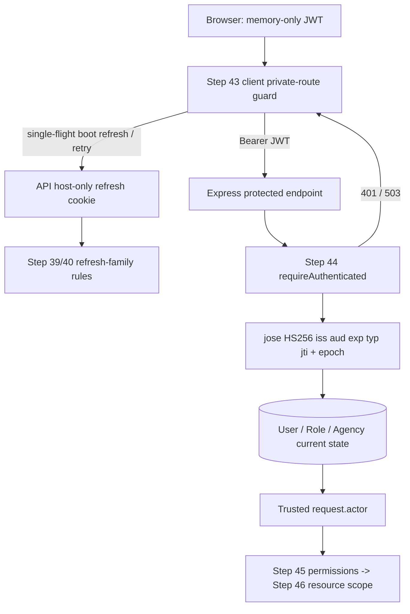

# INFRAOS — Enhanced Development Specification
## Roadmap Steps 43–44 of 190: Protected Frontend Routes/UX + Authoritative Backend Authentication Middleware

**Project:** INFRAOS — National Infrastructure Intelligence & Coordination Platform  
**Identity:** “The Operating System for National Infrastructure”  
**Type:** Sri Lankan university GovTech / portfolio demonstration, **not** a live government system  
**Prepared:** 24 October 2026  
**Repository:** `divejikan-yuvarajah/InfraOS`  
**Verified GitHub baseline:** `origin/development`, `origin/main` and `feature/auth-password-recovery` at `6d233480ef3e` at preparation; **recheck before execution**  
**Branch strategy:** One relevant feature-based branch, recommended `feature/auth-protected-access`, for both steps. Separate **step acceptance** and **Git approval** checkpoints; no per-step branches or worktrees.  
**Only workspace:** `C:\Users\ASUS\Desktop\InfraOS\InfraOS`  
**Companion:** `INFRAOS_Steps_43_44_Cursor_Agent_Execution_Prompts.md` — exactly **two prompts per step** (implementation, then combined review/testing).  
**Roadmap evidence:** Available roadmap-derived planning material calls Step 43 “Protected frontend routes/UX” and Step 44 “Backend authentication middleware”; Steps 45–46 separately own permission engine and agency/resource IDOR authorization. Original authoritative `Steps.docx` has not been directly verified here. If present locally, compare before implementation and report disagreements; do not change the order.

> **Mandatory gates:** Step 42 owner acceptance and any required dev database migration authorization → Step 43 implement/test/review/owner approval → Step 44 implement/test/review/owner approval → separately authorized commits/push/PR to `development` → separately authorized promotion to `main`. GitHub inclusion is not proof of approved Atlas indexes or real browser/API demo. Do not infer that an earlier step was signed off merely from a commit.

---

# A. Shared engineering contract and current architecture

## A1. Non-negotiable rules

1. Operate **only** in `C:\Users\ASUS\Desktop\InfraOS\InfraOS`; no `InfraOS-step43`, `InfraOS-auth-guard`, new checkout, additional worktree or copied repository. **Never inspect, move, modify, or delete the separate `Documents` folder.**
2. Examine `git status --short`, worktrees, local/remote SHAs, untracked/ignored files before switching branches. Never overwrite/stash/reset someone else's work without separate permission. Reuse a suitable feature branch or create `feature/auth-protected-access` from a **clean, synchronized** `origin/development` only when necessary and allowed. A branch name is a feature, not a roadmap number.
3. **Do not commit, push, create PR, merge or deploy without explicit owner approval**, even when a later phase of this document describes those actions. No force push, hard reset, secret commit, or unauthorized database write.
4. Protect the complete preexisting auth lifecycle: Steps 36–42 (provisioning, verification, login, JWT, refresh rotation, logout, forgot/reset password). No altered public Connected Future landing page or public marketing components. Do not create a private dashboard with invented metrics or a fake governmental data set.
5. Stack is **Next.js 16 App Router / React 19 / TypeScript / Tailwind 4 / Radix-shadcn**, Express 5 / TS and `/api/v1`, MongoDB Atlas + Mongoose, `jose` JWT HS256, `bcryptjs` cost 12, Pino, Zod, isolated Mongo replica-set tests. Prefer existing code/helpers over a new framework. AI, vector search, maps, R2, external IdP and password-mail integrations are unrelated to Steps 43–44.
6. Existing access JWT is ~15 minutes, stored in **web memory only**; refresh token is opaque HMAC-hashed server-side and in host-only API cookie `infraos_refresh; HttpOnly; Secure; SameSite=None; Path=/api/v1/auth` with no Domain. Never store JWT/refresh tokens in `localStorage`, `sessionStorage`, URL, global logs, HTML SSR, Next middleware headers or cookies readable from JS.
7. Preserve `NEXT_PUBLIC_AUTH_LOGIN_ENABLED=1` **development-only** operation. `getAuthAvailability()` deliberately forces `preview` when `NODE_ENV=production`. Do not enable production authentication until owner release decision and adequate Steps 43–46 protections. Don't introduce a fake login/guard bypass to make a demo green.
8. UI must comply with accessible, professional, premium INFRAOS internal styling: scoped `[data-infra-app]`, sober dark/neutral surfaces and restrained Sri Lankan flag-inspired accents **orange `#FF5B00`, yellow `#FEB600`, maroon `#8C1F28`, green `#279541`**. Avoid inaccessible color-only communication. Public page is unchanged. English/Sinhala/Tamil existing auth paths should continue to work; draft native-language copy must be labeled for review, not falsely called certified translations.
9. Security enforcement lives in Express; **frontend guards are UX only**, never protection for private records or privileged APIs. Step 43 is not a permission engine; Step 44 authenticates identity, but **does not** replace Steps 45–46 authorization.
10. Each step needs **pre-implementation audit, threat/race assessment, implementation manifest, tests, independent-style review, bug fixes/retests, actual manual demonstration where possible, residual-risk register and a final owner decision** (`APPROVE / REVISE / BLOCKED`). Self-review must be explicitly identified as self-review.

## A2. Verified source anchors (not a substitute for a new repo audit)

- `docs/reviews/step-42/STEP-43-HANDOFF.md`: Step 43 follows reset. Access JWTs minted pre-reset remain valid at cryptographic verification layer until their expiry; Step 44 must impose current-account freshness on protected APIs.
- `docs/reviews/step-42/END-OF-STEP-VERIFICATION.md`: 256 API tests, 115 web tests, type-check, lint, build PASS in documented last run; browser reset success/rejection used UI fixtures; live consume against API **NOT RUN**; live email BLOCKED; Atlas indexes NOT RUN pending approval. Reverify present local status and owner decision.
- `apps/web/src/middleware.ts` **already exists** and injects `x-infraos-public-locale`. It does not validate identity. Do not overwrite/break localization middleware.
- `apps/web/src/lib/auth/state.ts`: module-scoped memory state, auth generation/epoch (`getAuthEpoch`, `beginLogoutEpoch`, `applyAuthenticated`). No reactive subscription yet. `refresh-flight.ts`: single-flight refresh/boot. `availability.ts`: production preview. `client.ts`/`transport.ts`: login/logout and credentialed refresh. `apps/web/src/lib/api/client.ts`: `Authorization: Bearer` from memory on explicit `authenticated: true`, with one safe GET/HEAD refresh/retry.
- `apps/web/src/lib/auth/redirect.ts`: `sanitizeNextParam` allowlist currently focuses on public paths; Step 43 must extend safely for approved protected paths. Do not turn it into an open redirect or unbounded path acceptor.
- `docs/security/route-access-policy.md`: public/auth/staff/admin route classes, `/dashboard`, `/projects`, `/roadsync`, `/map`, `/contractors`, `/assets`, `/documents`, `/inspections`, `/issues`, `/notifications`, `/reports`, `/profile`, `/settings`, `/admin/**`, with public `/403` `/404` `/500` `/maintenance`. Treat catalog as routing contract; **do not build all future workspaces**.
- `apps/api/src/modules/identity/auth/jwt.ts`: `signAccessToken(userId)` currently signs `typ: access`, HS256, issuer/audience, jti/iat/exp; **no `credentialEpoch` claim**. `verifyAccessToken` checks shape and cryptography. `User` and `RefreshFamily` models gained numeric `credentialEpoch` in Step 42, default 0, with legacy missing-value handling.
- `apps/api/src/routes/v1.ts`: mounts health/ready/email-verification/auth; **no protected business feature routes yet**. `apps/api/src/middleware/` currently contains error, request ID/logger, validation, not-found, no authenticated request middleware.
- `apps/api/src/shared/http/envelope.ts`: `success(data,requestId)` and `failure(code,message,requestId)` envelope. Current login only allows `ACTIVE`, verified email, active role/agency; Q-002 still open product policy, existing strict rule must be retained.
- `docs/reviews/step-40/INDEX-MIGRATION-PROPOSAL.md`, `docs/reviews/step-41/INDEX-MIGRATION-PROPOSAL.md`, `docs/reviews/step-42/INDEX-MIGRATION-PROPOSAL.md`: **do not presume Atlas indexes deployed**. Development Mongoose `autoIndex` may write indexes merely by connecting. Verify owner approval before live Atlas process, `npm run dev:api`, syncIndexes, or index commands with writes.

## A3. Scope limits and handoffs

| This package | Deliver now | Strictly excluded |
|---|---|---|
| Step 43 | Private-route UX classification, guard state lifecycle, login-next-safe redirect, loading/retry/offline/expired experience, accessible internal protected shell or minimal authentic access-check page where necessary, tests | Server permission decisions, agency-scoped queries, public-site redesign, role impersonation, full operational dashboard, new auth issuer |
| Step 44 | Express Bearer middleware, strict JWT validation, account/role/agency freshness, credential-generation invalidation, typed actor context, protected real verification endpoint, safe errors, security regression tests | Full permission matrix, per-agency resource authorization, IDOR protection, wildcard protection of intentionally public endpoints, MFA/OAuth, refresh-token denylist, JWT `jti` blacklist (unless separately approved) |
| Steps 45–46 | **Future** | RBAC permission engine and organization/assignment resource scopes. Do not claim Step 44 establishes permission enforcement. |

---

# B. Step 43 — Protected frontend routes and state-driven UX

**Roadmap complexity:** high, frontend reliability and security-boundary-sensitive. Implement Step 43 in the shared auth-protected-access feature branch; stop for review and owner acceptance before writing Step 44 code. A stubbed/planned backend interface may be documented but not implemented yet.

## B1. Preconditions and pre-implementation review

1. Reverify working repo/branch and Step 42 owner approval. Confirm Step 42 committed implementation on `6d23348`, but check whether actual local checkout and migration status match. Record any blocker; unapproved Atlas changes remain blocked. Do not overwrite uncommitted work.
2. Inspect `apps/web/src/middleware.ts`, auth client/transport/state/refresh-flight, `apps/web/src/app/layout.tsx`, `AppProviders`, auth pages/locales, safe `next` parser, scoped styles, existing Vitest setup, and route access policy.
3. Produce observed-vs-desired private-route catalog, including route precedence, nested and dynamic paths, unknown routes, public exceptions and language prefixed existing public routes. Preserve locale header functionality and public recovery endpoints.
4. Choose an implementation with **no SSR credential leak**: since JWT lives only in browser memory and refresh cookie is host-only on the API origin, Next.js middleware **cannot reliably read or validate a session from its own request** in a Vercel/Render cross-site topology. Thus, the existing middleware should continue locale-only behavior (or add nonauth path classification only); use a **client route guard plus server-side API authentication in Step 44**. Do not attempt cookie guessing, `localStorage`, or insecure browser-readable cookie to force Edge redirects.

## B2. Route groups and public exceptions

Implement an explicit well-tested path classifier (literal path segments + safe prefixes), not `pathname.includes('admin')` or an overbroad `startsWith('/project')` check. Recommended categories:

- **Public:** `/`, `/(si|ta)`, `/about`, `/faq`, `/contact`, `/how-it-works`, `/privacy`, `/accessibility`, locale equivalents, `/403`, `/404`, `/500`, `/maintenance`, public project/map/report routes when they actually exist. Do not unintentionally convert public pages to staff-only.
- **Auth/public:** `/login`, `/forgot-password`, `/reset-password`, `/verify-email` and English/Sinhala/Tamil variants. Reset flows remain accessible without session.
- **Private staff:** `/dashboard`, `/projects` and children, `/roadsync` and children, `/map` (distinct from `/public-map`), `/contractors`, `/assets`, `/documents`, `/inspections`, `/issues`, `/notifications`, `/reports`, `/profile`, `/settings`, `/admin/**`. Guard each path **when implemented**; do not create all those pages now. Confirm role/catalog support with route policy.
- Never treat unknown routes as private by default in a way that makes `/404` inaccessible. Never promise restricted roles get a 403 until Steps 45–46 actually evaluate capabilities; public error route may exist as UX placeholder with accurate explanatory copy.

## B3. Client auth lifecycle / SSR and hydration

1. Create minimal stable, reactive auth observation (e.g., a subscribe/getSnapshot store with React `useSyncExternalStore`, or context with a stable SSR snapshot). Preserve `getMemoryAccessToken` + `beginLogoutEpoch` behavior. Avoid rendering authenticated content based only on stale module state without React updates.
2. Distinguish `checking`, authenticated, definitely unauthenticated (`401`/no cookie), preview/unavailable, and network-error state. Treat boot refresh as pending, not instantly unauthenticated. No unauthorized content flash while session status is unknown.
3. Reuse existing **single-flight** refresh; the guard must not launch competing boot/route refreshes or repeatedly rotate a cookie. One refresh attempt at boot or route entry, finite retry and transparent unavailable/error UX; offline does not equal logged out unless session truly expired.
4. Respect epoch/generation when resolving delayed login, refresh, logout and unmount navigation. No stale async response may reauthenticate after logout. In-flight API client retry must not cause an infinite auth loop; never automatically replay POST/PUT/PATCH/DELETE.
5. Guard only real private surfaces and their data fetching. During Step 43, if no private page exists, implement **the minimum approved `/dashboard` authenticated landing shell/access verification page** necessary to prove UX, explicitly labeled *“Workspace shell — operational modules pending”* with no invented KPIs, agencies, permissions, or private operational content. Alternatively use a minimal existing private page if present. Scope content under `[data-infra-app]`; no redesign of `/`.
6. Login redirect: for unauthenticated private URL, navigate to `/login?next=...` with path and safe query encoded; preserve locale when an approved locale login route is used. Sanitize/allowlist only same-origin relative destinations, reject `//`, `\\`, control chars, traversal, double decoding, userinfo, scheme injection, and `next=/login` loops. Ensure POST-reset link fragments/tokens are NEVER copied into `next` or navigation logs.
7. After login, honor a validated private `next`, else route to an actually available minimal authenticated destination; don't route to a nonexistent dashboard. Logged-in user visiting auth routes: follow documented policy while leaving reset-password reachable. Errors must not redirect infinitely.
8. On logout/session expiration: clear UI state and private query caches (`TanStack Query` etc.) before allowing private content again; inspect cached data for user-switch leakage. Expiration returns to localized login with safe `next`; public pages remain available.
9. Ensure accessibility: keyboard focus to status heading after redirect/guard failure, `aria-live` polite loading status vs alert for error, visible focus, disabled double-submit, reduced motion, 320/390/768/1024/1440 widths, high contrast, dark/light tokens as existing, English/Sinhala/Tamil typography continuity. Mark SI/TA copy draft pending native review.
10. Metadata: private shell and login-related pages `robots: noindex`; do not leak bearer tokens in HTML, redirect URL, analytics, error overlays or logs. Respect Next.js 16 App Router server/client module boundaries and existing middleware matching.

## B4. Expected file touch points (not a mandate to create everything)

- `apps/web/src/lib/auth/{state,refresh-flight,client,redirect,availability}.ts`
- Reusable path classifier and `ProtectedRouteGuard` in existing `lib/auth`/`components/auth` or internal app shell. No new repository folder/worktree; **normal source subdirectories are fine**.
- `apps/web/src/app/(...appropriate App Router group...)/layout.tsx` or scoped wrapper, route(s) minimally needed for demonstration; no broken existing route groups.
- `apps/web/src/lib/api/client.ts` for safe query/cache invalidation or dedicated authorized GET behavior only if needed; no global fetch rewrites.
- `apps/web/src/middleware.ts` **preserve locale header**; modify only for a demonstrated routing concern.
- Scoped auth/app stylesheet and focused Vitest/Playwright (if already installed) tests; docs at `docs/reviews/step-43/`.

## B5. Step 43 test matrix

| Scenario | Expected evidence |
|---|---|
| Anonymous direct `/dashboard` / nested private path | No private flash; login redirect with validated `next`; no redirect loop |
| Browser reload with live refresh cookie | Pending UI until single-flight refresh settles; correct authenticated route or error |
| Public pages and SI/TA auth/recovery pages | No unauthorized redirect; public landing content unchanged |
| Stale local auth state after logout | Guard clears sensitive/private query cache; late refresh/login cannot reopen |
| Preview production build | No claim of live login; protected pages never reveal private content or bypass backend |
| Offline/503 vs 401 | Helpful retry state vs definitive sign-in expiration; no infinite retry |
| Query/fragment injection to `next` | External/protocol-relative/traversal/encoded attacks rejected; no token propagation |
| User switch, back/forward, deep link, rapid navigation | No cached PII or broken state, no infinite loops |
| SSR & hydration; dev overlays | No hydration mismatch or auth-dependent SSR/private HTML leak |
| Keyboard, translations, focus, 320–1440px | Accessible responsive UX, no horizontal overflow |
| Existing auth web tests and build | Regression green; legitimate failures documented, not hidden |

### Step 43 owner acceptance gate

Required: implementation manifest, route classification tests, guard/reactive-state tests, refresh single-flight/epoch race tests, SSR/hydration and public-page regression checks, actual browser run where available, `npm run test:web`, `npm run type-check`, `npm run lint`, `npm run build` PASS. Any unrun live test must say NOT RUN with reason. **Owner must explicitly approve Step 43 before Step 44 implementation.** Do not push premature docs claiming production security.

---

# C. Step 44 — Authoritative Express authentication middleware

**Roadmap complexity:** critical, trust boundary. Implement only after Step 43 approval, on the **same feature-based auth-protected-access branch** (or other owner-approved appropriate current branch), without creating a new checkout or step branch.

## C1. Preconditions and pre-implementation security review

1. Inspect full `apps/api/src/app.ts`, `routes/v1.ts`, `auth/jwt.ts`, `auth/auth.service.ts`, `auth/refresh-session.service.ts`, `User`/`Role`/`Agency`/`RefreshFamily` models, Step 42 `credentialEpoch`, existing error envelopes/logging, tests, and `docs/security/route-access-policy.md`.
2. Verify Step 43 gate and Step 42 known risks. Existing JWT signing has **no credential generation claim**. Simply calling `verifyAccessToken()` on a pre-reset JWT does not make it invalid. Design a change that closes this gap without a token blacklist. Preserve accepted HS256 algorithm, audience, issuer, `typ:access`, jti/iat/exp and TTL rules.
3. Define a typed safe `AuthenticatedActor` for API request scope: `userId`, `roleId`/resolved role key, `agencyId`, `credentialEpoch`, minimal status as actually required, and request-scoped audit provenance. Never trust role/agency/client permissions from JWT body or browser. Prefer authenticating state from `User` + `Role` + `Agency` DB each protected request (bounded lean/projection); no PII or hash/token secrets in `req` log dumps.
4. Error semantics: missing/invalid/malformed/expired Bearer, subject missing, account inactive/unverified/suspended/disabled/deleted, missing/inactive role/agency, credential-generation mismatch → consistent **401 `AUTH_REQUIRED` or `SESSION_EXPIRED`** as suitable; authenticated but insufficient permission (future Step 45) → **403 `FORBIDDEN`**. DB/secrets unavailable → **503 `SERVICE_UNAVAILABLE`**. Do not turn DB failure into 401 or log raw bearer headers. Allow intentional unauthenticated routes to operate normally.

## C2. Access-token generation and reset invalidation contract

**Important source fact:** Current `SignJWT({ typ: 'access' })` does not embed `credentialEpoch`; Step 42 changes `users.credentialEpoch` and invalidates refresh, but legacy JWT signature stays valid. The authoritative middleware must fix this for future protected requests.

Recommended minimal design, subject to tests:

- Issue an explicit signed numeric credential generation claim, e.g. `ce` or `credentialEpoch`, from the **same verified user epoch** used during successful login/refresh. Do not accept a caller-supplied epoch. On protected calls compare JWT epoch to freshly read `User.credentialEpoch` (legacy missing user value means 0). A mismatch rejects protected access even before exp.
- Close **signing races**: login/refresh must not stamp an old epoch onto a JWT after a concurrent reset or claim a new epoch that the password verification did not authorize. Tie issuance to the existing Step 42 login transaction and epoch consistency; inspect `issueAccessSession` and `signAccessToken` call sites and recheck at issuance/response boundaries as needed. Never create a new family solely to satisfy middleware.
- Compatibility: decide and document how a **pre-Step-44 JWT without `ce`** behaves. Safety-first options: **deny on protected API (requiring refresh/relogin)**, or **treat missing as epoch 0 only when the stored user epoch is still 0 and documented grandfathering is owner-approved**. Never accept missing epoch for a user whose current epoch exceeds 0. A rollout should not silently revalidate an old JWT after password reset.
- Do not promise instant revocation of an access JWT on **logout alone** unless Step 44 explicitly checks a revocation marker encoded in that JWT. The requested minimum is JWT freshness after password reset/account disable on protected routes; logout remains primarily refresh family termination until a separately approved active-access-session scheme exists. Explicitly record the limitation.
- Signature validation with `jose` remains HS256 allowlist; reject `alg:none` and confusion, invalid key, wrong issuer/audience, malformed sub/jti/iat/exp, expired/future token beyond approved tolerance. Never call `jwt.decode` as acceptance proof.

## C3. Express middleware, typed request and routing

1. Create reusable `requireAuthenticated` (name appropriate to codebase), using Express 5 async error handling conventions and `jose` verifier. Accept `Authorization: Bearer <token>` only, with strict parsing (reject empty, multiple/doubled, comma-separated, Basic, malformed bytes). Do not authenticate cookie as bearer. Never expose `req.auth` untrusted client data.
2. On successful verification load `User` by validated `sub` (safely reject malformed Mongo ObjectIds), verify ACTIVE + emailVerified + active role + active agency under Q-002 policy (including null-agency disallowance until separately decided). Read DB on **each protected request** to detect state/role/agency changes. If per-request caching is considered, prove freshness or decline; stale global caches are not acceptable.
3. Attach only minimal actor metadata to request context using a typed declaration (inspect TypeScript `express` augmentation pattern), clear expectation for permission middleware (Step 45). No role ID parsed from JWT as authoritative. Distinguish role existence/status from permission enforcement.
4. Mount middleware explicitly **only** on routes intended to be authenticated. Keep `/health`, `/ready`, login, refresh, logout, verification, forgot-password, reset-password, and public/citizen read endpoints public according to existing policy. Do not globally wrap `/api/v1` and break those flows. Do not accidentally allow invented unprotected private routes.
5. Provide a real, bounded verification endpoint if needed, suggested `GET /api/v1/auth/me` requiring a Bearer JWT, returning **safe existing AuthUser DTO only** (no `passwordHash`, tokenHash, secrets, permission arrays or raw JWT). `Cache-Control: no-store`. This establishes an actual protected API for frontend guard integration without implementing full Steps 45/46. Document exact response envelope and status errors. No `User` records serialized wholesale.
6. Ensure request IDs, `Cache-Control: no-store`, consistent envelope errors and Pino redaction; no `WWW-Authenticate` requirement unless standards reviewed; if sent do not embed credentials. Correct CORS allowed headers for Bearer, no wildcard origin with credentials.
7. Work within modular-monolith boundary. Do not build separate auth microservice, OAuth server, Redis cache, UI role matrix, or broad admin routes.

## C4. Step 43 + Step 44 integration

- Once `/auth/me` exists, guard may use `apiClient` `authenticated:true` to confirm **authoritative** server session before displaying private app content. Crucial: network `503` must not be treated as permanently unauthenticated; 401 clears session/redirects, and client GET retry happens at most once with single-flight refresh.
- The JWT remains memory-only; page reload attempts a cookie-backed refresh from allowed origin, then GET `/auth/me`. Server verifies account epoch/status. Never promote frontend route classification into an authorization decision or assume `/auth/me` enforces access to unrelated resources.
- 403 semantics remain reserved for future permission checks; Step 43 can show a generic forbidden screen only when a real backend 403 is received. Avoid falsely blocking roles based on frontend roleKey.
- Ensure route and path `/api/v1/auth/me` is covered by auth-exclusion logic for cookie route retries **only as appropriate**: it is a bearer-protected read that may legitimately do one refresh, unlike `/login`, `/refresh`, `/logout`.

## C5. Step 44 threat model and required tests

| Threat / test | Mandatory behavior |
|---|---|
| Missing/Basic/empty/duplicate/garbled authorization | 401 standardized envelope; no request actor |
| Tampered signature, HS/none/RS confusion, wrong aud/iss/typ | 401; no controller executed |
| Missing malformed `sub`/`jti`/`iat`/`exp`, expired and future token | 401; bounded clock skew according to existing verifier |
| Pre-reset validly signed JWT after `credentialEpoch` increment | 401 on `/auth/me`; do not report still valid on protected routes |
| Legacy JWT without epoch vs user epoch 0 / 1 | Explicit compatibility policy, secure test and handoff note |
| Fresh login/refresh after reset | New JWT with current credential claim passes, but only if account eligible |
| User DISABLED/SUSPENDED/PENDING/unverified or deleted after token issuance | 401 immediately on next authenticated protected API request |
| Role deactivated/deleted or agency disabled/deleted | 401 per current eligibility rule; never rely on stale client role |
| Access token for another subject, malformed ObjectId, forged role in claim | 401 or verified subject-only actor; role derives from DB |
| Mongo disconnected, malformed secret configuration | 503; no DB/secret leakage; no hang/500 |
| Login, refresh, logout, forgot/reset, health, ready | No regression, remain accessible without bearer as defined |
| Concurrent reset with in-flight login or refresh | Protected token cannot use old epoch after commit; deterministic barriers |
| Concurrent status disable or agency/role change around check | Define request-level consistency, log residual TOCTOU without claiming serializability |
| Cross-tenant actor identity and future perms | Actor data is minimal; no approval/admin resource access implied |
| Logs, response DTO, headers | No password/token/hash/secret exposure, no caching of private DTO |
| Client 401 retry | At most one safe GET refresh+retry; no POST unsafe replay, no retry storm |

## C6. Manual proof and regression suite

When owner-authorized isolated/local database is available:

1. Start API and web with existing safe dev configs; check `GET /health`, `GET /ready`, `npm run db:check` and non-destructive index checks; never invoke Atlas index creation without approval.
2. Create/use only approved synthetic `ACTIVE`/verified/active-role/active-agency account in `infraos_dev` or isolated memory replica set. No seeded demo fixture hash as a login credential.
3. Sign in in nonproduction; verify no token stored in web storage. Navigate to `/dashboard` or tested private shell; GET `/auth/me` succeeds only with fresh Bearer JWT; anonymous direct access redirects through client guard but endpoint independently denies without bearer.
4. Logout and verify refresh cookie cleared, private cache/UI erased; test direct/back navigation, repeat logout, expired access, 503/offline and no refresh-loop.
5. In an isolated replica-set flow: issue an access JWT; reset password; check **same access JWT** now returns 401 on `/auth/me`, and new-login JWT succeeds. Do not expose tokens in logs.
6. Change status/role/agency in isolated test DB; verify `/auth/me` immediately denies. Do not mutate production/real user accounts.
7. Run root `npm run test:api`, `npm run test:web`, `npm run type-check`, `npm run lint`, `npm run build`; focused tests; browser EN/SI/TA auth pages and public landing regressions; verify no altered landing source. If any fails, fix only in-scope defects and re-run.

### Step 44 owner acceptance gate

- Verifier + middleware unit/integration tests green; all negative token/status cases and credential-epoch reset invalidation proven. Demonstrate a genuinely protected API (`/auth/me` or existing equivalent) and frontend-safe UX.
- Record exact `401 / 403 / 503` contract and legacy JWT policy. `403` means **valid authentication but denied capability**, not generic invalid token.
- Full suites, lint, types and build green; actual browser/dev proof where available. If Atlas, indexes or live email are blocked, **do not mark them PASS**; classify each and explain relevance.
- Independently review code (second reviewer if available; otherwise mark self-review), performance/load consequences of DB status checks, race and secret leakage, rollback and manual test evidence. Obtain owner **APPROVE** before Git integration.

---

# D. Shared system diagrams and API contracts

## D1. Authentication boundaries



## D2. Protected page request flow

```mermaid
sequenceDiagram
  actor Person
  participant Web as Next.js client guard
  participant API as Express
  participant DB as MongoDB
  Person->>Web: Open /dashboard directly
  Web->>Web: Hide private content; read reactive auth state
  alt No in-memory JWT
    Web->>API: POST /auth/refresh (credentials include)
    API->>DB: Verify and rotate family
    API-->>Web: JSON JWT or 401 / 503
  end
  Web->>API: GET /auth/me (Authorization Bearer)
  API->>API: Verify JWT claims and credential epoch
  API->>DB: Load User, Role, Agency freshness
  alt Valid identity and epoch
    API-->>Web: 200 safe user DTO, no-store
    Web-->>Person: Minimal authenticated workspace
  else Missing/expired/ineligible
    API-->>Web: 401
    Web-->>Person: Localized login?next=/dashboard
  else Database unavailable
    API-->>Web: 503
    Web-->>Person: Retry state, no private data rendered
  end
```

## D3. Proposed verified API contract

`GET /api/v1/auth/me` (name to confirm at Step 44 pre-audit):

- `Authorization: Bearer <short-lived JWT>`, **no cookie authentication**; must pass current `credentialEpoch` + user status + active role and agency checks.
- `200`: existing standard success envelope, **safe minimal user DTO**, no tokens or secret fields; `Cache-Control: no-store`.
- `401`: standard failure `AUTH_REQUIRED` or `SESSION_EXPIRED` as documented (missing, invalid, expired, revoked epoch, ineligible). No existence disclosure.
- `503`: `SERVICE_UNAVAILABLE` for dependency outages, fail closed.
- `403`: reserved for authenticated-but-not-authorized routes in later permission middleware; **do not invent 403 in this endpoint simply to satisfy a checklist**.

`GET /health`, `/ready`, and public `/api/v1/auth/login|refresh|logout|verification/request|verify-email|forgot-password|reset-password` retain their current method/contract. Protect other endpoints **explicitly** when built; no blanket router attachment.

---

# E. Environment, accounts, services and secret policy

## E1. Exact Step 43–44 runtime values

**`apps/api/.env`** (existing, never committed):

```dotenv
NODE_ENV=development
PORT=4000
FRONTEND_ORIGIN=http://localhost:3000
LOG_LEVEL=info
API_PREFIX=/api/v1
MONGODB_URI=<reuse your existing approved Atlas DEVELOPMENT connection URI; never paste into chat/review>
MONGODB_DB_NAME=infraos_dev
ACCESS_TOKEN_SECRET=<reuse Step 39+ existing strong secret, min 32 chars>
ACCESS_TOKEN_TTL=15m
REFRESH_TOKEN_SECRET=<reuse a DIFFERENT strong existing secret, min 32 chars>
REFRESH_TOKEN_TTL=7d
```

**`apps/web/.env.local`** (existing, never committed):

```dotenv
NEXT_PUBLIC_API_BASE_URL=http://localhost:4000
NEXT_PUBLIC_AUTH_LOGIN_ENABLED=1
```

- `NEXT_PUBLIC_AUTH_FIXTURE=1` is **optional testing-only** if the existing fixture mode is intentionally used; it is not a required deployment key. Never expose any JWT or DB URI via `NEXT_PUBLIC_*`.
- **Do not add new env keys for Step 43–44** unless a concrete reviewed implementation requires them. No `JWT_SECRET`, `REFRESH_SECRET`, `CLIENT_URL` aliases. Do **not rotate existing secrets** to implement guards.
- Only external account needed for **live local** tests is the **already approved MongoDB Atlas dev cluster** at <https://cloud.mongodb.com/> with authorized IP and driver URI. If present, reuse. An isolated MongoDB in-memory **replica-set test** requires no external account. Do not connect to production, create unrestricted IP `0.0.0.0/0` without approval, copy real staff credentials, or write Atlas indexes automatically.
- No new accounts/API keys for OpenRouter, Qdrant, Cloudflare R2, maps, email, authentication-as-a-service, analytics or SMS. Step 41–42's lack of approved live mail provider is **not fixed** in these steps and must not be misrepresented.
- Before `npm run dev:api`, verify **Step 40–42 Atlas index approvals and the Mongoose autoIndex setting**. Starting a development API can implicitly write indexes. If not approved, demonstrate using disposable replica set and mark Atlas work BLOCKED/NOT RUN. Ask owner permission before DB/index modifications.
- Do not add fake/synthetic account using unsecured HTTP bootstrap route. Any local test user requires owner-approved synthetic provisioning; never use seeded accounts with nonlogin hashes as live credentials. Handle test-user cleanup explicitly.

## E2. Verification commands (repository root; adapt to actual package scripts)

```powershell
cd C:\Users\ASUS\Desktop\InfraOS\InfraOS
git status --short
git branch --show-current
git fetch origin
git log -1 --oneline origin/development
npm run test:web
npm run test:api
npm run type-check
npm run lint
npm run build
# Only after authorized Atlas access / index review:
npm run db:check -w @infraos/api
npm run db:indexes:check -w @infraos/api
npm run dev:api
npm run dev:web
```

Focused test commands should use **actual filenames discovered during implementation**, not guess nonexistent test paths. `npm run db:indexes:check` is read-only by design; `syncIndexes`, `autoIndex`, and `createIndex` are *not* read-only.

---

# F. Reviews, documentation, and safe Git integration

## F1. Required per-step review files (within the **existing repository**, not new workspace folders)

Under `docs/reviews/step-43/` and `docs/reviews/step-44/`, create/maintain **concise**, high-signal Markdown evidence. Prefer 4–6 files per step, not dozens of repetitive audits:

1. `PRE-IMPLEMENTATION-AUDIT.md`: baseline, scope, dependency gate, risks, API/UX contracts.
2. `IMPLEMENTATION-AND-TEST-MATRIX.md`: changed files, requirements→tests, expected/actual, screenshots only without tokens.
3. `SECURITY-AND-INDEPENDENT-REVIEW.md`: bugs, severity, threats, reviewer identity (“same-agent review” vs independent).
4. `END-OF-STEP-VERIFICATION.md`: exact commands/results, PASS/FAIL/BLOCKED/NOT RUN, owner recommendation, no unverified claims.
5. `HANDOFF.md`: next-step boundaries (Step 44 then 45), known limitations.
6. Optional `BUG-AND-RESIDUAL-RISKS.md` only if enough distinct material warrants it.

Normal nested `docs/reviews/step-*` source organization is allowed; user's **single-folder rule** prohibits extra top-level checkouts/worktrees, not ordinary documentation directories inside `InfraOS`.

## F2. Mandatory independent/final review checklist

- Correct roadmap step ordering; no premature Step 45/46 work.
- No secret/token storage/logging/HTML leaks; no forged role/agency claims trusted; failed DB/secrets fail closed.
- No unauthorized edits to public landing page, metadata/locale/header middleware regressions or `Documents`.
- Step 43 anonymous/private/public/preview/offline/redirect/caches/SSR/keyboard flows and browser screenshots.
- Step 44 all JWT rejection variants, status/role/agency/credential epoch, safe envelope and actual protected route.
- Cross-step live integration and bug re-tests; `npm run test:api`, `npm run test:web`, `npm run type-check`, `npm run lint`, `npm run build` with exit status, counts and any existing warnings.
- Dev/Atlas/test database index status, mail provider absence, synthetic user cleanup; don't conflate approval with deployment.
- Independent reviewer not same author if possible; when not, transparently mark self-review; get owner acceptance separately.

## F3. Git lifecycle after *separate* owner approval

1. At baseline, inspect `git status`, other worktrees, stale branches and remote divergence. Create/reuse **one `feature/auth-protected-access` branch in the existing checkout** if clean/appropriate. Never switch on dirty work without authorization. No extra filesystem folder.
2. Implement Step 43, review and obtain **owner approval**. Step 44 cannot start before this. Keep independent per-step test evidence and review notes; staging/commit is **not automatic**.
3. Implement Step 44 on the same branch after the Step 43 gate. Review full integration and get **owner approval**. Do not hide unreviewed Step 43 changes inside Step 44 diffs.
4. Owner may **separately** authorize stage+conventional commits (`feat(web): guard authenticated routes`; `feat(api): enforce authenticated bearer access`) and subsequent push/PR; no secrets or irrelevant changes. **No commit/push/PR/merge just because this development prompt was supplied**.
5. On authorization, PR against `development`; run CI and independent review; fix defects with owner-approved new commits; obtain merge approval. Post-merge smoke tests on `development`, compare tree/commit.
6. Promotion `development → main` is a **separately approved stable release gate**. Never automatically merge from implementation to `main`; do not claim main updated without verifying SHA.
7. Rollback: feature toggle or revert approved code only; no destructive Atlas schema rollback; document legacy JWT compatibility and private route rollback impact. Keep development auth feature gate production-preview until explicitly lifted.

---

# G. Final two-stage acceptance snapshot

| Gate | Must be true before completion |
|---|---|
| **G0 prerequisite** | Step 42 owner-approved and source checkout safe; Atlas migrations not assumed; blockers recorded |
| **G43 — frontend** | Path classifier/guard/SSR/locale/redirect/refresh/logout UX green; actual preview/private/public tests; full web types/lint/build; reviewer + owner approval |
| **G44 — backend** | JWT auth middleware protects real endpoint, current User/Role/Agency and epoch rechecks, pre-reset JWT denied, positive/negative/race tests, full test suites; reviewer + owner approval |
| **G-Git** | Explicit separate permission before commit, push, PR, merging into `development`; release to `main` later and separately |
| **G-post** | Handoff to Step 45 permission-engine design only after G44 approval; no fake RBAC/IDOR completeness claims |

**End of enhanced specification.**
