<div align="center">


# INFRAOS

### National Infrastructure Intelligence & Coordination Platform
*The Operating System for National Infrastructure*

**Connect Infrastructure. Coordinate Agencies. Build Smarter.**

[](https://nodejs.org/)
[-000000?style=for-the-badge&logo=next.js&logoColor=white)](https://nextjs.org/)
[](https://www.typescriptlang.org/)
[](https://expressjs.com/)
[](https://www.mongodb.com/atlas)
[](https://tailwindcss.com/)
[](https://maplibre.org/)
[](https://fastapi.tiangolo.com/)
[](docs/ux/README.md)
[](README.md)

</div>

> **Academic and portfolio project** by the INFRAOS Development Team, South Eastern University of Sri Lanka.
> All demo and seed data is **synthetic**. INFRAOS is not an official government system and its demo data must never be presented as official data.

---

## Table of contents

1. [What is INFRAOS?](#1-what-is-infraos)
2. [Key features](#2-key-features)
3. [Visual platform showcase](#3-visual-platform-showcase)
4. [User roles & RBAC](#4-user-roles--rbac)
5. [System architecture & flows](#5-system-architecture--flows)
6. [Technology stack](#6-technology-stack)
7. [Repository structure](#7-repository-structure)
8. [Database design](#8-database-design)
9. [Security model & governance](#9-security-model--governance)
10. [Installation & setup](#10-installation--setup)
11. [Environment configuration](#11-environment-configuration)
12. [Database setup, seeding & default credentials](#12-database-setup-seeding--default-credentials)
13. [Running the application](#13-running-the-application)
14. [Testing & quality verification](#14-testing--quality-verification)
15. [API overview](#15-api-overview)
16. [Deployment](#16-deployment)
17. [Troubleshooting](#17-troubleshooting)
18. [Documentation map](#18-documentation-map)
19. [Contributing & branch strategy](#19-contributing--branch-strategy)
20. [Team & licence](#20-team--licence)

---

## 1. What is INFRAOS?

Public infrastructure is built by many autonomous agencies that historically operated in silos with minimal visibility into each other's schedules. The consequence is well known: a municipal road is paved and resurfaced, only for a utility agency to excavate it weeks later for water mains, telecommunication conduits, or power lines.

**INFRAOS** gives statutory authorities a unified, geospatial, and schedule-aware coordination operating system to **plan, coordinate, approve, construct, inspect, account, hand over, and maintain** national infrastructure assets with spatial collision detection *before* physical works begin.

```text
Create Project → Map Project (GeoJSON) → File Work Request → Detect Spatial Conflict
→ Inter-Agency Coordination Thread → Formal Resolution & Ledger → Track Milestone Progress
→ Field Inspection Verification → Maker-Checker Payments → Asset Handover & Passport → Lifecycle Maintenance → Immutable Audit
```

Core design tenets:

- **Truthful data.** Unknown states are rendered as an honest "unavailable". No fabricated metrics, artificial trends, or deceptive "real-time" indicators. Uninspected progress is never reported as officially verified.
- **Server-side authority.** Access control, institutional permissions, agency boundaries, dual-approval segregation, and audit logging are strictly enforced by the backend API. Hiding a client-side button is never security.
- **Privacy by default.** Files and physical evidence never live in unencrypted database records. Storage endpoints are never leaked to browsers. All bytes stream through authenticated, MIME-validated endpoints.

---

## 2. Key features

| Module | What it does |
|---|---|
| **RoadSync (Conflict Engine)** | Work requests with GeoJSON coordinates and planned timelines. Runs automated 2D spatial & schedule clash detection to identify overlapping excavations, facilitates cross-agency coordination threads, scenario simulation, and audit ledgers. |
| **InfraMap (Geospatial Intelligence)** | High-performance MapLibre GL map of national capital works, road networks, public utilities, and hazard zones with dynamic layer toggles, role-restricted filters, and spatial inspection probes. |
| **ProjectTrace (Project Intelligence)** | Complete lifecycle tracking (Draft → Submitted → Approved → Active → On-Hold → Delayed → Completed), milestones, Gantt dependency timelines, physical vs financial progress curves, and audit trails. |
| **Admin-Approved Registration** | Multi-step statutory applicant registration wizard with bcrypt password hashing (cost 12), institutional access requests, automated branded HTML email alerts to administrators, and a dedicated Super Admin review portal (`/admin/registrations`) with role and agency assignments. |
| **AI Document Intelligence & Processing** | Background processing pipeline: automated text extraction (PDF/DOCX), recursive semantic chunking, Qdrant vector indexing, interactive Document AI Q&A panel strictly grounded in authorized versions, and AI risk analysis. |
| **DocTrace (Classified Documents)** | Enterprise document management: validated streamed uploads (magic bytes, ZIP bomb inspection), immutable versioning, secure preview/download, archive-first deletion, metadata tagging, and full-text search. |
| **Finance & Maker-Checker Ledger** | Immutable project budget ledgers with formal revisions, dual-authorization payment disbursements (maker-checker separation of duties), expense tracking, verified spending comparisons, and CSV reporting. |
| **Field Inspections & Evidence** | Milestone-gated inspections with structured checklists, defect logging, GPS-tagged photographic evidence in GridFS, reviewer sign-offs, and verified physical progress comparisons. |
| **Asset Passports & Maintenance** | Formal conversion of completed capital projects into long-term statutory assets (approval gate), condition assessments, evidence-gated health scores, and recurring maintenance schedules. |
| **Contractor Registry** | Accredited contractor database, capacity grades, official certifications, performance history, and active project staffing assignments. |
| **Citizen Infrastructure Portal** | Public issue reporting (potholes, water leaks, electrical hazards, drainage blockages) with automatic routing to responsible statutory agencies and progress notifications. |
| **Trilingual Civic Atlas** | Complete localized user interface in **English, Sinhala (සිංහල), and Tamil (தமிழ்)** with instant language switching and Google Gemini dynamic AI translation integration. |
| **Security & Governance** | Cryptographic short-lived in-memory JWTs, host-only rotating refresh cookies with family-based replay protection, append-only transactions, and strict RBAC. |

---

## 3. Visual platform showcase

<div align="center">

### National Infrastructure Platform in Action

| Public Portal & Civic Atlas | Statutory Sign-In & Onboarding |
|:---:|:---:|
| <a href="docs/Screen/08-public-landing-page.png">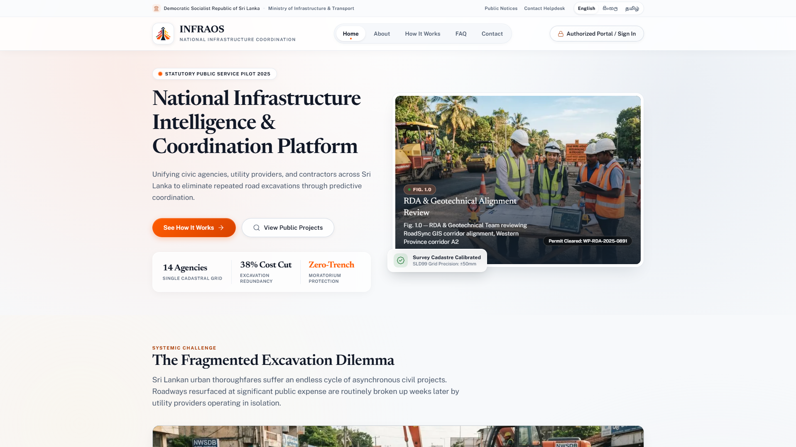</a> | <a href="docs/Screen/09-sign-in.png">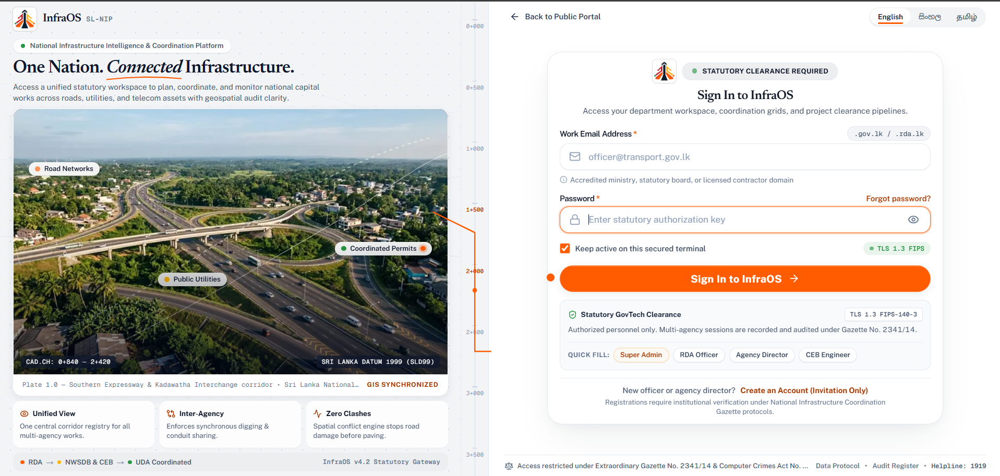</a> |
| *Civic Atlas landing page with interactive corridor radar and GIS preview* | *Statutory GovTech login with Quick Fill and Admin Approval gates* |

| RoadSync Spatial Conflict Engine | InfraMap Geospatial Intelligence |
|:---:|:---:|
| <a href="docs/Screen/02-roadsync-infrastructure-coordination.png">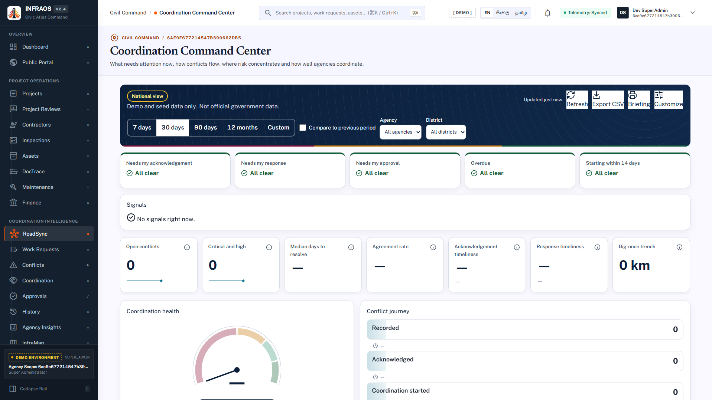</a> | <a href="docs/Screen/03-inframap-infrastructure-intelligence.png">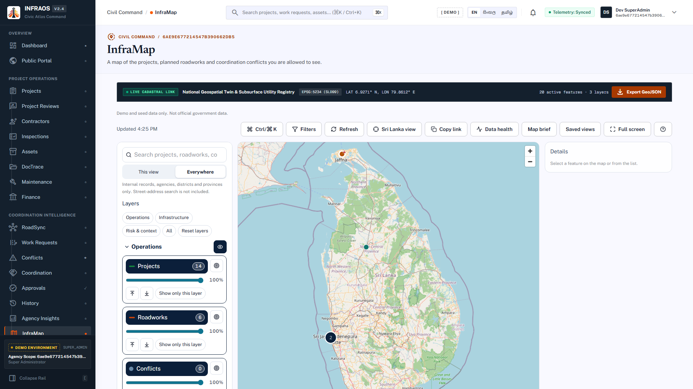</a> |
| *Multi-agency excavation clash detection and synchronous scheduling* | *Multi-layered infrastructure mapping with restricted utility overlays* |

| ProjectTrace National Monitoring | DocTrace & AI Document Intelligence |
|:---:|:---:|
| <a href="docs/Screen/01-project-intelligence-monitoring.png">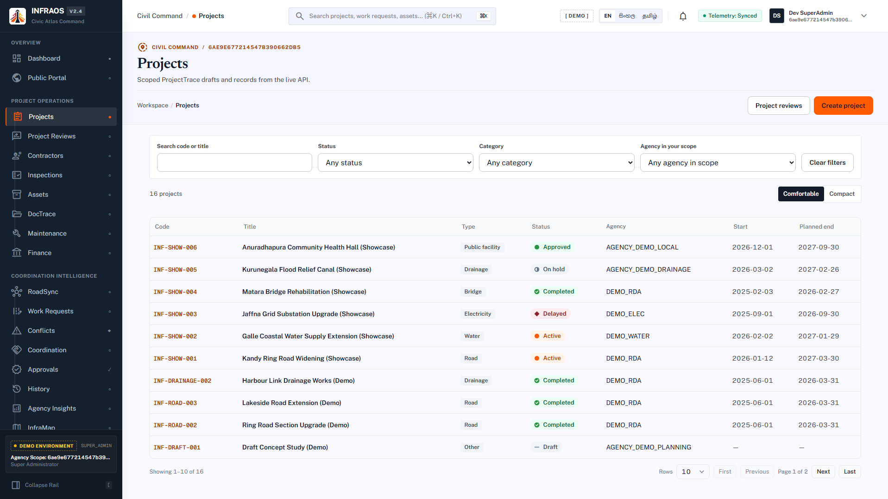</a> | <a href="docs/Screen/05-doctrace-document-intelligence.png">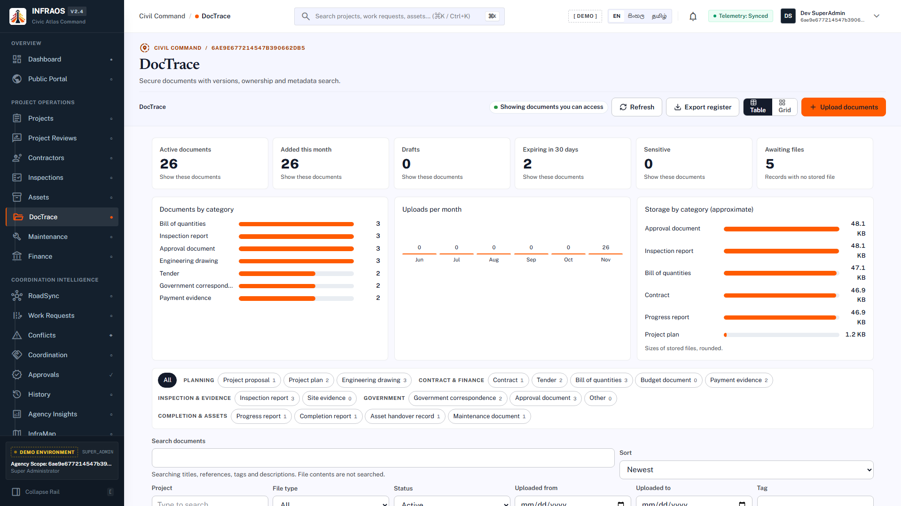</a> |
| *National project portfolio monitoring, milestone tracking, and audit trail* | *Classified document management, versioning, and AI vector search* |

| Finance & Contractor Management | Field Inspections & Photographic Evidence |
|:---:|:---:|
| <a href="docs/Screen/06-finance-contractor-asset-management.png">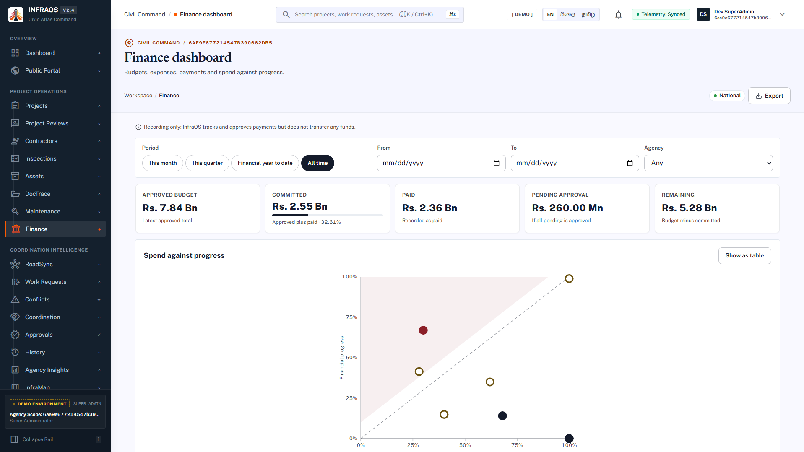</a> | <a href="docs/Screen/17-inspections.png">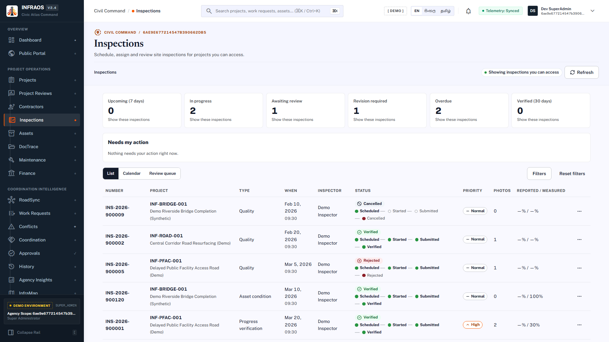</a> |
| *Maker-checker payment disbursements, budget ledgers, and contractor records* | *On-site inspection checklists, defect logging, and GPS-tagged evidence* |

| Asset Passport & Health Scoring | System Administration & Audit Registry |
|:---:|:---:|
| <a href="docs/Screen/18-assets-register.png">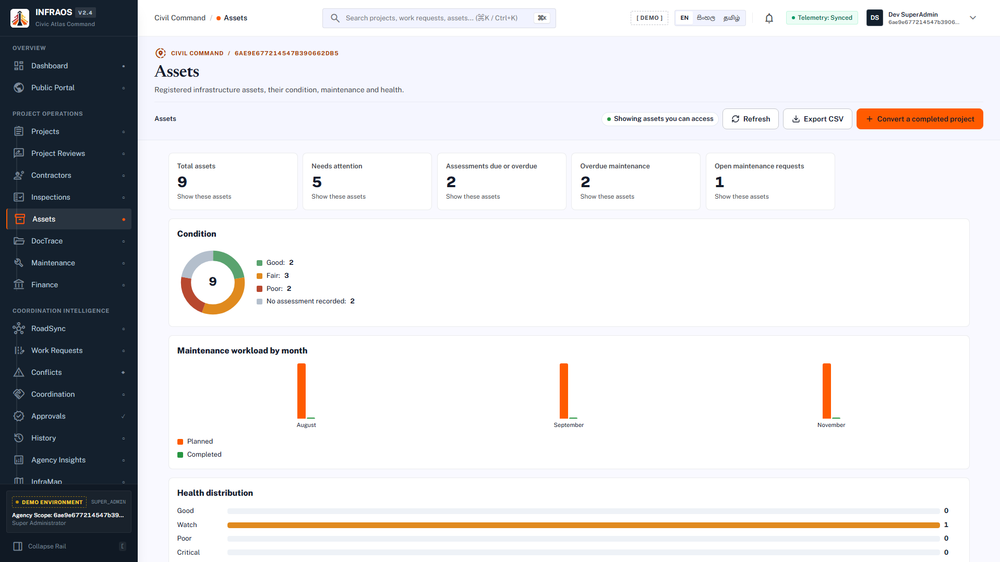</a> | <a href="docs/Screen/25-admin-users.png">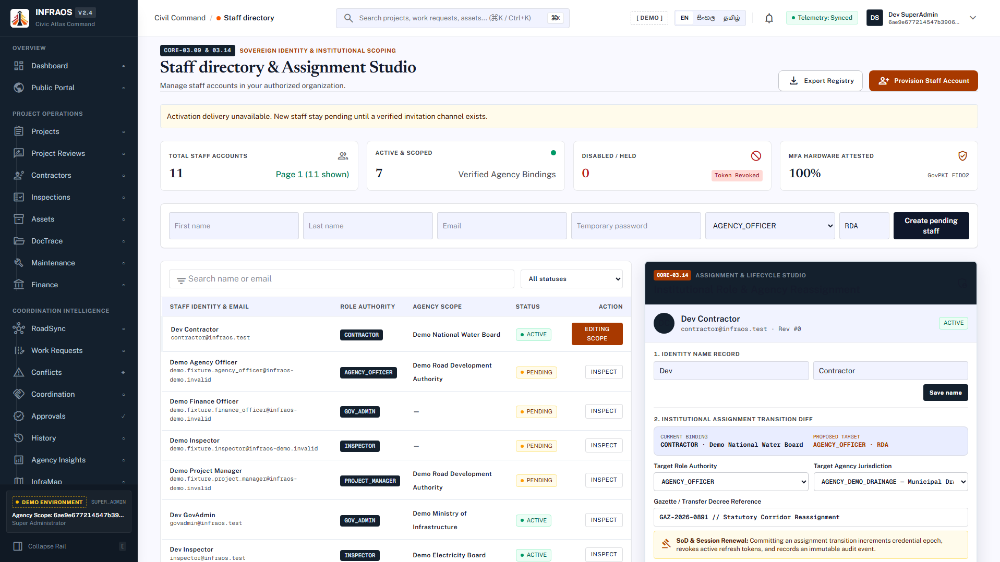</a> |
| *Asset lifecycle records, condition assessments, and maintenance requests* | *Role-based access control, pending approvals, and immutable audit logs* |

| AI Risk & Predictive Intelligence | Citizen Infrastructure Portal |
|:---:|:---:|
| <a href="docs/Screen/04-ai-risk-project-intelligence.png">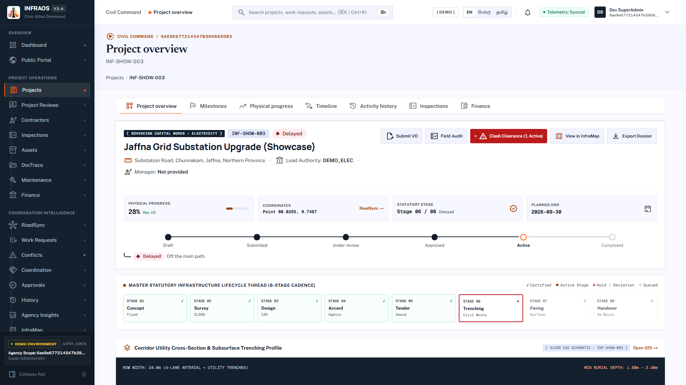</a> | <a href="docs/Screen/07-citizen-infrastructure-portal.png">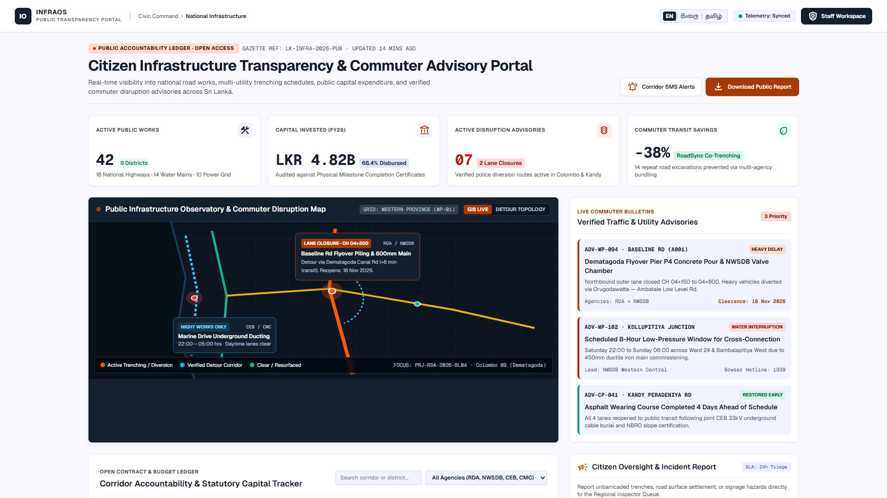</a> |
| *Predictive project risk assessment, delay factors, and AI mitigation insights* | *Public citizen grievance redressal, geospatial issue logging, and status tracking* |

</div>

---

## 4. User roles & RBAC

| Role | Scope | Typical work |
|---|---|---|
| **Super Administrator** | Platform | Identity and governance, platform-wide read and oversight, user registration approvals, and audit review. Cannot verify inspections or approve its own submissions. |
| **Government / Ministry Administrator** | Own agency and descendants | Statutory project approvals, conflict resolution, inter-agency coordination, and administration inside the organisation tree. |
| **Agency Officer** | Own agency | Day-to-day operations: filing work requests, inter-agency coordination messages, document management, and maintenance requests. |
| **Project Manager** | Assigned projects | Project authoring and milestone management, contractor assignments, reads agency spatial context for work coordination. |
| **Inspector** | Assigned inspections | Field inspections, GPS-tagged photographic evidence capture, defect logging, and physical progress verification against reported claims. |
| **Contractor** | Narrow, assigned fields | Reported physical progress on assigned milestones and defect resolution notes. No payment or budget approval authority. |
| **Citizen** | Self | Reports public infrastructure defects (potholes, bursts, hazards) and tracks resolution on the public portal. |

Permissions follow a locked `resource.action` catalog (for example `project.read`, `finance.payment.create`, `document.restrict`). Out-of-scope identifiers return **404**, never 403, so existence is not leaked. See [docs/security](docs/security/README.md).

---

## 5. System architecture & flows

### 5.1 High-level view

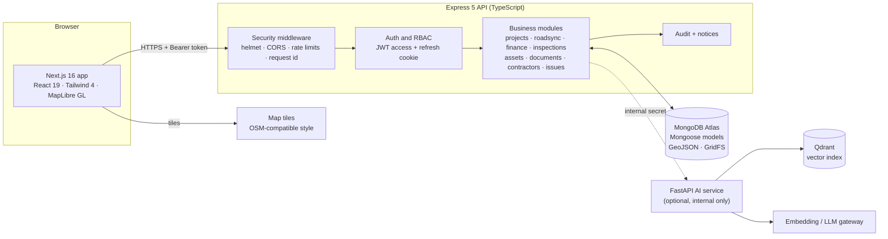

### 5.2 Layers inside the API

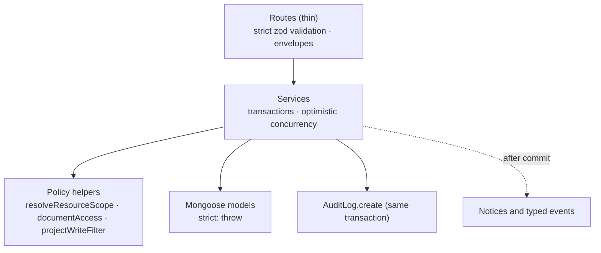

### 5.3 Authentication flow

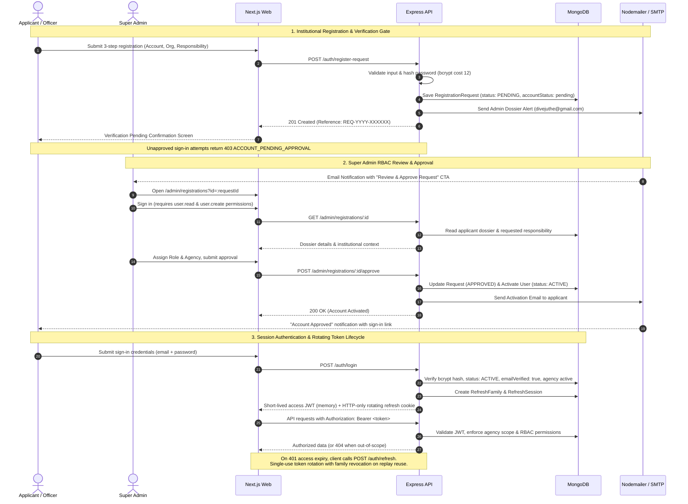

### 5.4 Conflict detection and coordination (RoadSync)

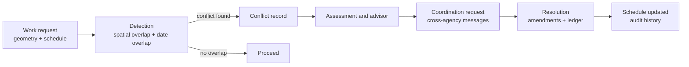

### 5.5 Project to asset lifecycle

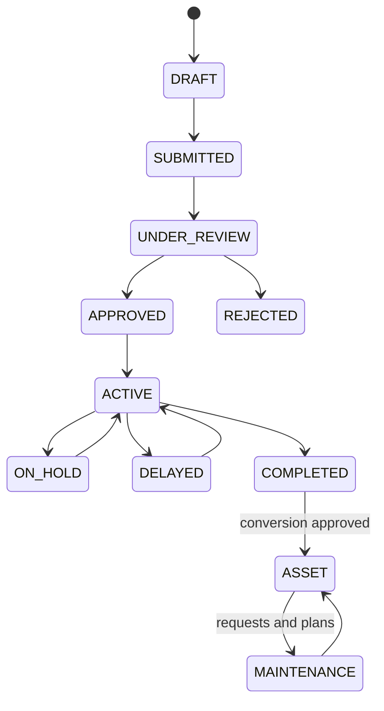

### 5.6 DocTrace upload protocol

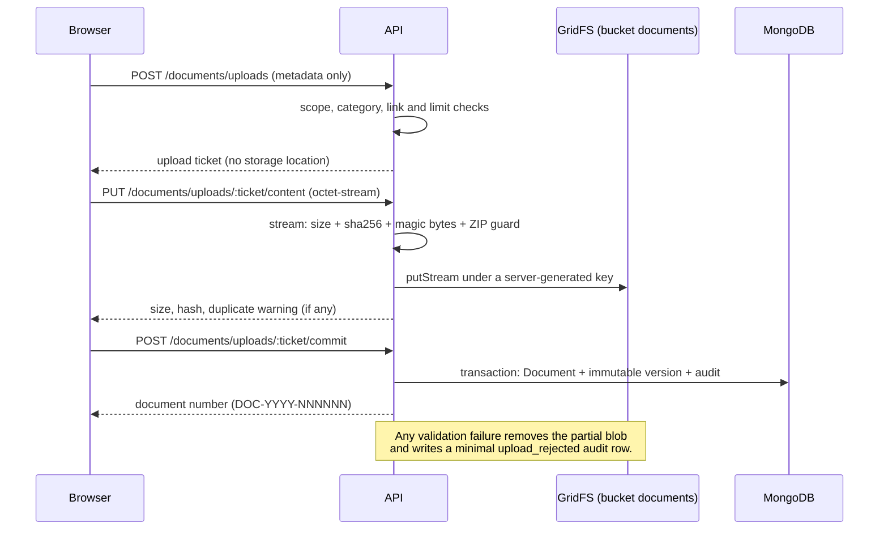

### 5.7 Deployment topology

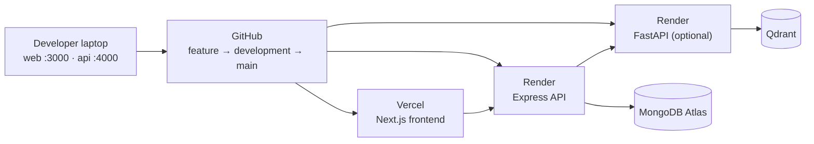

---

## 6. Technology stack

| Layer | Technology |
|---|---|
| **Frontend** | Next.js 16 (App Router), React 19, TypeScript, Tailwind CSS 4, shadcn/Radix UI, TanStack Query, react-hook-form, zod, MapLibre GL, Sonner toasts, Lucide icons |
| **Backend** | Node.js 22, Express 5, TypeScript, Mongoose 8, zod 4, jose (JWT), bcryptjs (cost 12), Nodemailer, helmet, express-rate-limit, pino |
| **Database** | MongoDB Atlas (Mongoose, 2dsphere geo indexes, multi-document transactions, GridFS for binary files) |
| **AI & Search** | Python 3.12, FastAPI, Qdrant vector database, OpenAI-compatible embeddings, Google Gemini 3.5 Flash Lite translation gateway |
| **Geospatial Maps** | MapLibre GL with OSM-compatible vector style & statutory layer control |
| **Testing** | Vitest, Supertest, mongodb-memory-server (isolated replica sets), Testing Library |
| **Tooling & Monorepo** | npm workspaces, ESLint, TypeScript strict mode, Conventional Commits |
| **Hosting & Cloud** | Vercel (web), Render (API and AI), MongoDB Atlas (data), Qdrant Cloud |

---

## 7. Repository structure

```text
InfraOS/
├── apps/
│   ├── web/                 Next.js frontend (App Router, Tailwind 4, MapLibre GL)
│   │   ├── src/app/         Routes: dashboard, projects, roadsync, inframap, finance,
│   │   │                    inspections, assets, maintenance, documents, admin, ...
│   │   ├── src/components/  Modular feature and design system components
│   │   ├── src/lib/         API clients, i18n dictionaries (en/si/ta), view helpers
│   │   └── public/brand/    Brand logos, marks, and official visual identity
│   ├── api/                 Express 5 API
│   │   ├── src/modules/     identity, agencies, projects, roadsync, inframap, contractors,
│   │   │                    finance, inspections, assets, documents, issues, notifications,
│   │   │                    risk, audit, health
│   │   ├── src/database/    Seeds (core + demo), migration helpers
│   │   ├── src/scripts/     Database checks, seeds, password resets, backfills
│   │   └── tests/           Comprehensive Vitest test suites (in-memory MongoDB)
│   └── ai-service/          FastAPI AI microservice (document chunking, Qdrant vectors)
├── packages/
│   └── shared-types/        Shared TypeScript contracts (permissions, categories, DTOs)
├── docs/                    Architecture, ADRs, security, database, UX, setup, reviews, logos, screenshots
├── Prompts/                 Implementation prompt archives for each development phase
├── CLAUDE.md                Guidelines for AI-assisted development
└── CONTRIBUTING.md          Team and Git workflow
```

Details: [docs/architecture/repository-structure.md](docs/architecture/repository-structure.md).

---

## 8. Database design

INFRAOS uses **MongoDB Atlas** via Mongoose with strict transactional guarantees. Every schema enforces `strict: "throw"`, monetary values are stored as integer cents (LKR) to eliminate floating-point drift, and coordinates use GeoJSON standards backed by `2dsphere` indexes.

### 8.1 Entity relationship overview

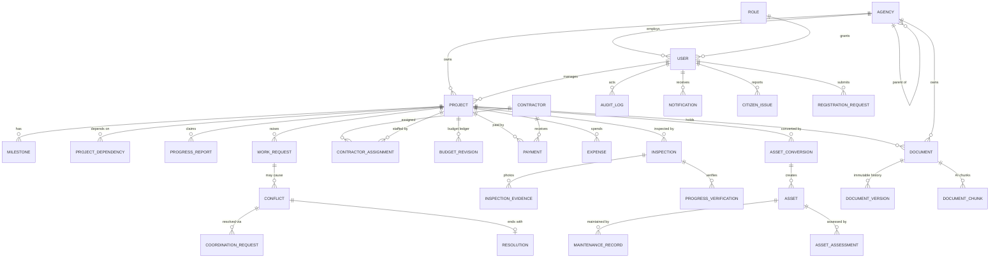

### 8.2 Collections

| Area | Collections |
|---|---|
| **Identity & Access** | `users`, `roles`, `agencies`, `refresh_sessions`, `refresh_families`, `account_registration_requests`, `email_verification_challenges`, `password_reset_challenges`, `admin_lifecycle_locks` |
| **Projects & Milestones** | `projects`, `milestones`, `projectDependencies`, `dependencyGraphLocks`, `progressReports`, `progressVerifications` |
| **RoadSync Engine** | `workRequests`, `roadsync_conflicts`, `roadsync_candidates`, `roadsync_coordination_requests`, `roadsync_coordination_messages`, `roadsync_resolutions`, `roadsync_amendments`, `roadsync_ledger`, `roadsync_scenarios`, `roadsync_recommendations`, `roadsync_counters` |
| **Contractors & Finance** | `contractors`, `contractorAssignments`, `projectBudgetRevisions`, `projectPayments`, `projectExpenses` |
| **Inspections & Evidence** | `inspections`, `inspectionEvidence` (binary image data in GridFS bucket `inspectionEvidence`) |
| **Assets & Maintenance** | `assets`, `assetConversions`, `assetConditionAssessments`, `maintenanceRecords`, `maintenanceEvidence` |
| **DocTrace & AI Vectors** | `documents`, `documentVersions`, `documentUploads`, `documentChunks`, `processingJobs`, `aiUsageRecords` (files in GridFS bucket `documents`) |
| **Map & Risk Intelligence** | `hazardZones`, `riskAssessments` |
| **Governance & System** | `citizenIssues`, `notifications`, `auditLogs` (append-only), `counters` |

### 8.3 Design rules

- **Binary isolation:** Large files and photographic evidence are never stored inline in JSON documents. Binary streams live in dedicated GridFS buckets with opaque hashes.
- **Immutable version history:** Document versions, budget revisions, inspection findings, and audit rows are strictly append-only.
- **Atomic sequential identifiers:** Human-readable sequential numbers (`REQ-YYYY-NNNNNN`, `PAY-YYYY-NNNNNN`, `INS-...`, `AST-...`, `DOC-...`) use atomic sequence counters rather than error-prone `count()` scans.
- **Optimistic concurrency:** Critical records carry version fields to prevent lost updates in multi-agency workflows.
- **Index verification:** `npm run db:indexes:check` automatically audits required indexes against running databases.

---

## 9. Security model & governance

| Concern | How INFRAOS handles it |
|---|---|
| **Admin-Approved Registration** | 3-step institutional signup flow; password hashed with bcrypt (cost 12); accounts are created in `PENDING` state and completely blocked from logging in (403 `ACCOUNT_PENDING_APPROVAL`) until reviewed and activated by a Super Admin. |
| **Admin Email Alerts** | Submissions automatically dispatch an InfraOS-branded notification email with the applicant's dossier and a secure approval link to the designated administrator (`ADMIN_APPROVAL_EMAIL`). |
| **Token Architecture** | Short-lived access JWTs (15m expiry) kept **in client memory only**; rotating refresh tokens (7d expiry) delivered in **SameSite HTTP-only cookies** with family-based replay attack invalidation. |
| **Multi-Agency Isolation** | Strict organizational tenant scoping. Queries verify live user and role permissions; out-of-scope identifiers return **404 Not Found** (never 403) to prevent resource existence leaks. |
| **Segregation of Duties** | Maker-checker protocols on capital payments, budget revisions, and project approvals. Initiators cannot approve their own requests. |
| **File Upload Sanitation** | Multi-gate defense: extension allowlists, declared MIME validation, **magic byte verification**, size quotas, and ZIP bomb inspection. No raw storage URLs are ever exposed. |
| **Immutable Audit Logging** | `AuditLog` rows are committed **inside the same database transaction** as the business state change, capturing actor identity, IP, and sanitized change diffs. |
| **Input Validation** | Strict Zod schemas with unknown-key rejection on all HTTP bodies and queries. User input is never injected into dynamic regular expressions. |
| **Credential Rotation** | Instant session invalidation via `credentialEpoch` increment upon password reset, admin suspension, or credential modification. |

---

## 10. Installation & setup

### Prerequisites

| Tool | Version | Notes |
|---|---|---|
| Node.js | **22 LTS** (see `.nvmrc`) | Use `nvm use` if you have nvm installed |
| npm | **10+** | npm workspaces. Do not use Yarn or pnpm |
| Git | 2.x | |
| MongoDB | Atlas cluster **or** local replica set | Transactions require a replica set |
| Python | 3.12+ | Optional; required only for the AI microservice |

### Steps

```powershell
# 1. Clone repository
git clone https://github.com/divejikan-yuvarajah/InfraOS.git
cd InfraOS

# 2. Install workspace dependencies
npm install

# 3. Create per-app environment configuration files
Copy-Item apps\web\.env.example apps\web\.env.local
Copy-Item apps\api\.env.example apps\api\.env
```

---

## 11. Environment configuration

Configuration is scoped **per app**. Safe local defaults are documented in each `.env.example`; the canonical variable catalog is in [docs/setup/environment.md](docs/setup/environment.md).

### 11.1 API: `apps/api/.env`

| Variable | Required | Purpose / Example |
|---|---|---|
| `NODE_ENV` | yes | `development` locally, `production` when deployed |
| `PORT` | yes | `4000` |
| `FRONTEND_ORIGIN` | yes | Must match the web origin, e.g. `http://localhost:3000` |
| `API_PREFIX` | yes | `/api/v1` |
| `LOG_LEVEL` | no | `info` (or `debug`, `warn`, `error`) |
| `MONGODB_URI` | yes | MongoDB Atlas connection string (URL-encode special characters) |
| `MONGODB_DB_NAME` | yes | `infraos_dev` (`_test` for automated tests) |
| `ACCESS_TOKEN_SECRET` | yes | 32+ character cryptographic secret for access JWTs |
| `ACCESS_TOKEN_TTL` | yes | e.g. `15m` |
| `REFRESH_TOKEN_SECRET` | yes | 32+ character cryptographic secret for rotating refresh tokens |
| `REFRESH_TOKEN_TTL` | yes | e.g. `7d` |
| `ADMIN_APPROVAL_EMAIL` | yes | Administrator inbox receiving applicant registration dossiers (e.g. `divejuthe23@gmail.com`) |
| `SMTP_HOST` | yes (for email) | SMTP server hostname (e.g. `smtp.gmail.com`) |
| `SMTP_PORT` | yes (for email) | SMTP port (`587` for STARTTLS, `465` for SSL) |
| `SMTP_USER` | yes (for email) | Authenticated SMTP username / email address |
| `SMTP_PASS` | yes (for email) | SMTP password or 16-character Google App Password |
| `SMTP_FROM` | yes (for email) | Formatted sender (e.g. `"InfraOS Platform <divejuthe23@gmail.com>"`) |
| `SMTP_SECURE` | no | `false` for port 587 (STARTTLS), `true` for port 465 |
| `GEMINI_API_KEY` | optional | Google Gemini API key for server-side dynamic EN/SI/TA translation |
| `GEMINI_MODEL` | optional | Default: `gemini-3.5-flash-lite` |
| `STORAGE_PROVIDER` | no | Empty or `gridfs` (built in). `r2` reserved for Cloudflare R2 |
| `DOCUMENT_MAX_FILE_MB` | no | Lowers the 25 MB per-file upload cap |
| `AI_BASE_URL` | AI only | Address of the FastAPI AI service (e.g. `http://localhost:8000`) |
| `AI_INTERNAL_SECRET` | AI only | Shared secret between Express API and FastAPI service |
| `OPENROUTER_API_KEY` | AI only | Embedding & LLM gateway key |
| `QDRANT_URL`, `QDRANT_API_KEY` | AI only | Vector database endpoint and optional API key |

Generate a cryptographic secret in your terminal:

```powershell
node -e "console.log(require('node:crypto').randomBytes(48).toString('hex'))"
```

### 11.2 Web: `apps/web/.env.local`

| Variable | Required | Purpose |
|---|---|---|
| `NEXT_PUBLIC_API_BASE_URL` | yes | API origin without prefix, e.g. `http://localhost:4000` |
| `NEXT_PUBLIC_AUTH_LOGIN_ENABLED` | yes | `1` to enable real authentication against the API |
| `NEXT_PUBLIC_MAP_STYLE_URL` | optional | HTTPS MapLibre style URL. Empty uses the built-in cartographic style |
| `NEXT_PUBLIC_AUTH_FIXTURE` | no | Keep `0` for live development |

> [!WARNING]
> Variables prefixed with `NEXT_PUBLIC_*` are bundled into browser scripts. Never place database URIs, JWT secrets, or SMTP credentials in `apps/web/.env.local`.

---

## 12. Database setup, seeding & default credentials

All commands run from the repository root. **Never execute seeds against a production database.**

```powershell
# Verify connectivity and index schema integrity (read-only)
npm run db:check
npm run db:indexes:check

# 1. Core identity: seed system roles and core ministerial agencies
npm run db:seed:core

# 2. Seed comprehensive demo scenario (idempotent, safe to re-run)
npm run db:seed:demo

# 3. Audit demo seed veracity
npm run db:seed:verify

# Reset demo records (preserves core roles and agencies)
npm run db:seed:reset-demo
```

### 12.1 Default Local Development Credentials

After running `npm run db:seed:demo`, the following accounts are pre-configured:

| Account Type | Email Address | Password | Permissions & Scope |
|---|---|---|---|
| **Super Administrator** | `superadmin@infraos.test` | `Admin@12345678` | Platform-wide oversight, User & Agency Management, Registration Approvals (`/admin/registrations`) |
| **Government Admin** | `govadmin@infraos.test` | `GovPass#2025` | Ministry-level coordination, project approvals |
| **Agency Officer** | `officer@transport.gov.lk` | `GovPass#2025` | Road Development Authority work requests |
| **Agency Director** | `director@rda.gov.lk` | `GovPass#2025` | RDA departmental oversight |
| **CEB Engineer** | `engineer@ceb.lk` | `GovPass#2025` | Ceylon Electricity Board utility coordination |

> [!TIP]
> The sign-in page (`/login`) includes **Quick Fill** buttons for `[ Super Admin ]`, `[ RDA Officer ]`, `[ Agency Director ]`, and `[ CEB Engineer ]`.
> To update or reset any user's password from the terminal:
> ```powershell
> npm run db:set-password -w @infraos/api -- superadmin@infraos.test "NewPassword#123"
> ```

---

## 13. Running the application

Open two separate terminals in the repository root:

```powershell
# Terminal 1: Backend Express API (http://localhost:4000)
npm run dev:api

# Terminal 2: Frontend Next.js Web (http://localhost:3000)
npm run dev:web
```

| URL | Component | Access |
|---|---|---|
| `http://localhost:3000` | Public Landing Page & Civic Atlas | Public |
| `http://localhost:3000/login` | Statutory Sign-In & Quick Fill | Public |
| `http://localhost:3000/auth/register` | 3-Step Institutional Registration | Public |
| `http://localhost:3000/dashboard` | National Mission Control Dashboard | Authenticated Staff |
| `http://localhost:3000/admin/registrations` | Pending Registration Requests | Super Admin |
| `http://localhost:3000/documents/processing` | AI Document Processing Center | Agency Staff |
| `http://localhost:4000/api/v1/health` | API Liveness Probe | Public |
| `http://localhost:4000/api/v1/ready` | API Readiness Probe (503 until DB connected) | Public |

> [!NOTE]
> On Windows, `@infraos/web` defaults to running Next.js with `--webpack` (`npm run dev:web`) to eliminate known Windows filesystem file-locking (`EPERM`) errors during Turbopack atomic manifest renames.

---

## 14. Testing & quality verification

```powershell
# Run backend API test suites (in-memory MongoDB replica set)
npm run test:api

# Run frontend React & component test suites
npm run test:web

# Static TypeScript type check across all workspaces
npm run type-check

# ESLint code style and quality check
npm run lint
```

Tests run in complete isolation: they automatically spawn a disposable `mongodb-memory-server` replica set and never contact external databases or networks.

---

## 15. API overview

Base URL: `http://localhost:4000/api/v1`. Every endpoint responds with a standardized JSON envelope:

```json
{ "success": true, "data": { }, "meta": { "requestId": "req-123456" } }
{ "success": false, "error": { "code": "NOT_FOUND", "message": "resource was not found" }, "meta": { "requestId": "req-123456" } }
```

| Route Prefix | Scope & Purpose |
|---|---|
| `/health`, `/ready` | Service liveness and MongoDB readiness probes |
| `/auth/login`, `/auth/refresh`, `/auth/logout` | Session lifecycle with rotating HTTP-only refresh cookies |
| `/auth/register-request` | 3-step institutional registration with admin email alert |
| `/auth/verify-email`, `/auth/password-reset` | Email challenges and password reset tokens |
| `/profile` | Authenticated user profile and session security |
| `/admin/registrations` | Review, approve (with role/agency assignment), or reject pending applicants |
| `/admin/users`, `/admin/roles`, `/admin/agencies`, `/admin/audit-logs` | Platform identity, RBAC governance, and audit trails |
| `/projects` and `/projects/:id/*` | Projects, milestones, dependencies, physical/financial progress, activity |
| `/roadsync/*` | Work requests, 2D spatial & schedule clash detection, coordination ledger |
| `/inframap/*` | Map layers, GIS search, infrastructure assets and hazard context |
| `/contractors/*` | Contractor registry, certifications, active project assignments |
| `/finance/*` | Maker-checker payments, budget ledger revisions, expenses, CSV export |
| `/inspections/*` | Inspections, checklists, defect logs, GridFS photo evidence |
| `/assets/*`, `/maintenance/*` | Asset registry, conversions, condition health scoring, maintenance schedules |
| `/documents/*` | DocTrace secure file uploads, immutable versions, streaming downloads, archive |
| `/documents/processing/*` | AI document chunking, Qdrant vector indexing, and background jobs |
| `/ai/*` | AI semantic search, document Q&A, and project risk assessments |
| `/notifications`, `/issues/*` | In-app notification bell, citizen issue ticketing and routing |

---

## 16. Deployment

| Component | Target Platform | Deployment Notes |
|---|---|---|
| **Web** | Render | Next.js Web Service via `render.yaml` Blueprint; set `NEXT_PUBLIC_API_BASE_URL` to the production API origin (see [docs/setup/deploy-render.md](docs/setup/deploy-render.md)) |
| **API** | Render | Express Web Service via `render.yaml` Blueprint; configure environment variables in Render Dashboard and set `FRONTEND_ORIGIN` to the production Web URL |
| **Database** | MongoDB Atlas | Dedicated M-tier cluster; seeding scripts refuse production database names |
| **AI Service** | Render (Optional) | Internal FastAPI web service; authenticated via `AI_INTERNAL_SECRET` |

---

## 17. Troubleshooting

| Symptom | Cause & Solution |
|---|---|
| `/ready` returns 503 | `MONGODB_URI` is empty or unreachable. Check Atlas Network Access (IP Whitelist) and run `npm run db:check`. |
| Sign-in returns 403 `ACCOUNT_PENDING_APPROVAL` | The account was registered through the public portal and is awaiting Super Admin verification. Log in as Super Admin (`superadmin@infraos.test`) and approve the dossier at `/admin/registrations`. |
| `EPERM: operation not permitted, rename ... server-reference-manifest.js` | Windows Turbopack file-lock collision. Run `npm run dev:web`, which uses `--webpack` to bypass atomic file lock retries. |
| SMTP delivery fails or returns `535-5.7.8` | When using Gmail SMTP, generate a 16-character **Google App Password** (under Google Account Security → 2-Step Verification → App Passwords). InfraOS automatically sanitizes spaces. |
| Login does nothing or buttons unresponsive | Ensure `NEXT_PUBLIC_AUTH_LOGIN_ENABLED=1` is set in `apps/web/.env.local`, make `FRONTEND_ORIGIN` match the browser origin, and restart both dev servers. |
| CORS or Cookie issues | `FRONTEND_ORIGIN` in `apps/api/.env` must match the exact web origin (scheme, host, and port). |
| Upload fails with "storage unavailable" | GridFS is the default built-in storage provider. Ensure `STORAGE_PROVIDER` is empty or set to `gridfs` and MongoDB is connected. |

---

## 18. Documentation map

| Topic | Primary Guide |
|---|---|
| **Documentation Index** | [docs/README.md](docs/README.md) |
| **System Architecture & ADRs** | [docs/architecture](docs/architecture/README.md) · [docs/adr](docs/adr/README.md) |
| **Security & RBAC Catalog** | [docs/security](docs/security/README.md) |
| **UX & Design System** | [docs/ux](docs/ux/README.md) · [docs/design](docs/design) |
| **Environment Configuration** | [docs/setup/environment.md](docs/setup/environment.md) |
| **MongoDB Atlas Setup** | [docs/setup/mongodb-atlas.md](docs/setup/mongodb-atlas.md) · [docs/database](docs/database/README.md) |
| **Render Deployment Guide** | [docs/setup/deploy-render.md](docs/setup/deploy-render.md) |
| **Frontend Setup & Conventions** | [docs/frontend/setup.md](docs/frontend/setup.md) · [conventions](docs/frontend/conventions.md) |
| **Backend Setup & Conventions** | [docs/backend/setup.md](docs/backend/setup.md) · [conventions](docs/backend/conventions.md) |

---

## 19. Contributing & branch strategy

- **`main`**: Production & submission-ready branch.
- **`development`**: Integration branch for active phase developments.
- **`feature/*`**, **`fix/*`**, **`chore/*`**: Dedicated topic branches, squash-merged into `development`.
- **Commit Format**: Conventional Commits standard (`feat(auth): ...`, `fix(api): ...`, `docs: ...`).
- **Pre-PR Quality Checklist**: Run `npm run type-check`, `npm run lint`, and unit tests prior to opening PRs.

See [CONTRIBUTING.md](CONTRIBUTING.md) and [docs/team/git-workflow.md](docs/team/git-workflow.md).

---

## 20. Team & licence

**INFRAOS Development Team**, South Eastern University of Sri Lanka.

Academic and portfolio project. All demo datasets and seed scenarios are synthetic and do not represent official government records.

<div align="center">


**INFRAOS** · Connect Infrastructure. Coordinate Agencies. Build Smarter.

</div>
