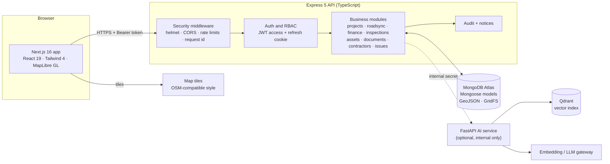
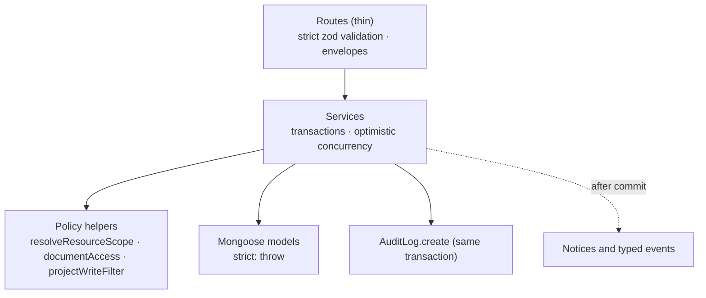
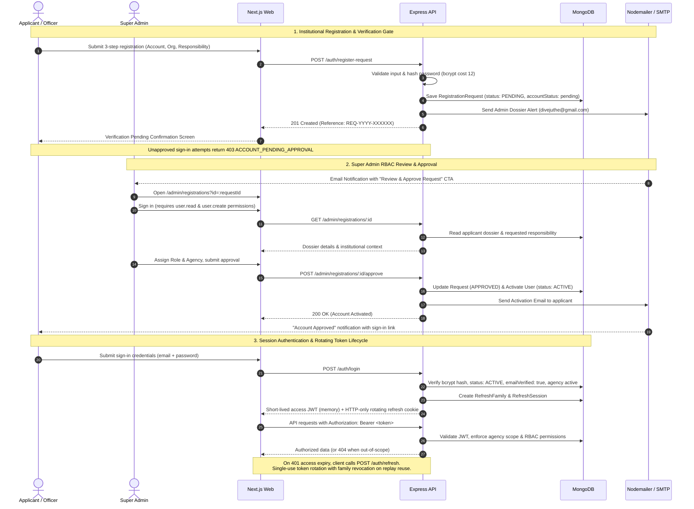
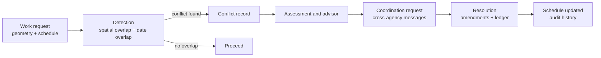
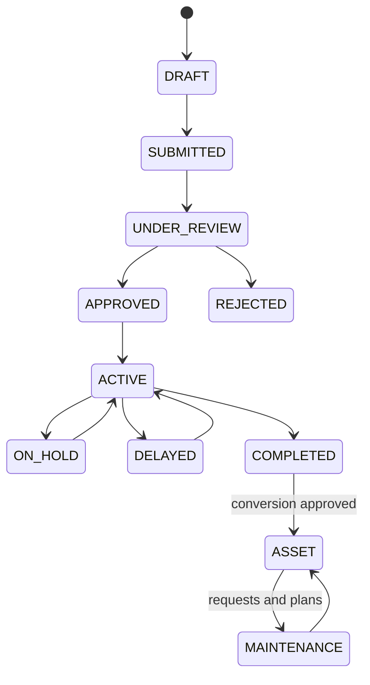
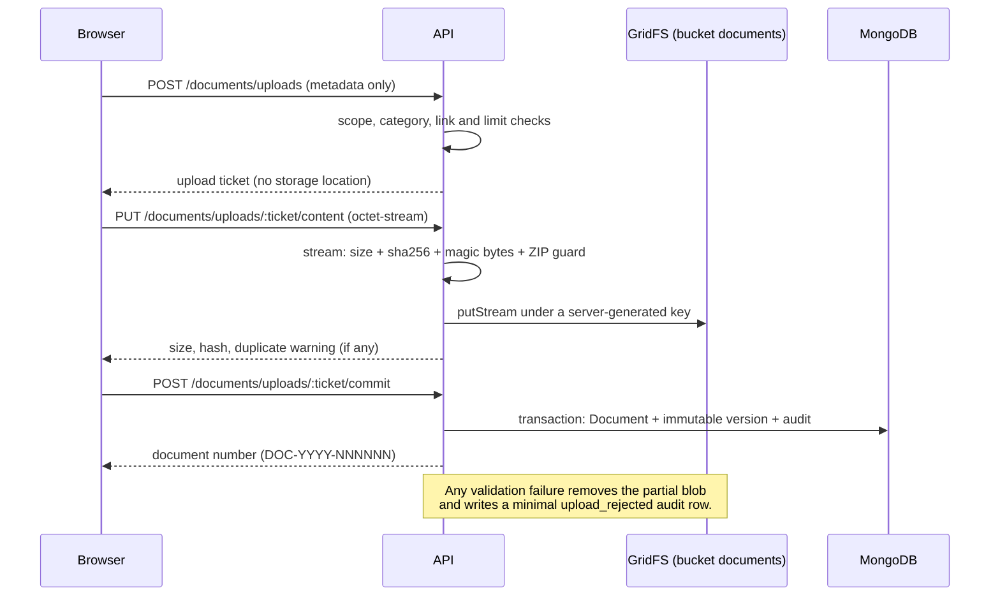
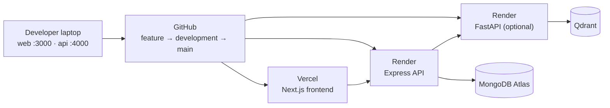
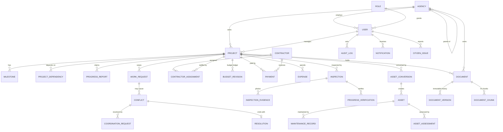

<div align="center">


# INFRAOS

### National Infrastructure Intelligence & Coordination Platform
*The Operating System for National Infrastructure*

**Connect Infrastructure. Coordinate Agencies. Build Smarter.**


</div>

> **Academic and portfolio project** by the INFRAOS Development Team, South Eastern University of Sri Lanka.
> All demo and seed data is **synthetic**. INFRAOS is not an official government system and its demo data must never be presented as official data.

---

## Table of contents

1. [What is INFRAOS?](#1-what-is-infraos)
2. [Key features](#2-key-features)
3. [User roles](#3-user-roles)
4. [System architecture](#4-system-architecture)
5. [Technology stack](#5-technology-stack)
6. [Repository structure](#6-repository-structure)
7. [Database](#7-database)
8. [Security model](#8-security-model)
9. [Installation](#9-installation)
10. [Environment configuration](#10-environment-configuration)
11. [Database setup and seed data](#11-database-setup-and-seed-data)
12. [Running the application](#12-running-the-application)
13. [Testing and quality checks](#13-testing-and-quality-checks)
14. [API overview](#14-api-overview)
15. [Deployment](#15-deployment)
16. [Troubleshooting](#16-troubleshooting)
17. [Documentation map](#17-documentation-map)
18. [Contributing and branch strategy](#18-contributing-and-branch-strategy)
19. [Team and licence](#19-team-and-licence)

---

## 1. What is INFRAOS?

Public infrastructure is built by many agencies that rarely see each other's plans. The result is familiar: a road is resurfaced, and weeks later another agency digs it up for a water main.

**INFRAOS** gives agencies one shared, map-aware workspace to **plan, coordinate, approve, build, verify, monitor, complete and maintain** infrastructure work, with geographic and schedule awareness so conflicts are found *before* the excavator arrives.

```text
Create Project → Map Project → Create Work Request → Detect Conflict
→ Coordinate Agencies → Resolve Conflict → Track Progress
→ Verify on Site → Pay and Account → Hand Over as an Asset → Maintain → Audit everything
```

Design principles:

- **Honest data.** Unknown means an honest "unavailable" state. No fabricated counts, trends or "live" indicators. Reported 100% is not "officially completed". Financial figures stay provisional.
- **Server-side authority.** Authentication, role permissions, agency scope, approval segregation and audit are enforced by the API. Hiding a button is never security.
- **Private by default.** Files never live in ordinary database documents and storage locations are never exposed. Every byte goes through authenticated streaming.

---

## 2. Key features

| Module | What it does |
|---|---|
| **ProjectTrace** | Project lifecycle (draft → review → approved → active → completed), milestones, dependencies and timeline, reported progress, dashboards, activity history. |
| **RoadSync** | Work requests, spatial and schedule **conflict detection**, assessment, cross-agency coordination threads, resolution with amendments and a ledger, scenario simulator, advisor. |
| **InfraMap** | MapLibre GL map of projects, assets, utilities and hazard zones with layer controls, restricted layers by role, and context panels. |
| **Contractors** | Registry, certifications, performance evidence, assignments (primary, additional, replaced, ended) and contract references. |
| **Finance** | Budget ledger with revisions, payments (maker-checker approval), expenses, verified spending, cost-efficiency conclusions and CSV export. |
| **Inspections** | Scheduled inspections by type, structured checklists, defects, private photo evidence, reviewer decisions, and verified-progress records compared with reported progress. |
| **Assets and Maintenance** | Convert completed projects into assets (approval gate), condition assessments, evidence-gated health scores, maintenance requests, scheduling, completion and recurrence. |
| **DocTrace** | Secure document management: validated streamed uploads, immutable versions, authenticated preview and download, archive-first deletion, categories, tags, metadata search with safe highlighting, facets and saved views. |
| **Citizen Issues** | Citizens report problems (pothole, leak, drainage, streetlight...) that are routed to the responsible agency. |
| **Notifications and Audit** | In-app notices after committed events, plus an append-only audit log written in the same transaction as every state change. |
| **Identity and Admin** | Registration with email verification, rotating sessions, role and permission administration, agency management, user lifecycle. |
| **AI service** *(optional)* | Separate FastAPI process for decision support: document extraction and chunking, embeddings, retrieval over **authorised** document chunks, and risk analysis. It never decides roles or writes project, conflict or payment status. |
| **Mission Control UI** | Premium, responsive workspace in **English, Sinhala and Tamil**, role-aware navigation, accessible components and a Sri Lankan flag-inspired palette used as accents. |

---

## 3. User roles

| Role | Scope | Typical work |
|---|---|---|
| **Super Administrator** | Platform | Identity and governance, platform-wide read and oversight. Cannot verify inspections or approve its own submissions. |
| **Government / Ministry Administrator** | Own agency and descendants | Approvals, conflict resolution, administration inside the organisation tree. |
| **Agency Officer** | Own agency | Day-to-day operations: work requests, coordination, documents, maintenance. |
| **Project Manager** | Assigned projects | Writes on managed projects, reads agency context for coordination. |
| **Inspector** | Assigned inspections | Field inspections, evidence capture, reports. Sees only inspection-relevant documents. |
| **Contractor** | Narrow, assigned fields | Reported progress on assigned work. No payment approval. |
| **Citizen** | Self | Reports issues, views the public portal. |

Permissions follow a locked `resource.action` catalog (for example `project.read`, `finance.payment.create`, `document.restrict`). Out-of-scope identifiers return **404**, never 403, so existence is not leaked. See [docs/security](docs/security/README.md).

---

## 4. System architecture

### 4.1 High-level view



### 4.2 Layers inside the API



### 4.3 Authentication flow



### 4.4 Conflict detection and coordination (RoadSync)



### 4.5 Project to asset lifecycle



### 4.6 DocTrace upload protocol



### 4.7 Deployment topology



---

## 5. Technology stack

| Layer | Technology |
|---|---|
| **Frontend** | Next.js 16 (App Router), React 19, TypeScript, Tailwind CSS 4, shadcn/Radix UI, TanStack Query, react-hook-form, zod, MapLibre GL, Sonner toasts, Lucide icons |
| **Backend** | Node.js 22, Express 5, TypeScript, Mongoose 8, zod 4, jose (JWT), bcryptjs, helmet, express-rate-limit, pino |
| **Database** | MongoDB Atlas (Mongoose, 2dsphere geo indexes, transactions, GridFS for files) |
| **AI (optional)** | Python 3.12, FastAPI, Qdrant vector search, OpenAI-compatible embeddings and LLM gateway |
| **Maps** | MapLibre GL with an OSM-compatible style (configurable) |
| **Testing** | Vitest, Supertest, mongodb-memory-server (replica set), Testing Library |
| **Tooling** | npm workspaces, ESLint, TypeScript strict mode, Conventional Commits |
| **Hosting** | Vercel (web), Render (API and AI), MongoDB Atlas (data) |

---

## 6. Repository structure

```text
InfraOS/
├── apps/
│   ├── web/                 Next.js frontend (App Router, Tailwind, MapLibre)
│   │   ├── src/app/         Routes: dashboard, projects, roadsync, inframap, finance,
│   │   │                    inspections, assets, maintenance, documents, admin, ...
│   │   ├── src/components/  Feature and shared UI
│   │   ├── src/lib/         API clients, i18n dictionaries (en/si/ta), view helpers
│   │   └── public/brand/    Optimised logo files
│   ├── api/                 Express API
│   │   ├── src/modules/     identity, agencies, projects, roadsync, inframap, contractors,
│   │   │                    finance, inspections, assets, documents, issues, notifications,
│   │   │                    risk, audit, health
│   │   ├── src/database/    Seeds (core + demo), helpers
│   │   ├── src/scripts/     DB checks, seed, backfill, sync and cleanup scripts
│   │   └── tests/           Vitest suites (isolated in-memory MongoDB)
│   └── ai-service/          FastAPI service (optional, internal only)
├── packages/
│   └── shared-types/        Contracts shared by web and API (permissions, categories, enums)
├── docs/                    Architecture, ADRs, security, database, UX, setup, reviews, logo
├── Prompts/                 Implementation prompts for each roadmap step
├── CLAUDE.md                Working rules for AI-assisted development
└── CONTRIBUTING.md          Team and Git workflow
```

Details: [docs/architecture/repository-structure.md](docs/architecture/repository-structure.md).

---

## 7. Database

INFRAOS uses **MongoDB Atlas** through Mongoose. Every schema is `strict: "throw"`, money is stored as integer cents (LKR), and geometry is GeoJSON with 2dsphere indexes.

### 7.1 Entity relationship overview



### 7.2 Collections

| Area | Collections |
|---|---|
| **Identity** | `users`, `roles`, `agencies`, `refresh_sessions`, `refresh_families`, `email_verification_challenges`, `password_reset_challenges`, `account_registration_requests`, `admin_lifecycle_locks` |
| **Projects** | `projects`, `milestones`, `projectDependencies`, `dependencyGraphLocks`, `progressReports`, `progressVerifications` |
| **RoadSync** | `workRequests`, `roadsync_conflicts`, `roadsync_candidates`, `roadsync_coordination_requests`, `roadsync_coordination_messages`, `roadsync_resolutions`, `roadsync_amendments`, `roadsync_ledger`, `roadsync_scenarios`, `roadsync_recommendations`, `roadsync_counters` |
| **Contractors and Finance** | `contractors`, `contractorAssignments`, `projectBudgetRevisions`, `projectPayments`, `projectExpenses` |
| **Inspections** | `inspections`, `inspectionEvidence` (photos in GridFS bucket `inspectionEvidence`) |
| **Assets** | `assets`, `assetConversions`, `assetConditionAssessments`, `maintenanceRecords`, `maintenanceEvidence` |
| **DocTrace** | `documents`, `documentVersions`, `documentUploads`, `documentChunks` (files in GridFS bucket `documents`) |
| **Map and risk** | `hazardZones`, `riskAssessments` |
| **Citizens and system** | `citizenIssues`, `notifications`, `auditLogs` (append-only), `counters` |

### 7.3 Design rules

- **Files are never stored in ordinary documents.** Bytes live in GridFS; rows hold only an opaque reference that is never serialised.
- **Immutable history.** Document versions, budget revisions, progress reports and audit rows are append-only.
- **Atomic counters** produce human numbers (`PAY-YYYY-NNNNNN`, `INS-...`, `AST-...`, `DOC-YYYY-NNNNNN`) and never use `count()`.
- **Optimistic concurrency** (`version` field) protects edits; the loser sees a conflict and reloads.
- **Index check:** `npm run db:indexes:check` verifies every expected index exists without changing anything. Details in [docs/database](docs/database/README.md).

---

## 8. Security model

| Concern | How INFRAOS handles it |
|---|---|
| Authentication | Short-lived JWT access token **in memory only**, rotating refresh token in an **HTTP-only cookie**, email verification, login rate limits. |
| Authorisation | Locked permission catalog plus **agency scope** resolved from the live user and role on every request. Out-of-scope ids return 404. |
| Segregation of duties | Maker-checker on payments, budget revisions and project approval. Nobody approves their own submission. |
| Files | Extension allowlist + declared MIME + **magic bytes** + size, ZIP-bomb guard, safe download headers (`nosniff`, `no-store`, sandbox CSP), no storage URLs in responses, logs or audit rows. |
| Audit | `AuditLog` is append-only and written **inside the same transaction** as each state change, with allow-listed snapshots (no file names or content). |
| Input | Strict zod schemas that reject unknown and repeated keys. User text is never used as a regular expression. |
| Secrets | Per-app `.env` files only, never committed. Rejected aliases: `JWT_SECRET`, `CLIENT_URL`. |

Production readiness is a separate audit and is **not** claimed by this README. See [docs/security](docs/security/README.md).

---

## 9. Installation

### Prerequisites

| Tool | Version | Notes |
|---|---|---|
| Node.js | **22 LTS** (see `.nvmrc`) | Use `nvm use` if you have nvm |
| npm | **10+** | npm workspaces. Do not add Yarn or pnpm lockfiles |
| Git | 2.x | |
| MongoDB | Atlas cluster **or** local replica set | Transactions need a replica set |
| Python | 3.12+ | Only for the optional AI service |

### Steps

```powershell
# 1. Clone
git clone https://github.com/divejikan-yuvarajah/InfraOS.git
cd InfraOS

# 2. Install all workspaces
npm install

# 3. Create per-app environment files (never a root .env with secrets)
Copy-Item apps\web\.env.example apps\web\.env.local
Copy-Item apps\api\.env.example apps\api\.env
```

Then edit the two new files as described in the next section.

---

## 10. Environment configuration

Configuration lives **per app**. Names and safe defaults are in each `.env.example`; the full catalog is [docs/setup/environment.md](docs/setup/environment.md).

### 10.1 API: `apps/api/.env`

| Variable | Required | Purpose / example |
|---|---|---|
| `NODE_ENV` | yes | `development` locally |
| `PORT` | yes | `4000` |
| `FRONTEND_ORIGIN` | yes | Must equal the web origin, e.g. `http://localhost:3000` |
| `API_PREFIX` | yes | `/api/v1` |
| `LOG_LEVEL` | no | `info` |
| `MONGODB_URI` | yes to connect | Atlas connection string (URL-encode special characters in the password) |
| `MONGODB_DB_NAME` | yes | `infraos_dev` (seeding is only allowed on `infraos_dev` or `infraos_test`) |
| `ACCESS_TOKEN_SECRET` | yes for login | Random, 32+ characters |
| `ACCESS_TOKEN_TTL` | yes for login | e.g. `15m` |
| `REFRESH_TOKEN_SECRET` | yes for login | Random, 32+ characters, **different** from the access secret |
| `REFRESH_TOKEN_TTL` | yes for login | e.g. `7d` |
| `STORAGE_PROVIDER` | no | Empty or `gridfs` (built in). `r2` is reserved for a later provider |
| `DOCUMENT_MAX_FILE_MB` | no | Lowers the 25 MB per-file upload cap |
| `AI_BASE_URL`, `AI_INTERNAL_SECRET` | AI only | Address and shared secret of the FastAPI service |
| `OPENROUTER_API_KEY` | AI only | Embedding / LLM gateway key |
| `QDRANT_URL`, `QDRANT_API_KEY` | AI only | Vector database |
| `R2_*` | later | Object storage (not needed for GridFS) |

Generate a secret locally:

```powershell
node -e "console.log(require('node:crypto').randomBytes(48).toString('hex'))"
```

### 10.2 Web: `apps/web/.env.local`

| Variable | Purpose |
|---|---|
| `NEXT_PUBLIC_API_BASE_URL` | API origin only, **no** `/api/v1` suffix, e.g. `http://localhost:4000` |
| `NEXT_PUBLIC_AUTH_LOGIN_ENABLED` | `1` to enable real login against a running API |
| `NEXT_PUBLIC_MAP_STYLE_URL` | Optional HTTPS MapLibre style. Empty uses the built-in default |
| `NEXT_PUBLIC_AUTH_FIXTURE` | Testing only. Keep `0` |

> `NEXT_PUBLIC_*` values are visible in the browser. Never put database, JWT, AI or storage secrets there.

### 10.3 MongoDB Atlas quick setup

1. Create a free cluster and a **dev-only** database user.
2. Add your IP to the network access list.
3. Copy the connection string into `MONGODB_URI` and set `MONGODB_DB_NAME=infraos_dev`.
4. Verify: `npm run db:check`.

Full guide: [docs/setup/mongodb-atlas.md](docs/setup/mongodb-atlas.md).

---

## 11. Database setup and seed data

All commands run from the repository root. **Never run seeds or tests against a production database.**

```powershell
# Connectivity and index checks (read-only)
npm run db:check
npm run db:indexes:check

# 1. Core identity: the seven system roles and core agencies
npm run db:seed:core

# 2. Full demo data (idempotent, safe to re-run)
npm run db:seed:demo

# 3. Verify the demo data
npm run db:seed:verify

# Remove only the demo layer (keeps roles and core agencies)
npm run db:seed:reset-demo
```

What the demo seed creates (all labelled *Synthetic*):

- Agencies, fixture users, three contractors and their assignments
- 16 projects across road, water, electricity, bridge, drainage and public-facility types, in every lifecycle status, with milestones
- Work requests and a RoadSync conflict scenario
- Finance: budget ledger, payments and expenses in every status
- Inspections in every status and type, with evidence, and verified-progress records
- Assets, condition assessments and maintenance records
- DocTrace: documents with **real tiny files**, a 3-version document, draft, archived, sensitive and agency-level records
- Citizen issues and InfraMap hazard zones

Demo fixture users are **non-login**. Create a real account through the registration flow, or have an administrator provision one, then sign in. A **Super Administrator** or **Government Administrator** account sees the most demo data.

### Upgrading an existing database

```powershell
# Grants new permissions to stored system roles (dry run by default)
npm run db:sync:document-permissions
npm run db:sync:document-permissions -- --apply --confirm-db=<MONGODB_DB_NAME>

# Shape legacy document rows (dry run by default)
npm run db:backfill:documents
npm run db:backfill:documents -- --commit

# Remove stale upload tickets and unreferenced blobs (dry run by default)
npm run db:cleanup:documents -- --commit
```

Other idempotent maintenance scripts: `db:sync:finance-permissions`, `db:sync:inspection-permissions`, `db:sync:asset-permissions`, `db:backfill:finance|inspections|assets|contractors`, `db:recompute:asset-health`, `db:cleanup:evidence`.

---

## 12. Running the application

Open two terminals in the repository root.

```powershell
# Terminal 1: API (http://localhost:4000)
npm run dev:api

# Terminal 2: Web (http://localhost:3000)
npm run dev:web
```

| URL | What |
|---|---|
| http://localhost:3000 | Public landing page and sign-in |
| http://localhost:3000/dashboard | Staff workspace (after sign-in) |
| http://localhost:4000/api/v1/health | API liveness |
| http://localhost:4000/api/v1/ready | Readiness (503 until MongoDB is connected) |

Before starting, check that the ports are free:

```powershell
Get-NetTCPConnection -LocalPort 3000,4000 -State Listen -ErrorAction SilentlyContinue |
  Select-Object LocalPort, OwningProcess
```

### Production build

```powershell
npm run build          # web, then api
npm run build:web      # Next.js production build
npm run build:api      # TypeScript compile
```

### Optional: AI service

The FastAPI service is a separate Python process (not an npm workspace). Create a virtual environment inside `apps/ai-service/.venv`, install its requirements, set `AI_BASE_URL` and `AI_INTERNAL_SECRET` in the API `.env`, and start it on its own port. It only accepts internal calls with the shared secret and is optional for the core coordination path. See [apps/ai-service/README.md](apps/ai-service/README.md).

---

## 13. Testing and quality checks

```powershell
npm run test:api       # API suites (in-memory MongoDB replica set, no network)
npm run test:web       # Web unit and component tests
npm run type-check     # TypeScript, both apps
npm run lint           # ESLint, both apps
```

Run one file while developing:

```powershell
npm run test -w @infraos/api -- tests/documents-api.test.ts
npm run test -w @infraos/web -- src/lib/documents/documents.test.ts
```

Tests never touch Atlas: they start an isolated `mongodb-memory-server` replica set. Highlights of what is covered: role and agency isolation (a second agency can never read, count or search another agency's records), approval segregation, audit atomicity, file validation (spoofed types, ZIP bombs, path traversal), search safety, and seed idempotency.

---

## 14. API overview

Base URL: `http://localhost:4000/api/v1`. Every response uses one envelope:

```json
{ "success": true, "data": { }, "meta": { "requestId": "..." } }
{ "success": false, "error": { "code": "NOT_FOUND", "message": "resource was not found" }, "meta": { "requestId": "..." } }
```

| Prefix | Purpose |
|---|---|
| `/health`, `/ready` | Liveness and readiness |
| `/auth/*`, `/profile` | Register, verify email, login, refresh, logout, password reset, self-service |
| `/admin/users`, `/admin/roles`, `/admin/agencies`, `/admin/audit-logs` | Administration |
| `/projects` and `/projects/:id/*` | Projects, milestones, timeline, dependencies, activity, documents, inspections |
| `/roadsync/*` | Work requests, conflicts, coordination, resolution, advisor, simulator |
| `/inframap/*` | Map layers, search, asset and hazard context |
| `/contractors/*` | Registry, assignments, performance |
| `/finance/*` | Budgets, payments, expenses, exports |
| `/inspections/*` | Inspections, evidence, reviews |
| `/assets/*`, `/maintenance/*` | Assets, conversions, assessments, maintenance |
| `/documents/*` | DocTrace: library, uploads, versions, preview, download, archive, activity |
| `/notifications`, `/insights/coordination` | Notices and agency insights |

Documentation: [docs/api](docs/api/README.md) and [docs/backend/conventions.md](docs/backend/conventions.md).

---

## 15. Deployment

| Component | Target | Notes |
|---|---|---|
| Web | Vercel | Set `NEXT_PUBLIC_API_BASE_URL` to the HTTPS API origin and rebuild |
| API | Render | Set all API variables as service secrets; `FRONTEND_ORIGIN` must equal the web origin; cookies need HTTPS |
| Database | MongoDB Atlas | Use a separate production database name; seeds refuse production |
| AI | Render (optional) | Internal-only; shared secret; no browser traffic |

Release rules: `main` is submission-ready; deploy only from reviewed, squash-merged work. A separate readiness audit is required before any real use.

---

## 16. Troubleshooting

| Symptom | Fix |
|---|---|
| `/ready` returns 503 | `MONGODB_URI` is empty or unreachable. Check Atlas network access and run `npm run db:check`. |
| Login does nothing | Set `NEXT_PUBLIC_AUTH_LOGIN_ENABLED=1` in `apps/web/.env.local`, make `FRONTEND_ORIGIN` match the web origin, and restart both servers. |
| CORS or cookie errors | `FRONTEND_ORIGIN` must be the exact web origin (scheme, host and port). |
| `next build` says another build is running | A dev server holds the `.next` lock. Build into another folder: `$env:INFRAOS_NEXT_DIST_DIR=".next-verify"; npm run build:web`. |
| Seed refuses to run | Seeds only run on `NODE_ENV=development` or `test` with `MONGODB_DB_NAME` set to `infraos_dev` or `infraos_test`. |
| Uploads fail with "storage unavailable" | `STORAGE_PROVIDER` is `r2`, or MongoDB is not connected. Leave it empty to use GridFS. |
| Demo users cannot sign in | They are non-login fixtures by design. Register a real account. |

---

## 17. Documentation map

| Topic | Link |
|---|---|
| Docs index | [docs/README.md](docs/README.md) |
| Product and scope | [docs/planning](docs/planning/README.md) |
| Architecture and ADRs | [docs/architecture](docs/architecture/README.md) · [docs/adr](docs/adr/README.md) |
| Security and permissions | [docs/security](docs/security/README.md) |
| Routes and UX | [docs/ux](docs/ux/README.md) · [docs/design](docs/design) |
| Environment | [docs/setup/environment.md](docs/setup/environment.md) |
| MongoDB Atlas and schema | [docs/setup/mongodb-atlas.md](docs/setup/mongodb-atlas.md) · [docs/database](docs/database/README.md) |
| Frontend | [docs/frontend/setup.md](docs/frontend/setup.md) · [conventions](docs/frontend/conventions.md) |
| Backend | [docs/backend/setup.md](docs/backend/setup.md) · [conventions](docs/backend/conventions.md) |
| Storage provider decision | [docs/adr/ADR-010-file-storage-provider.md](docs/adr/ADR-010-file-storage-provider.md) |

---

## 18. Contributing and branch strategy

- `main`: submission-ready
- `development`: integration branch
- `feature/*`, `fix/*`, `chore/*`, `docs/*`: work branches, **squash-merged** into `development`
- Never force-push `main` or `development`
- Conventional Commits (`feat(documents): ...`, `fix(api): ...`, `docs: ...`)
- Before opening a PR: `npm run type-check`, `npm run lint`, and the focused tests for what you changed

See [CONTRIBUTING.md](CONTRIBUTING.md) and [docs/team/git-workflow.md](docs/team/git-workflow.md).

---

## 19. Team and licence

**INFRAOS Development Team**, South Eastern University of Sri Lanka.

Use and extend INFRAOS as an academic and portfolio project. Demo and seed data is synthetic and must not be presented as an official government dataset.

<div align="center">


**INFRAOS** · Connect Infrastructure. Coordinate Agencies. Build Smarter.

</div>
