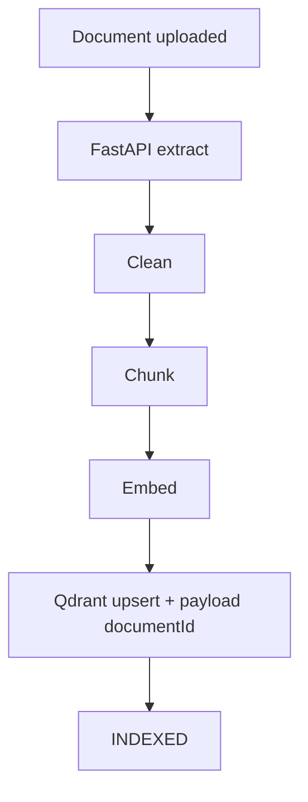
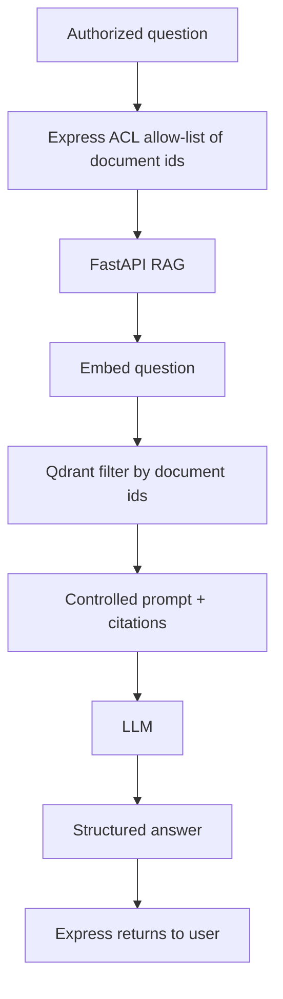
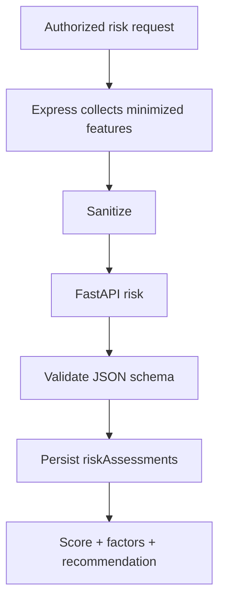

# INFRAOS AI and RAG Architecture

**Document:** `/docs/architecture/ai-rag-architecture.md`  
**Step:** 03  
**Status:** Locked  
**Does not change:** [ai-decisions.md](./ai-decisions.md), ADR-008, ADR-011

Express is the only browser-facing AI facade (`/api/v1/ai/...`).

---

## 1. RAG index

---

## 2. RAG query

Fallbacks: unsupported file, empty extract, no chunks, model down, rate limit, weak match → warning, no fake citations.

Hallucination: always treat as assistance; show sources or “insufficient evidence.”

---

## 3. Risk

Model output **never** patches `projects.status`.

---

## 4. Optional vision (P2)

Reported % vs estimate % → recommend inspector. **Never** “fraud.”
