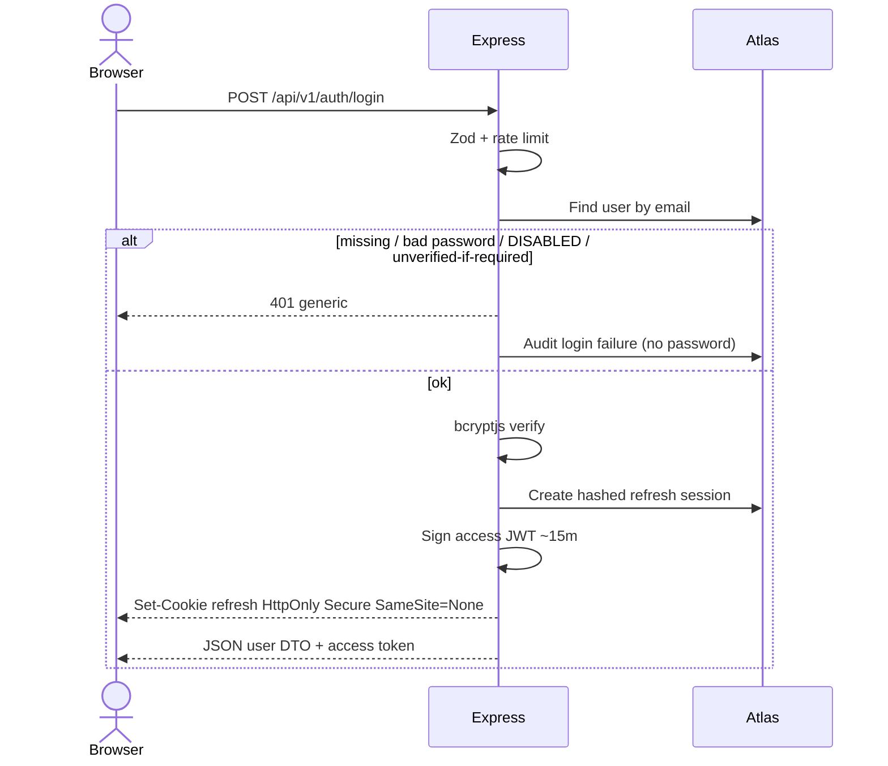
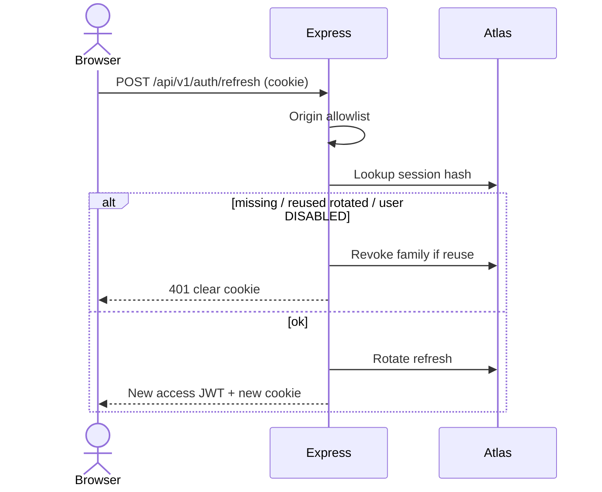
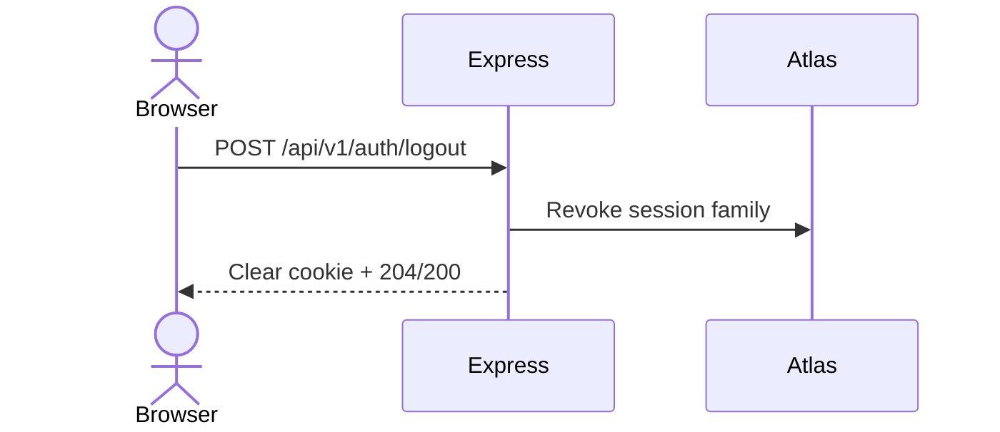
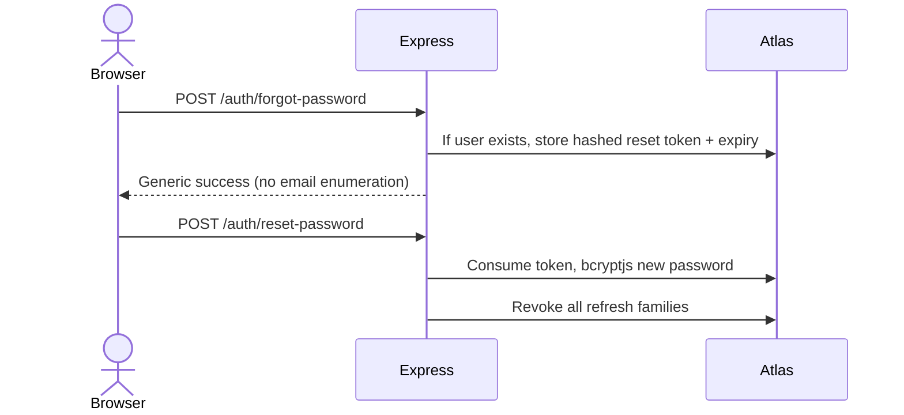

# INFRAOS Authentication Flow

**Document:** `/docs/architecture/auth-flow.md`  
**Step:** 03  
**Status:** Locked  
**Policy:** [security-decisions.md](./security-decisions.md), [ADR-006](../adr/ADR-006-jwt-access-refresh-session.md)

Trust: browser untrusted; Express verifies password, status, and tokens.

---

## 1. Login

Never return password hash. User DTO has no permission to self-elevate.

---

## 2. Refresh

---

## 3. Logout

---

## 4. Forgot / reset password (P1)

Email send is P2; for demo, token may be logged in **non-production** only if the team agrees (never production logs).

---

## 5. Email verification (P1 mechanism)

Policy of blocking login remains **Q-002**. Flow: hashed verify token → `emailVerifiedAt`.

---

## 6. App boot (silent session)

1. No access token in memory.
2. `POST /refresh` with credentials.
3. On success, hydrate user query; on 401, stay logged out.

---

## 7. Trust boundary

| Item | Trusted? |
|------|----------|
| Password in JSON over HTTPS | Transport only; hashed at rest |
| Access JWT signature + exp | Yes, then load `DISABLED` from DB on sensitive routes |
| Client `role` field | **No** |
| Refresh cookie | Yes only after Origin check + hashed lookup |
