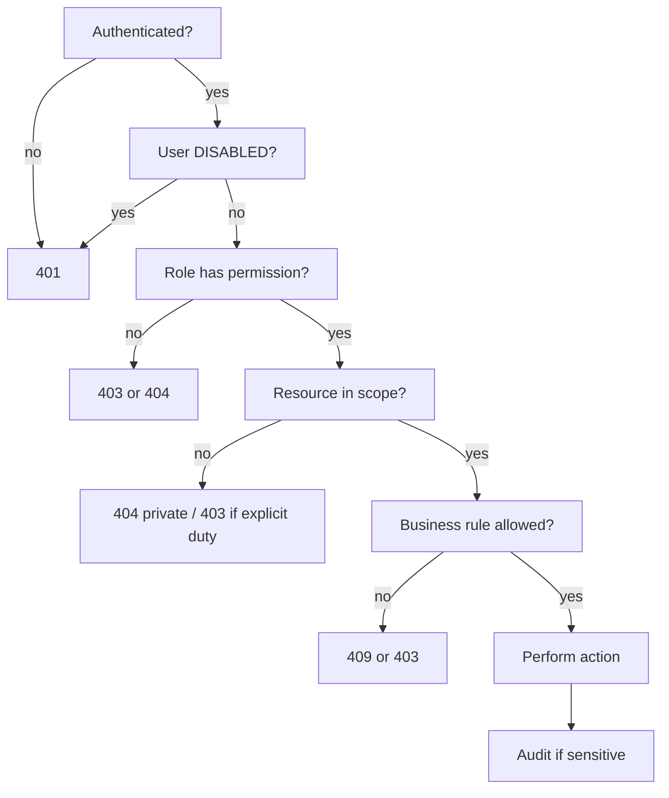

# INFRAOS Authorization Flow

**Document:** `/docs/architecture/authorization-flow.md`  
**Step:** 03  
**Status:** Locked (Step 3 flow; Step 4 matrix linked)  
**ADR:** [ADR-007](../adr/ADR-007-rbac-resource-authorization.md)  
**Matrix:** [../security/permission-matrix.md](../security/permission-matrix.md) (Step 4)  
**Catalog:** [../security/permission-catalog.md](../security/permission-catalog.md)  
**Resource rules:** [../security/resource-authorization.md](../security/resource-authorization.md)

---

## 1. Server pipeline

Frontend nav hiding is **not** this pipeline.

---

## 2. Examples

| Case | RBAC | Resource | Result |
|------|------|----------|--------|
| PM edits assigned project | `project.update` | `project.agency` + assignment | Allow |
| PM edits other agency project | maybe permission | fail scope | 404 |
| Contractor updates own progress | `progress.update` | assigned project | Allow |
| Contractor approves inspection | no | — | 403 |
| Inspector verifies, cannot PAID payment | inspect vs finance | — | 403 |
| Citizen GET confidential document | no | — | 404 |
| Gov Admin list | `project.list` | ministry/agency scope in query | Scoped list |
| Super Admin user disable | `user.disable` | platform | Allow; not used to APPROVE roads |

---

## 3. List endpoints

MongoDB filter **includes** `agencyId` / assignment / public flag. Never fetch all then hide.

---

## 4. IDOR

Knowing an ObjectId is not authorization. Private miss and private forbidden → **404** (`RESOURCE_SCOPE_DENIED` / `RESOURCE_NOT_ASSIGNED`).

Malformed id → **400**.

Capability routes the role can never use (e.g. `/admin`) → **403** `FORBIDDEN`.

Codes, SoD, and catalog: [../security/README.md](../security/README.md).
