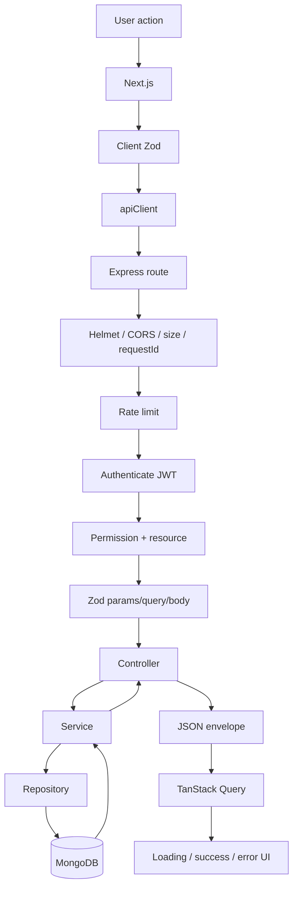
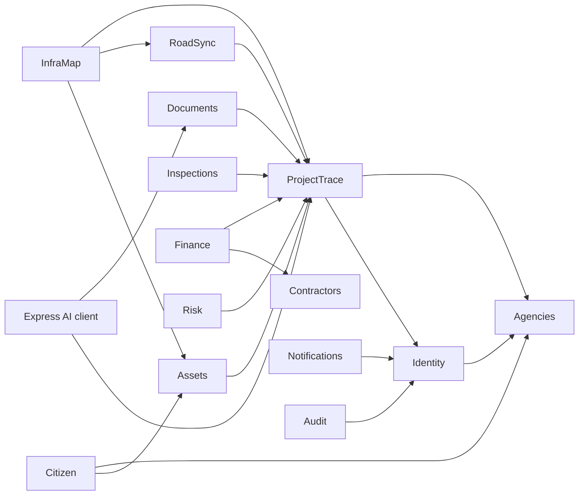

# INFRAOS Backend Architecture

**Document:** `/docs/architecture/backend-architecture.md`  
**Step:** 03  
**Status:** Locked  
**Stack:** ADR-003, ADR-005

---

## 1. Process

One Express process. Feature folders under e.g. `apps/api/src/modules/<name>/`.

Shared: `middleware/`, `lib/` (errors, envelope, logger), `config/`.

FastAPI is a **separate process**, not an Express module.

---

## 2. Module file pattern

```text
module/
├── module.routes.ts
├── module.controller.ts
├── module.service.ts
├── module.repository.ts
├── module.model.ts
├── module.schema.ts        # Zod
├── module.types.ts
├── module.constants.ts
├── module.errors.ts
└── __tests__/
```

Omit empty files. Health checks do not need a repository.

| File | Responsibility |
|------|----------------|
| routes | Path + middleware order |
| controller | HTTP, envelope, status codes |
| service | Rules, workflows, calling other **services** (not their repositories) |
| repository | Mongoose queries |
| model | Schema + indexes |
| schema | Zod input |
| errors | Module error codes |

---

## 3. Request flow



---

## 4. Domain modules

| # | Module | Owns | Must not directly modify |
|---|--------|------|--------------------------|
| 1 | auth | login, refresh, logout, reset tokens | project status |
| 2 | users | user records, disable | other modules’ collections except refs |
| 3 | roles | role/permission catalog | ad-hoc permission strings in clients |
| 4 | permissions | (may live with roles) | — |
| 5 | agencies | agency catalog | projects without service call |
| 6 | projects | **official project status**, core project doc, dashboard aggregations | conflict status |
| 7 | milestones | milestone state machine | parent COMPLETED |
| 8 | project progress | reported physical progress | inspection outcome, financial totals |
| 9 | work requests | work request docs + geometry/dates | project completion |
| 10 | conflicts | conflict records, severity, resolution | AI “recommendation executed” as status |
| 11 | coordination | coordination requests/responses | closing conflict without conflict service |
| 12 | map queries | bbox reads / DTO GeoJSON | writes to project/work (read-only API) |
| 13 | contractors | contractor profile, assignment | payments approval |
| 14 | finance/payments | budget, payments state machine | inspection |
| 15 | documents | metadata, ACL, processing status | Qdrant (FastAPI) |
| 16 | inspections | inspection workflow | contractor payment |
| 17 | assets | asset register | rewriting project history |
| 18 | maintenance | schedules/records | health score as official close |
| 19 | risk assessments | persisted AI results | official status |
| 20 | citizen issues | issues + public DTOs | confidential documents |
| 21 | notifications | notification rows + optional emit | business status |
| 22 | reports | scoped aggregations/export | bypass list authz |
| 23 | audit | append-only logs | update/delete APIs |

**Project status lives only in ProjectTrace (projects service).** Other modules request transitions through that service.

**RoadSync owns conflict status.** ProjectTrace may *read* open blocking conflicts before COMPLETED (BR-PRJ-005) via RoadSync service.

Dependency direction (avoid cycles):



RoadSync **must not** import ProjectTrace **repository**. It calls `projectsService.getById` / `assertAccessible`.

---

## 5. Cross-module calls

Allowed: `moduleA.service` → `moduleB.service`.

Forbidden: `moduleA.service` → `moduleB.repository` or `moduleA` updating `moduleB` collections with ad-hoc `Model.update`.

---

## 6. Health

`GET /health` — no auth, no dependency fan-out beyond “process up”.

Optional `GET /health/ready` — Mongo ping (used by Render), no secrets.
