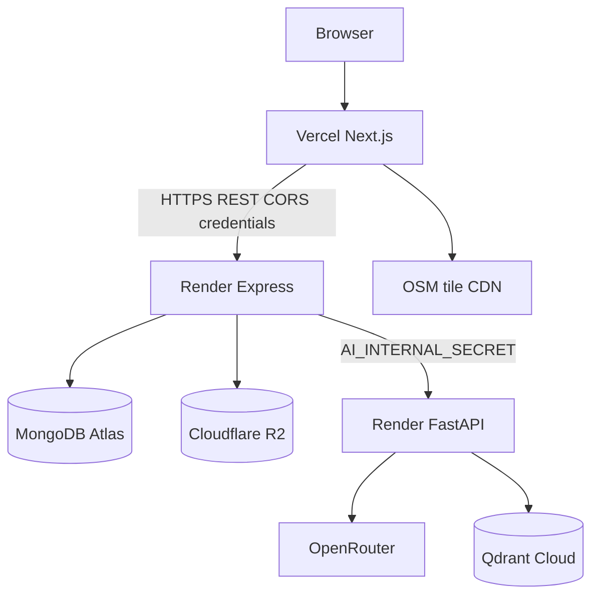

# INFRAOS Deployment Architecture

**Document:** `/docs/architecture/deployment-architecture.md`  
**Step:** 03  
**Status:** Locked  
**Does not change:** [deployment-decisions.md](./deployment-decisions.md), ADR-012

---

## 1. Topology

---

## 2. Boundaries

| Concern | Choice |
|---------|--------|
| CORS | Exact `FRONTEND_ORIGIN` |
| Cookies | Refresh on API host; `SameSite=None; Secure; HttpOnly` |
| HTTPS | Terminated at Vercel/Render |
| Envs | Separate Atlas DB + secrets for prod vs dev |
| Service secret | `AI_INTERNAL_SECRET` |
| Staging | Optional second Render + Vercel preview |

---

## 3. CI

GitHub Actions: install, lint, type-check, unit, integration if practical, build. Do not deploy red builds.

---

## 4. Local

Next + Express + Atlas (or local Mongo). Qdrant Docker when RAG is in play. R2 emulator = disk/MinIO.
