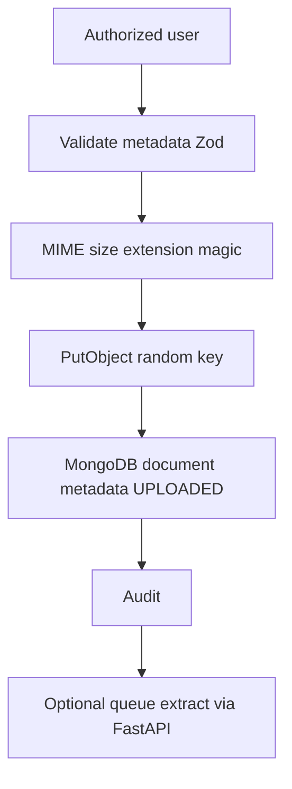
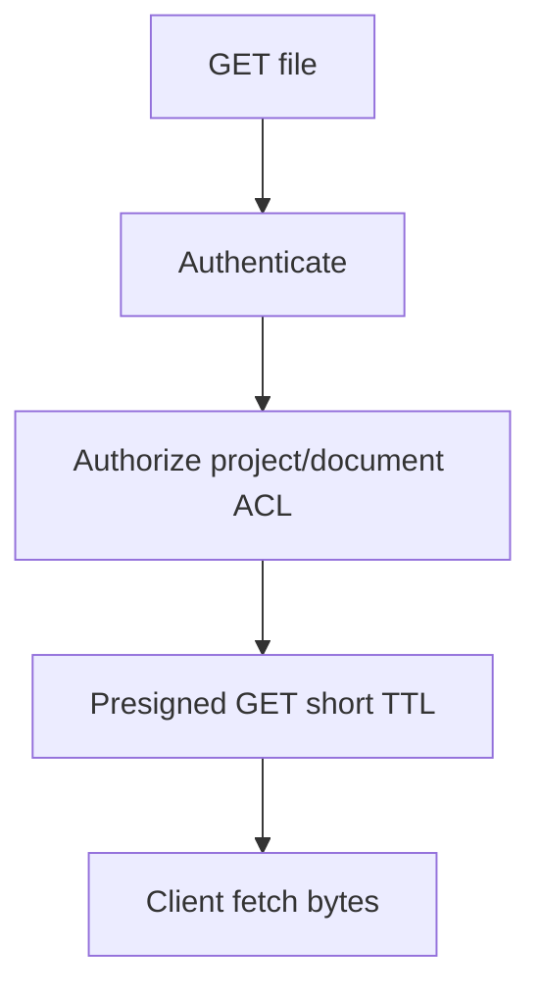

# INFRAOS File and Document Architecture

**Document:** `/docs/architecture/file-document-architecture.md`  
**Step:** 03  
**Status:** Locked  
**Storage:** ADR-010 (R2)  
**DocTrace owner:** Member 4

---

## 1. Upload

If R2 succeeds and Mongo fails: compensating delete or retry; do not leave an orphan “success” UI.

---

## 2. Download / preview

Citizens never receive confidential keys. Public release is an explicit flag.

---

## 3. Processing states

`UPLOADED → QUEUED → EXTRACTING → INDEXED | FAILED | UNSUPPORTED`

Original object remains on failure.

Chunk text may be stored in MongoDB `documentChunks` for debug; **vectors only in Qdrant**.

---

## 4. Security

- Random keys, private bucket
- Server MIME allowlist per category
- No executable types
- Virus scan P2
