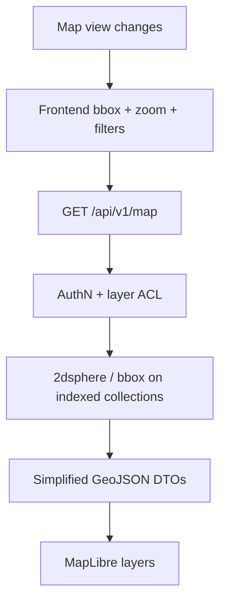

# INFRAOS InfraMap Architecture

**Document:** `/docs/architecture/inframap-architecture.md`  
**Step:** 03  
**Status:** Locked  
**Owner:** Member 2 (map UX + map API reads)  
**Stack:** ADR-009  
**Writes:** still owned by ProjectTrace / RoadSync / Assets

Map data must **not** load the entire database.

---

## 1. Viewport flow

Debounce moveend. Cancel in-flight queries (TanStack Query).

---

## 2. Layers (V1)

| Layer | Source collection | P |
|-------|-------------------|---|
| Projects planned/active/completed | projects | P0 |
| Work requests | workRequests | P0 |
| Conflicts | conflicts | P0 |
| Assets | assets | P1 |
| Risk visualization | riskAssessments join projects | P1 |
| Citizen issues (public map) | citizenIssues public | P1 |
| Utility GIS | **demo GeoJSON only** | demo |

Clustering / simplification: **later performance option**, not P0.

---

## 3. API shape (conceptual)

`GET /api/v1/map?bbox=w,s,e,n&layers=projects,work,conflicts&status=&agencyId=`

Response: FeatureCollection per layer or a documented multi-layer object. Properties are **role-safe** (no budgets on public).

---

## 4. Failure

Tile 503: show banner + retry; tables still work.

Empty bbox: empty layer, not an error.

---

## 5. Boundaries

InfraMap **must not** create projects or resolve conflicts. Those UIs live in ProjectTrace/RoadSync and may deep-link from the map drawer.
