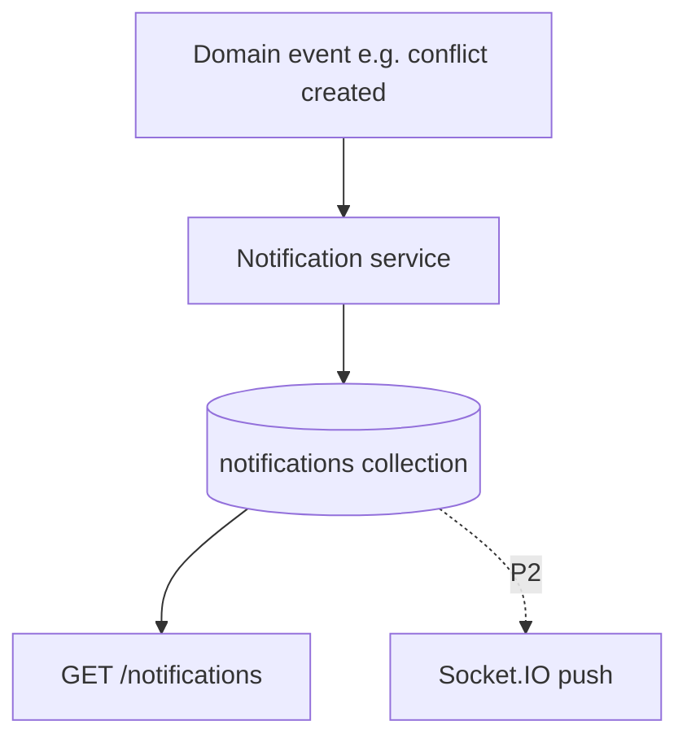
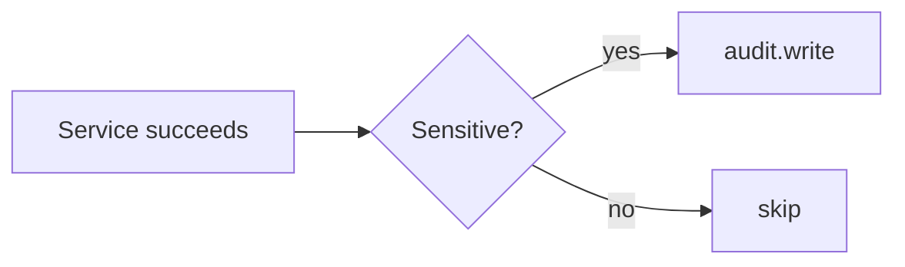

# INFRAOS Notification and Audit Architecture

**Document:** `/docs/architecture/notification-audit-architecture.md`  
**Step:** 03  
**Status:** Locked  
**Realtime:** Socket.IO P2 only (ADR / technology-stack)

---

## 1. Notifications

Database row is **source of truth**. No Kafka.

Categories: conflict, coordination, risk, milestone, approval, inspection, citizen issue.

Users read **only their** notifications (Super Admin support exception audited).

If Socket.IO is down, REST still works.

---

## 2. Audit

Append-only `auditLogs`. No update/delete API for normal roles.

Capture when sensitive:

- actor, action, resource, resourceId, timestamp
- old/new (redacted)
- requestId / IP truncated if useful

Always: project approval, budget change, role change, conflict resolution, contractor assignment, inspection verification, sensitive document delete, login success/failure (no secrets).

Never: passwords, tokens, file bytes, full model prompts with PII if avoidable.

Pino ≠ audit.
