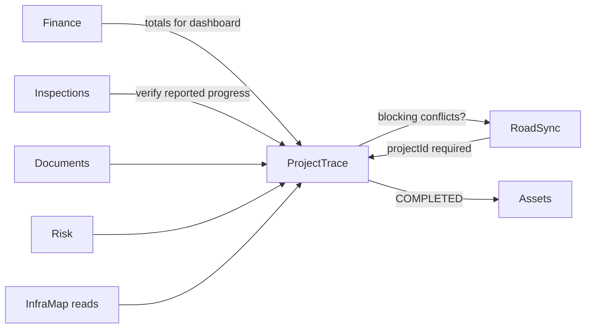

# INFRAOS ProjectTrace Architecture

**Document:** `/docs/architecture/projecttrace-architecture.md`  
**Step:** 03  
**Status:** Locked  
**Owner:** Team leader

ProjectTrace owns the **official project lifecycle**. Other modules attach to a project; they do not fork a second status field.

---

## 1. Bounded context

| Concern | Owner |
|---------|--------|
| Project CRUD, code uniqueness, geometry on the project, official status | ProjectTrace |
| Approvals (SUBMITTED → APPROVED / REJECTED) | ProjectTrace |
| Milestones state machine | ProjectTrace |
| Reported physical progress | ProjectTrace (progress) |
| Financial progress **display** | **Read** from Finance module service (do not store a client-authored `financialProgress` as authority) |
| Timeline / activity | ProjectTrace activity + audit reads |
| Dashboard aggregations (counts in scope) | ProjectTrace queries + scoped filters |
| Dependencies between projects | ProjectTrace (P1); reject cycles |
| Documents | DocTrace references `projectId` |
| Inspections | Inspection references `projectId` |
| Risk rows | Express persists; ProjectTrace does not copy score into status |
| Work requests | RoadSync; **must** include `projectId` |
| Asset conversion | Assets module after COMPLETED, via service call |

---

## 2. Status

Only `projectsService.transition(id, to, actor)` may change official status. State machine: [requirements.md](../planning/requirements.md).

100% physical progress **does not** complete the project.

COMPLETED may call RoadSync `hasBlockingOpen` and, if policy requires (Q-004), inspections.

---

## 3. Integrations

---

## 4. Permissions

Assignment + agency scope. PMs do not see all government projects by default.

Activity history is a query of project events + optional audit, not a writable client log.
