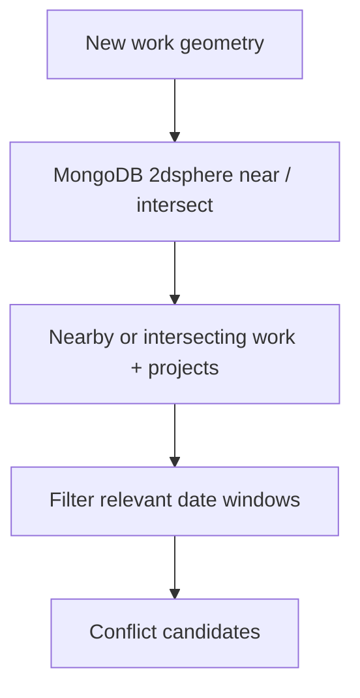
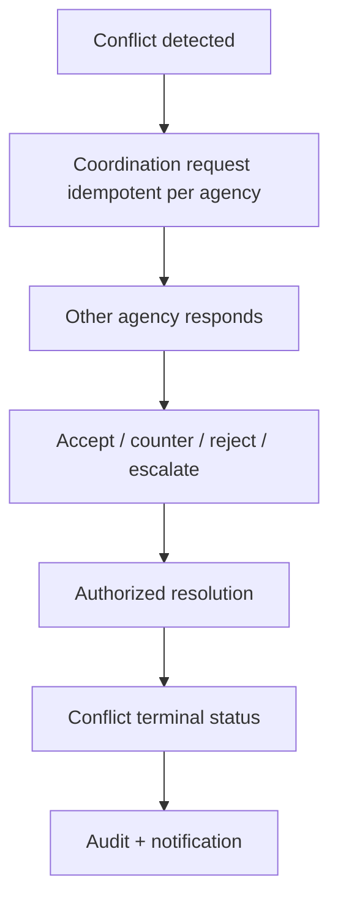
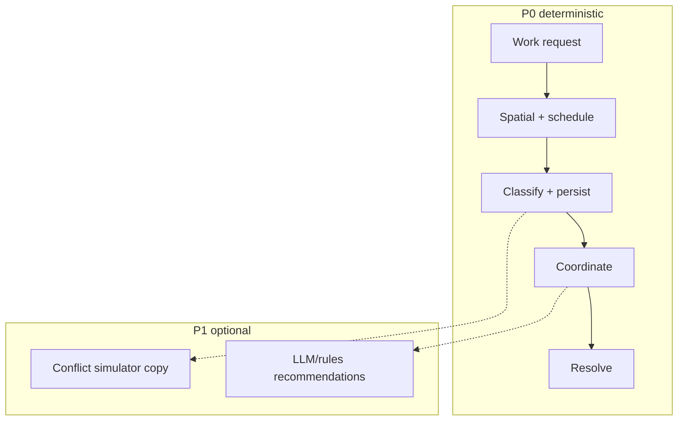

# INFRAOS RoadSync Architecture

**Document:** `/docs/architecture/roadsync-architecture.md`  
**Step:** 03  
**Status:** Locked  
**Owner:** Team leader  
**P0:** must run **without** FastAPI

RoadSync is the core differentiator. Conflict math is **deterministic**. AI recommendations are optional overlays (P1).

---

## 1. Work request

Required input:

- `projectId` (**mandatory in V1** — D-009 closed)
- agency (from project / actor, not client spoof)
- work type (road, water, electricity, telecom, drainage, other)
- GeoJSON geometry (Point, LineString, or Polygon)
- planned start / planned end (`start <= end`)
- priority

Owned by RoadSync module. ProjectTrace remains owner of **project** status.

---

## 2. Nearby detection

Queries run on the **server**. The client cannot declare “no conflicts.”

---

## 3. Conflict engine (deterministic)

Evaluate:

- spatial relationship (intersect, within buffer — exact meters in a later RoadSync rules step; Q-003)
- distance
- date overlap
- infrastructure category pair
- affected agencies
- severity rules (LOW / MEDIUM / HIGH)

HIGH should **block silent APPROVED** of the work request until coordination or authorized `ACCEPTED_RISK` (BR-RS-004). Exact blocking table remains Q-003.

Persist:

- involved work/project ids
- type, severity
- detectedAt
- status (DETECTED → OPEN → …)
- resolution, actor
- history

---

## 4. Coordination workflow

Recommendations **never** reschedule automatically.

---

## 5. Visualization

InfraMap conflict layer reads RoadSync GeoJSON via `/map?layers=conflicts`. RoadSync list/detail remains source for workflow actions.

---

## 6. Integration

- Create work request: `projectsService.assertWritable(projectId)`
- Complete project: ProjectTrace asks `conflictsService.hasBlockingOpen(projectId)`
- Do not duplicate project status inside work requests except denormalized display fields if needed
