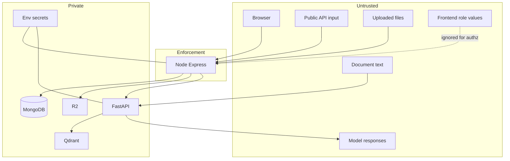

# INFRAOS Security Trust Boundaries

**Document:** `/docs/architecture/security-trust-boundaries.md`  
**Step:** 03  
**Status:** Locked  
**Details:** [security-decisions.md](./security-decisions.md)

---

## 1. Boundaries

- Browser untrusted
- Public API input untrusted
- Uploaded files untrusted
- Model responses untrusted
- Document contents untrusted
- Frontend roles untrusted
- **Express is the main enforcement boundary**
- DB credentials private
- FastAPI accepts **only** authorized internal requests

---

## 2. Threats and controls (V1)

| Threat | Control |
|--------|---------|
| XSS | React escaping; no raw HTML from API/model |
| CSRF | Origin allowlist on cookie routes; Bearer for APIs |
| Brute force | Rate limit login |
| IDOR | Resource authz; 404 default |
| Privilege escalation | Server roles; no self-assign |
| Malicious upload | MIME/size/random key/private R2 |
| Mongo operator injection | Zod + explicit queries |
| Exposed secrets | Env only; no Next public `AI_` keys |
| API abuse | Rate limits; pagination |
| Prompt injection | Treat docs as data; allow-list retrieval |
| Data leakage | Public DTOs |
| Hallucination | Assistance labeling; citations |

Impersonation: **default no** (Q-011).
