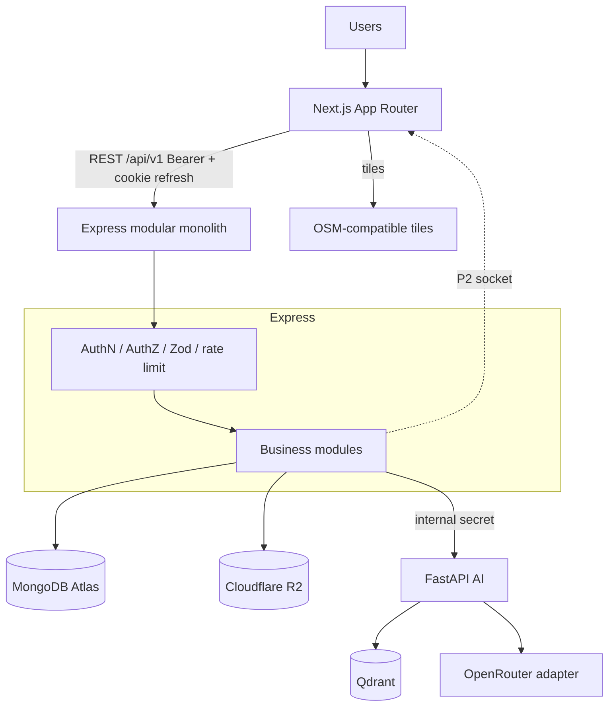
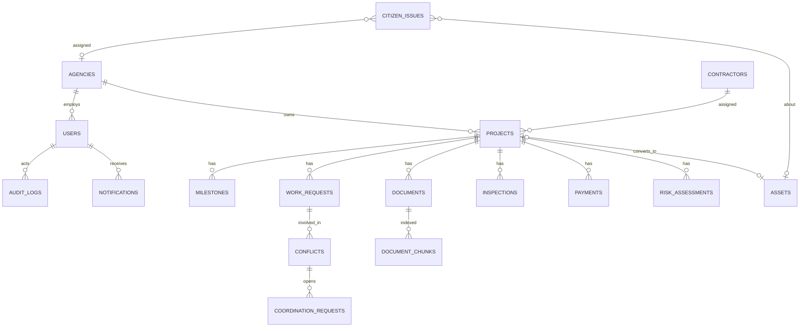

# INFRAOS High-Level System Architecture

**Document:** `/docs/architecture/system-architecture.md`  
**Step:** 03  
**Status:** Locked  
**Does not change:** ADR-001 … ADR-012

---

## 1. Architectural style

**Modular monolith (Express) + dedicated FastAPI AI service.**

```text
Users
  ↓
Next.js Web Application (Vercel)
  ↓ HTTPS REST  (+ Socket.IO P2)
Node.js + Express REST API (Render)
  ↓ Authentication / Authorization / Validation
Business modules
  ├── Identity (auth, users, roles, sessions)
  ├── Agencies
  ├── ProjectTrace (projects, milestones, progress)
  ├── RoadSync (work requests, conflicts, coordination)
  ├── InfraMap API (viewport GeoJSON)
  ├── Contractors
  ├── Finance
  ├── Documents (DocTrace metadata)
  ├── Inspections
  ├── Assets + maintenance
  ├── Citizen Issues
  ├── Notifications
  ├── Reports
  └── Audit
  ↓
MongoDB Atlas | Cloudflare R2 | OSM tiles
  ↓ authorized internal calls
FastAPI AI (risk, extract, embed, RAG, optional vision)
  ↓
LLM adapter | Qdrant
```

---

## 2. High-level diagram



---

## 3. Application boundaries

### Frontend (Next.js)

**Does:** presentation, forms, route UX, client Zod, TanStack Query, MapLibre rendering, a11y, responsive layouts, cosmetic role nav.

**Must not:** decide real permissions; trust client `role`; hold secrets; query MongoDB; call FastAPI, Qdrant, or R2 admin APIs; store refresh tokens in `localStorage`.

### Node backend (Express)

**Does:** REST, sessions, RBAC + resource authz, business rules, MongoDB, file grants, AI request authorization, notifications, audit, official status.

**Must not:** embed LLM keys in responses; trust FastAPI for ACL; skip Zod.

### MongoDB Atlas

**Does:** system of record, references, GeoJSON, indexes, notification rows, audit append-only.

**Must not:** store password plaintext, access tokens, or raw file bytes (bytes live in R2).

### Cloudflare R2

**Does:** private objects (documents, evidence, issue photos).

**Must not:** be publicly listed. Metadata/ACL in MongoDB.

### FastAPI

**Does:** risk computation, extraction, embeddings, RAG, optional vision.

**Must not:** accept browser traffic in production; decide user roles; mutate official project/conflict/payment status.

---

## 4. Conceptual data (not field-level schemas)

Collections planned (Step 12 will finalize fields):

```text
users, roles, agencies, refreshSessions
projects, milestones
workRequests, conflicts, coordinationRequests
contractors, projectPayments
documents, documentChunks   (chunk text optional in Mongo; vectors in Qdrant)
inspections
assets, maintenanceRecords
citizenIssues
notifications, riskAssessments, auditLogs
```

Ownership:

| Data | Owner module | GeoJSON | Unique-ish keys |
|------|--------------|---------|-----------------|
| users / sessions | Identity | no | email |
| agencies | Agencies | no | code |
| projects / milestones / progress | ProjectTrace | project geometry | projectCode |
| workRequests / conflicts / coordination | RoadSync | work geometry | — |
| map queries | InfraMap API (read models from owners) | bbox | — |
| contractors / payments | Finance+Contractor | no | — |
| documents | DocTrace | no | storageKey |
| inspections | Inspection | maybe site point | — |
| assets / maintenance | Assets | asset geometry | — |
| citizenIssues | Citizen | issue point | trackingCode |
| notifications | Notifications | no | — |
| riskAssessments | AI Risk (persist via Express) | no | — |
| auditLogs | Audit | no | append-only |

High-query: `projects`, `workRequests`, map viewport, `notifications`, `auditLogs` (write-heavy).



**V1 lock (closes D-009):** every **work request requires a `projectId`**. Unplanned corridor work starts as a ProjectTrace project (even DRAFT) so authorization, audit, and map layers stay consistent. No orphan work requests.

---

## 5. Consistency / transactions

Use MongoDB multi-document transactions **only** when two writes must succeed or fail together, for example:

- conflict resolve + work-request date change + audit
- project COMPLETED + optional asset create + audit
- approval + audit + notification
- password reset + session family revoke
- payment APPROVED/PAID + audit

Ordinary CRUD does **not** need transactions.

---

## 6. Error architecture

| Category | HTTP | Example code |
|----------|------|----------------|
| Validation | 400 | `VALIDATION_ERROR` |
| Authn | 401 | `UNAUTHORIZED` |
| Authz / IDOR private | 404 preferred for private resources | `NOT_FOUND` |
| Authz explicit (known resource, wrong duty) | 403 | `FORBIDDEN` |
| Missing public resource | 404 | `NOT_FOUND` |
| State conflict | 409 | `INVALID_STATUS_TRANSITION` |
| Rate limit | 429 | `RATE_LIMITED` |
| AI / storage / tiles dependent feature | 503 on that route | `AI_UNAVAILABLE` |
| Database down | 503 | `SERVICE_UNAVAILABLE` |
| Unknown | 500 | `INTERNAL_ERROR` |

Safe user `message`. No stack traces, raw Mongo errors, or secrets. Pino logs severity + `requestId`.

---

## 7. Logging architecture

| Stream | Store | Use |
|--------|-------|-----|
| Application logs | Pino stdout (Render) | Ops, errors, requestId |
| Audit logs | MongoDB `auditLogs` | Governance |
| Optional SaaS | Sentry | Unhandled exceptions |

Do not treat Pino as the audit trail.

---

## 8. Scalability path (not V1)

Future options only: Redis cache, job collection/worker for heavy PDF, PostGIS evaluation, CDN for public assets, search index, horizontal API clones.

Do **not** implement these now.

---

## 9. API groups (not implemented)

```text
/api/v1/auth
/api/v1/users
/api/v1/roles
/api/v1/agencies
/api/v1/projects
/api/v1/milestones
/api/v1/work-requests
/api/v1/conflicts
/api/v1/coordination
/api/v1/map
/api/v1/contractors
/api/v1/payments
/api/v1/documents
/api/v1/inspections
/api/v1/assets
/api/v1/issues
/api/v1/notifications
/api/v1/reports
/api/v1/audit
/api/v1/ai
```

Public subset may be unauthenticated under `/api/v1/public/...` or documented public routes on the same resources with public DTOs. Exact paths land in the API step.

---

## 10. Related

- [system-context.md](./system-context.md)
- [module-boundaries.md](./module-boundaries.md)
- [deployment-architecture.md](./deployment-architecture.md)
