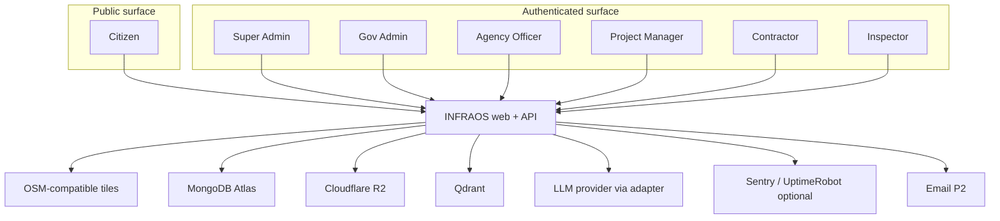

# INFRAOS System Context

**Document:** `/docs/architecture/system-context.md`  
**Step:** 03 — Complete System Architecture  
**Status:** Locked  
**Stack:** [technology-stack.md](./technology-stack.md) (Step 2 — do not silently change)

---

## 1. Purpose

This diagram shows **who** uses INFRAOS and **which external systems** the platform talks to. It is not a module list.

Two surfaces:

| Surface | Who | Auth |
|---------|-----|------|
| **Public** | Citizens (and anyone browsing public pages) | Unauthenticated, or optional later citizen account (Q-005) |
| **Authenticated app** | Super Admin, Gov Admin, Agency Officer, Project Manager, Contractor, Inspector | JWT access + refresh cookie |

The **browser is untrusted**. Only **Express** is the enforcement boundary. FastAPI, R2, Qdrant, and MongoDB are not exposed to the browser.

---

## 2. System context

---

## 3. Trust summary

| Actor | May reach |
|-------|-----------|
| Citizen | Public Next.js routes + public REST (`/public-projects`, `/issues` intake, `/public-map` data) |
| Staff | Authenticated Next.js app + `/api/v1/*` with Bearer access token |
| Nobody in the browser | MongoDB, R2 admin, Qdrant, FastAPI, provider API keys |

Email is **not** required for P0. Monitoring is operational, not a product actor.
