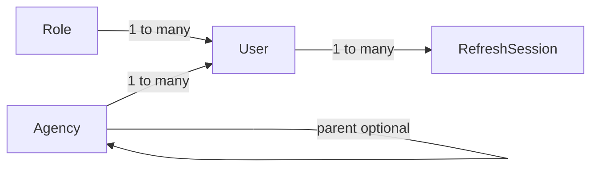

# INFRAOS core identity models

**Step:** 12  
**Status:** Foundation — no auth endpoints, no ProjectTrace/RoadSync collections

Mongoose models live in Express only. Next.js must not import these files.

Connection lifecycle: [connection.md](./connection.md). Atlas: [../setup/mongodb-atlas.md](../setup/mongodb-atlas.md). Authorization source of truth: [../security/permission-catalog.md](../security/permission-catalog.md).

---

## Models

| Model | Collection | Owner |
|-------|------------|--------|
| `Role` | `roles` | Identity |
| `User` | `users` | Identity |
| `RefreshSession` | `refresh_sessions` | Identity |
| `Agency` | `agencies` | Agencies |

Permissions are **strings on roles**, not a separate collection (Step 4). Role keys use the locked catalog (`GOV_ADMIN`, not `GOVERNMENT_ADMIN`).



---

## Role

| Field | Required | Notes |
|-------|----------|--------|
| `key` | yes | Immutable unique: `SUPER_ADMIN`, `GOV_ADMIN`, `AGENCY_OFFICER`, `PROJECT_MANAGER`, `CONTRACTOR`, `INSPECTOR`, `CITIZEN` |
| `name` | yes | Display label |
| `description` | yes | |
| `permissions[]` | yes | Unique catalog keys only (`resource.action`) |
| `scopeType` | yes | Default scope; **not** a grant by itself |
| `isSystem` | yes | Core roles; do not hard-delete in later UI |
| `isActive` | yes | |
| `createdAt` / `updatedAt` | auto | |

**Indexes:** unique `key`; `isActive`.

**Delete:** deactivate (`isActive: false`). Do not cascade-delete users.

**Scope types:** `PLATFORM` `ORGANIZATION` `AGENCY` `ASSIGNED_PROJECT` `ASSIGNED_INSPECTION` `OWN_RECORD` `PUBLIC`.

---

## User

| Field | Required | Notes |
|-------|----------|--------|
| `firstName` / `lastName` | yes | |
| `displayName` | virtual | `firstName + lastName`; not stored |
| `email` | yes | Trimmed, lowercased, unique |
| `passwordHash` | yes | `select: false`. Hashing is the auth step. Never store plaintext. |
| `roleId` | yes | Ref `Role`. Citizens use the `CITIZEN` role, not null. |
| `agencyId` | no | Null for Super Admin and typically Citizen. **Not** a contractor entity. |
| `status` | yes | `PENDING` (provisioned, cannot use app until activated) · `ACTIVE` · `SUSPENDED` (temporary) · `DISABLED` (terminal for login) |
| `emailVerified` | yes | Default false. P0 seeded staff may log in later without verification (Q-002). |
| `lastLoginAt` | no | |
| `createdBy` / `updatedBy` | no | Optional refs; bootstrap may have none |
| timestamps | auto | |

**Indexes:** unique `email`; `roleId`; `agencyId`; `status`.

**Privacy:** no national ID, home address, or date of birth.

**Delete:** set `DISABLED`. Keep the row for audit/history.

---

## Agency

| Field | Required | Notes |
|-------|----------|--------|
| `code` | yes | Unique, uppercase (`DEMO_RDA`). Demo codes are **not** official GoSL identifiers. |
| `name` | yes | |
| `shortName` | no | |
| `type` | yes | `MINISTRY` `DEPARTMENT` `ROAD` `WATER` `ELECTRICITY` `TELECOM` `LOCAL_AUTHORITY` `DRAINAGE` `OTHER` |
| `description` | no | |
| `contactEmail` / `contactPhone` / `address` | no | Organizational contact, not personal PII |
| `status` | yes | `ACTIVE` / `INACTIVE` |
| `parentAgencyId` | no | Hierarchy; cannot equal `_id`. Cycle checks later in services. |
| timestamps | auto | |

**Indexes:** unique `code`; `name`; `type`; `status`; `parentAgencyId`.

**Delete:** `INACTIVE`. Historical projects will still reference the agency.

---

## RefreshSession

Architecture (ADR-006) stores **hashed** rotating refresh tokens. The model exists now; **token issuance is not implemented**.

| Field | Required | Notes |
|-------|----------|--------|
| `userId` | yes | Ref `User` |
| `tokenHash` | yes | `select: false`. Never store the raw cookie value. |
| `familyId` | yes | Rotation family; reuse later revokes the family |
| `expiresAt` | yes | TTL index (`expireAfterSeconds: 0`). TTL is **not** an authorization check. |
| `revokedAt` / `replacedBySessionId` / `lastUsedAt` | no | |
| `userAgentSummary` | no | Short string only |
| `createdAt` | auto | |

No IP plaintext; do not add fingerprinting fields now.

---

## Seed

```powershell
npm run db:seed:core
```

- Idempotent upsert by role `key` and agency `code`
- Refuses `NODE_ENV=production` and `*_prod` database names
- Does **not** run on API startup
- Does **not** create users or passwords
- Demo agencies: `DEMO_MINISTRY`, `DEMO_RDA`, `DEMO_WATER`, `DEMO_ELEC` (development/demo only)

---

## Indexes in production

Development/test: Mongoose `autoIndex` is on. Production: `autoIndex` is off; create indexes with a later controlled migration, not a destructive script.

---

## Duplicate keys

`E11000` is mapped internally (`email`, `key`, `code`) for later APIs. Clients must never see raw Mongo errors.

---

## Future relationships (not in this step)

```text
Agency → Projects
User (Project Manager) → projectAssignments
Contractor user → Contractor entity (separate from agencyId)
Inspector → Inspections
Citizen → Citizen Issues
```

Do not implement those collections here.
