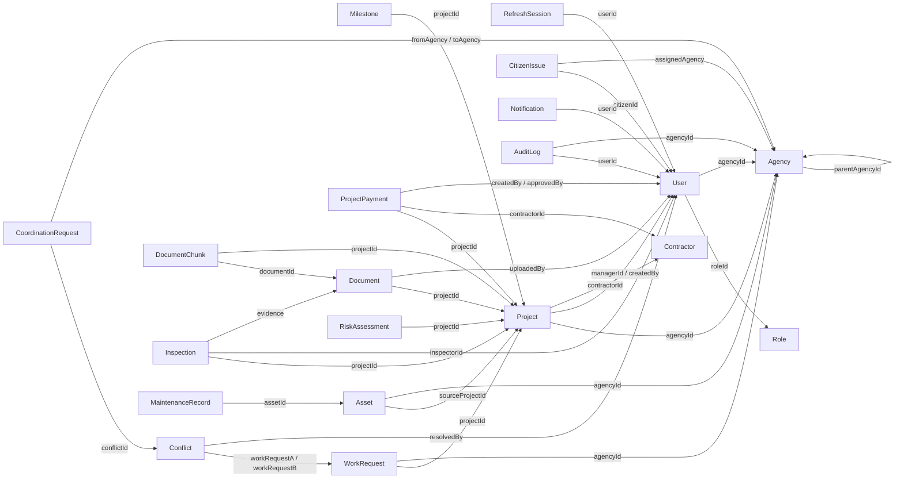

# INFRAOS domain data model

Step 13 implements the 16 remaining domain models in Express. Step 12 User,
Role, Agency, and RefreshSession schemas remain unchanged, including the existing
`refresh_sessions` collection name. No feature routes, services, authentication,
AI calls, indexes, or demo seeding are introduced here.

Source: `Prompts/INFRAOS_Cursor_Prompts_Steps_13_to_15.md`, Step 13.
Connections: [connection.md](./connection.md). Identity: [core-models.md](./core-models.md).

## Ownership and collections

All model paths below are relative to `apps/api/src/modules/`.
Each model exports an inferred `*Document` TypeScript type and reuses an existing
Mongoose model registration when present. Enums live beside their owning module.

| Owner | Model | Collection | Model file |
|---|---|---|---|
| ProjectTrace / Team Leader | Project | projects | projects/models/project.model.ts |
| ProjectTrace / Team Leader | Milestone | milestones | projects/models/milestone.model.ts |
| RoadSync / Team Leader | WorkRequest | workRequests | roadsync/models/work-request.model.ts |
| RoadSync / Team Leader | Conflict | conflicts | roadsync/models/conflict.model.ts |
| RoadSync / Team Leader | CoordinationRequest | coordinationRequests | roadsync/models/coordination-request.model.ts |
| Contractor / Member 5 | Contractor | contractors | contractors/models/contractor.model.ts |
| Finance / Member 5 | ProjectPayment | projectPayments | finance/models/project-payment.model.ts |
| DocTrace / Member 4 | Document | documents | documents/models/document.model.ts |
| DocTrace / Member 4 | DocumentChunk | documentChunks | documents/models/document-chunk.model.ts |
| Inspection / Team Leader | Inspection | inspections | inspections/models/inspection.model.ts |
| Asset / Member 5 | Asset | assets | assets/models/asset.model.ts |
| Asset / Member 5 | MaintenanceRecord | maintenanceRecords | assets/models/maintenance-record.model.ts |
| Citizen / Member 6 | CitizenIssue | citizenIssues | issues/models/citizen-issue.model.ts |
| Notifications / Team Leader | Notification | notifications | notifications/models/notification.model.ts |
| AI Risk / Member 3 | RiskAssessment | riskAssessments | risk/models/risk-assessment.model.ts |
| Governance / Team Leader | AuditLog | auditLogs | audit/models/audit-log.model.ts |

## Relationships

Arrows mean references, not MongoDB foreign keys. Required ObjectIds validate
presence and castability; they do not prove that a target exists, is authorized,
has the right role, or belongs to the same agency/project. Future services must
check those facts. Reference names are static; no user-controlled `refPath` exists.



Notifications and audit records additionally carry an application resource key
and ObjectId. Resolve these through a fixed, authorized service mapping later,
never by passing the resource key to `mongoose.model()` or arbitrary population.

## Fields and defaults

All schemas retain the Step 13 field names. All new schemas reject unknown fields
(`strict: "throw"`). Dates are BSON dates. Models use `createdAt` and `updatedAt`
except Notification and RiskAssessment (creation time only) and AuditLog
(`timestamp`, no update time). Business dates remain independent of timestamps.

| Model | Required fields beyond defaults | Other fields / decisions |
|---|---|---|
| Project | projectCode, title, projectType, agencyId, budget, createdBy | description; optional managerId/contractorId during planning; descriptive location; geometry; startDate/plannedEndDate/actualEndDate; physicalProgress and financialProgress default 0; status DRAFT; riskScore absent until assessed |
| Milestone | projectId, title, plannedStart, plannedEnd | description; actualStart/actualEnd; progress 0; status NOT_STARTED |
| WorkRequest | projectId, agencyId, geometry, workType, plannedStart, plannedEnd | status DRAFT; priority NORMAL |
| Conflict | workRequestA, workRequestB, conflictType, scheduleOverlap, severity | distance in metres (finite, nonnegative); status OPEN; resolution; resolvedBy/resolvedAt; identical work references rejected |
| CoordinationRequest | conflictId, fromAgency, toAgency, message | status PENDING; response |
| Contractor | name, registrationNumber | structured contact email/phone/address; rating 0–5; optional activeProjects/completedProjects caches; riskLevel; status ACTIVE |
| ProjectPayment | projectId, contractorId, amount, paymentType, date, createdBy | status PENDING; optional approvedBy; createdBy cannot equal approvedBy |
| Document | projectId, documentType, fileName, uploadedBy | optional storageUrl/storageKey, mimeType, sizeBytes; extractedTextStatus NOT_STARTED; visibility INTERNAL |
| DocumentChunk | documentId, projectId, chunkIndex, content | optional embeddingReference; chunkIndex is a nonnegative safe integer; embeddings are not required |
| Inspection | projectId, inspectorId, inspectionDate | optional physicalProgress and notes; status SCHEDULED; evidence defaults to empty Document reference array |
| Asset | sourceProjectId, agencyId, assetType, name, commissionedAt | descriptive location; geometry; condition UNKNOWN; healthScore; lastInspectionAt; nextMaintenanceAt |
| MaintenanceRecord | assetId, maintenanceType, scheduledDate | completedDate; optional cost; status PLANNED |
| CitizenIssue | citizenId, category, description, location | geometry; photos (private storageKey/fileName metadata); assignedAgency; status SUBMITTED; priority NORMAL |
| Notification | userId, type, title, message | optional paired resourceType/resourceId; isRead false; SYSTEM messages may have neither resource field |
| RiskAssessment | projectId, overallRisk, delayRisk, budgetRisk, scheduleRisk, modelVersion | structured factors and bounded recommendations default to empty arrays |
| AuditLog | action, resourceType, resourceId | userId absent only for system-originated actions; oldValue/newValue safe snapshots; ipAddress; userAgent; requestId; agencyId for scoped reads; timestamp assigned on insertion |

Project codes are immutable, human-readable `INF-<UPPERCASE_TYPE>-<DIGITS>` values.
The future service generates codes. Unique enforcement and its index are **Step 14**;
Step 13 does not claim concurrent duplicate protection. Contractor registration
numbers are trimmed uppercase identifiers allowing letters, digits, slash, and hyphen.

Optional additions have specific purposes: payment createdBy supports attribution
and segregation of duties; contractor status permits deactivation; asset agencyId
and geometry support ownership and InfraMap; citizen geometry separates coordinates
from descriptions; document visibility/private metadata support storage ACLs;
audit agencyId/requestId support scope and correlation. No operational workflows are added.

## Money, progress, and scores

`Project.budget`, `ProjectPayment.amount`, and `MaintenanceRecord.cost` all use:

```json
{ "amountMinor": 123450, "currency": "LKR" }
```

This means LKR 1,234.50. `amountMinor` is an integer between 0 and
`Number.MAX_SAFE_INTEGER`; fractional, negative, infinite, and unsafe values fail.
Currency defaults to and currently allows only LKR. Additional currencies require
an explicit policy for minor units and totals. No floating rupee amounts or mixed
Decimal128 values are stored. A missing maintenance cost means unknown, not zero.

All progress, project risk, assessment risk, factor scores, and asset health scores
use 0–100. Missing optional scores mean unassessed, not low risk.
`financialProgress` is a **cache**, calculated later by Finance from PAID payments
and budget, capped at 100 for this percentage field. Zero budget and over-budget
totals need explicit service handling; totals themselves must not be discarded.
Clients cannot authoritatively set this cache. Project `riskScore` is only the latest
summary; each full assessment belongs in RiskAssessment history. Saving an assessment
does not mutate Project. Contractor project counts are optional derived caches;
the future contractor service must calculate/reconcile them from Project records.

## Controlled values

| Field | Values |
|---|---|
| Project.projectType | ROAD, WATER, ELECTRICITY, TELECOM, DRAINAGE, BRIDGE, BUILDING, PUBLIC_FACILITY, MULTI_INFRASTRUCTURE, OTHER |
| Project.status | DRAFT, SUBMITTED, UNDER_REVIEW, APPROVED, ACTIVE, ON_HOLD, DELAYED, COMPLETED, CANCELLED |
| Milestone.status | NOT_STARTED, IN_PROGRESS, COMPLETED, DELAYED, BLOCKED, CANCELLED |
| WorkRequest.workType | ROAD_RESURFACING, ROAD_EXCAVATION, PIPELINE_INSTALLATION, ELECTRIC_CABLE_WORK, TELECOM_CABLE_WORK, DRAINAGE_WORK, UTILITY_REPAIR, BRIDGE_WORK, OTHER |
| WorkRequest.status | DRAFT, SUBMITTED, PLANNED, APPROVED, ACTIVE, COMPLETED, CANCELLED |
| WorkRequest.priority / CitizenIssue.priority | LOW, NORMAL, HIGH, CRITICAL |
| Conflict.conflictType | GEOGRAPHIC_OVERLAP, NEARBY_WORK, SCHEDULE_OVERLAP, UTILITY_INTERFERENCE, ACCESS_CONFLICT, MULTI_FACTOR |
| Conflict.severity | LOW, MEDIUM, HIGH, CRITICAL |
| Conflict.status | OPEN, COORDINATION_PENDING, UNDER_REVIEW, RESOLVED, CLOSED, DISMISSED |
| CoordinationRequest.status | PENDING, ACCEPTED, COUNTER_PROPOSED, REJECTED, CANCELLED |
| Contractor.riskLevel | LOW, MEDIUM, HIGH |
| Contractor.status | ACTIVE, INACTIVE |
| ProjectPayment.paymentType | ADVANCE, INTERIM, FINAL, RETENTION, OTHER |
| ProjectPayment.status | PENDING, APPROVED, REJECTED, PAID, CANCELLED |
| Document.documentType | CONTRACT, TENDER, BOQ, INVOICE, APPROVAL, PROGRESS_REPORT, INSPECTION_REPORT, DRAWING, OTHER |
| Document.extractedTextStatus | NOT_STARTED, QUEUED, PROCESSING, COMPLETED, FAILED, UNSUPPORTED |
| Document.visibility | INTERNAL, PROJECT_TEAM, PUBLIC |
| Inspection.status | SCHEDULED, IN_PROGRESS, SUBMITTED, VERIFIED, REQUIRES_REVIEW, REJECTED, CANCELLED |
| Asset.assetType | ROAD, WATER, ELECTRICITY, TELECOM, DRAINAGE, BRIDGE, BUILDING, PUBLIC_FACILITY, OTHER |
| Asset.condition | EXCELLENT, GOOD, FAIR, POOR, CRITICAL, UNKNOWN |
| MaintenanceRecord.maintenanceType | PREVENTIVE, CORRECTIVE, EMERGENCY, ROUTINE, OTHER |
| MaintenanceRecord.status | PLANNED, SCHEDULED, IN_PROGRESS, COMPLETED, OVERDUE, CANCELLED |
| CitizenIssue.category | POTHOLE, ROAD_DAMAGE, WATER_LEAK, DRAINAGE, STREET_LIGHT, UTILITY_DAMAGE, PUBLIC_ASSET_DAMAGE, OTHER |
| CitizenIssue.status | SUBMITTED, ASSIGNED, IN_REVIEW, IN_PROGRESS, RESOLVED, CLOSED, REJECTED |
| Notification.type | CONFLICT, COORDINATION, RISK, APPROVAL, MILESTONE, INSPECTION, CITIZEN_ISSUE, SYSTEM |
| RiskAssessment.factors.category | DELAY, BUDGET, SCHEDULE, PROGRESS, COORDINATION, OTHER |

Notification resource keys are PROJECT, WORK_REQUEST, CONFLICT, COORDINATION_REQUEST,
MILESTONE, INSPECTION, CITIZEN_ISSUE, DOCUMENT, PAYMENT, ASSET, RISK_ASSESSMENT.
Audit resource keys additionally cover identity and other domain entities; the exact
allowlist is in `audit/audit.constants.ts`. Audit actions use bounded `resource.action`
strings; future services select event names, never arbitrary client input.

### Differences from older planning documents

The user's Step 13 execution instruction explicitly names the Step 13 prompt as the
source of truth. Its statuses above are implemented verbatim. They supersede the
older example vocabulary in `planning/requirements.md`, `security/resource-authorization.md`,
and `architecture/file-document-architecture.md` **for these new schemas only**.
Those older files are not rewritten as part of data modeling.

| Older vocabulary | Step 13 schema vocabulary / integration consideration |
|---|---|
| Project REJECTED | Not a persisted Step 13 project state; later rejection workflow must be reconciled explicitly |
| Milestone PLANNED | NOT_STARTED |
| Work UNDER_COORDINATION / REJECTED | Not Step 13 states; PLANNED is available; blocking/return workflows need explicit feature design |
| Conflict DETECTED / UNDER_COORDINATION / ACCEPTED_RISK / CLOSED_INVALID | Step 13 uses OPEN / COORDINATION_PENDING / UNDER_REVIEW / RESOLVED / CLOSED / DISMISSED; accepted-risk policy must not be silently mapped away |
| Coordination ACKNOWLEDGED / ESCALATED / CLOSED | Not Step 13 states; acceptance/counter/rejection/cancellation retained |
| Payment DRAFT / SUBMITTED / UNDER_REVIEW | Step 13 PENDING; later approval services must preserve segregation of duties |
| Inspection APPROVED / REVISION_REQUESTED | VERIFIED / REQUIRES_REVIEW |
| Citizen ACKNOWLEDGED / DUPLICATE | Not Step 13 states; IN_REVIEW and CLOSED available |
| Document UPLOADED / EXTRACTING / INDEXED | NOT_STARTED / PROCESSING / COMPLETED; extraction completion does not itself prove vector indexing |

These are vocabulary differences, **not implemented transitions or automatic aliases**.
Operational feature steps must reconcile the older transition tables with this schema
before exposing writes. No role permissions, scope policy, or SoD rule is relaxed.

## Geometry and dates

Shared embedded GeoJSON supports Point, LineString, and Polygon with strictly numeric
`[longitude, latitude]` coordinates in geographic bounds. Lines require at least two
positions, polygon rings require at least four and must close. At most 10,000 positions
and 100 rings are accepted. Coordinates use a validated Mixed path because the three
GeoJSON kinds have different nesting depths; arbitrary object shapes are rejected.
No spatial index or topology/intersection engine exists yet. Step 14 handles indexes
and fuller geometry constraints. Optional geometry should be omitted, not set to null.

Project, Asset, and CitizenIssue location fields are descriptive district/province/
locality/roadName/description objects; they never contain a competing coordinate format.
WorkRequest geometry is mandatory. Project dates/geometry can be absent during drafting;
future submission validation must require them before SUBMITTED.

Document validation checks Project plannedEndDate >= startDate, Milestone planned
and actual end >= respective start, and WorkRequest plannedEnd >= plannedStart.
`scheduleOverlap` is a required boolean recording whether the two planned windows
overlap under the future RoadSync engine's policy; it is not a duration or AI result.

## Bounds and data minimization

Typical titles/names are capped at 200 characters; descriptions/inspection notes at
5,000; coordination/resolution text at 4,000; notifications at 2,000. Chunk content
is capped at 20,000 characters. Evidence is at most 50 Document ObjectIds; citizen
photos at most 10 metadata objects. No binaries or vectors are embedded. Risk factors
are at most 50 typed category/description/score objects; recommendations at most 20
strings of at most 1,000 characters. Risk output is advisory, never official state.

Documents default to INTERNAL. Storage URLs, when supplied, must be HTTPS without
credentials, query strings, or fragments; signed URLs must be generated on authorized
reads later. Storage keys/URLs, citizen photo metadata, and chunk text are excluded
from ordinary queries. Document keys/URLs and citizen photos are stripped from JSON.
These safeguards are **not** ACLs: authorized DTOs, storage-key validation, MIME/content
checks, and download authorization remain mandatory in feature steps. A photo is
independent citizen storage metadata, not a project Document with a fabricated project.
CitizenIssue requires a User reference; anonymous reporting/tracking remains undecided
under Q-005 and is not implemented here.

### Audit safety

Audit oldValue/newValue accept only structured snapshots containing status, roleId,
agencyId, managerId, contractorId, physicalProgress, financialProgress, budget, amount,
cost, and permissions. Unknown keys, including nested password/token/body fields,
are rejected. Do not spread request bodies or serialize full domain documents into
an audit record. Add new safe snapshot fields deliberately with tests.

Snapshots, IP address, and user agent are excluded from ordinary queries and JSON.
Future audit writers must minimize/truncate IP metadata and sanitize user agents and
other strings before storage; schemas cannot identify every secret hidden in text.
Never store passwords/hashes, access/refresh/reset tokens, API secrets, confidential
document bodies, or full AI prompts. Raw Mongoose errors remain internal and must be
mapped to safe errors by future APIs, following the existing error envelope.

Audit model save rejects changes to existing rows. Query update/replace/delete,
document delete, and bulkWrite are blocked. Insert with create/save on a new row or
validated insertMany. No application role receives audit update/delete permissions.
ODM hooks are not a database security boundary: native collection/driver access or
validation-bypassing writes can bypass them. Production privileges and controlled
retention operations must enforce the append-only policy operationally.

## Preservation and future validation

Disable User, deactivate Agency/Contractor, cancel Project through its future
workflow. Retain milestones, financial records, document metadata, inspections,
assets, maintenance, issues, assessments, and audit history. No cascade-delete
hooks, retention TTLs, or deletion services are introduced for domain records.

Schema validation does not enforce authorization or status transitions. Payment
createdBy != approvedBy catches one direct self-approval case; future finance services
must also deny contractor/inspector approval based on actor role and assignment,
require approval attribution, and audit sensitive mutations. Likewise, asset
conversion must verify a completed source project, and inspection evidence/document
chunks must belong to the correct project. Risk and health scores confer no authority.

Document `validate()`/`save()` run cross-field checks. Query updates, bulk operations,
raw collection access, and `validateBeforeSave: false` are not sanctioned write paths
for bypassing them. Later services should load a document, authorize, validate the
complete state, and save with concurrency protection; HTTP requests still need Zod.
`runValidators: true` alone does not implement cross-field/service rules.

Step 14 owns unique/project-code constraints, compound/query indexes, `2dsphere`,
duplicate conflict-pair policy, and index verification. Step 15 owns synthetic demo
seeding. No production/dev database is accessed by Step 13 tests.

## Verification

```powershell
npm run test -w @infraos/api -- tests/models.domain.validation.test.ts tests/models.domain.persistence.test.ts
npm run lint
npm run type-check
npm run test
npm run build
git diff --check
```

Validation tests run without a DB. Persistence tests use the existing
`startIsolatedMongo()` helper, which starts disposable localhost MongoDB and names
the database `infraos_test`; no external URI is accepted. Tests cover all 16 model
round-trips, Step 12 relationships/population, BSON dates and timestamps, sensitive
projections, and append-only audit guards. The isolated process is stopped after tests.
