# INFRAOS Core User Workflows

**Document:** `/docs/planning/user-workflows.md`  
**Step:** 01 — Final Project Requirement & Scope Lock  
**Status:** Locked for architecture (Steps 2–6)

Workflows describe **who does what**. They are not API specs. Authorization details are refined in Step 4.

P0 workflows (1–7, plus audit as a cross-cutting concern) must be demonstrable without AI.

---

## Legend

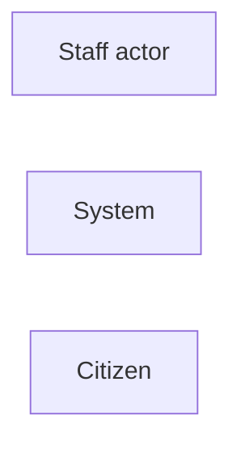

---

## 1. Government officer creates a project

**Actors:** Agency Officer or Project Manager  
**Priority:** P0

1. Authenticate.
2. Open create-project form.
3. Enter identity fields (name, code, agency, category, planned dates, description).
4. Draw or upload project geometry on the map.
5. Save as DRAFT.
6. System validates unique code, dates, and coordinates.
7. User sees the project detail page.

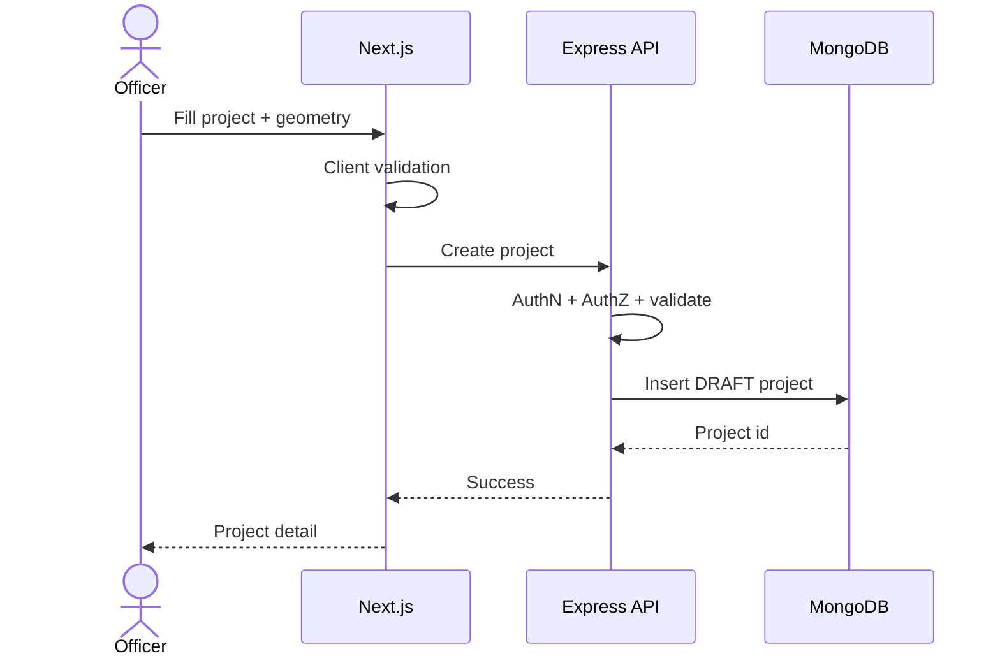

**Empty/error:** duplicate code, invalid polygon, start after end, unauthorized agency.

---

## 2. Project approval

**Actors:** Project Manager submits; Government Admin or authorized reviewer decides  
**Priority:** P0

1. Submitter completes required fields and submits DRAFT → SUBMITTED.
2. Reviewer opens queue; status may move UNDER_REVIEW.
3. Reviewer approves (APPROVED) or rejects with reason (REJECTED).
4. If a HIGH RoadSync conflict exists, reviewer is shown the conflict simulator (P1 packaging; P0 at least shows the conflict list).
5. Approval is audited.
6. Submitter is notified (P1 notification; P0 at least visible status).

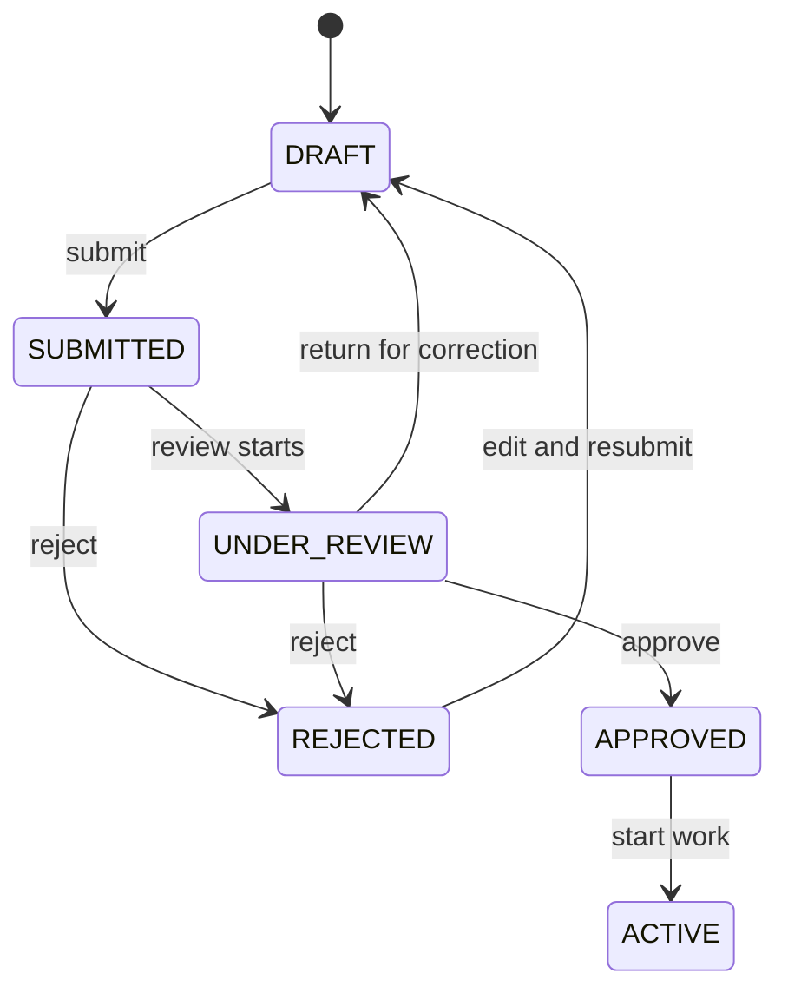

---

## 3. Create RoadSync work request

**Actors:** Agency Officer / Project Manager  
**Priority:** P0

1. Select related project (or agency work context).
2. Choose work type (road resurfacing, water pipeline, electricity, telecom, drainage, other).
3. Set planned start and end.
4. Draw GeoJSON geometry.
5. Save DRAFT or submit.
6. Server validates geometry and dates.

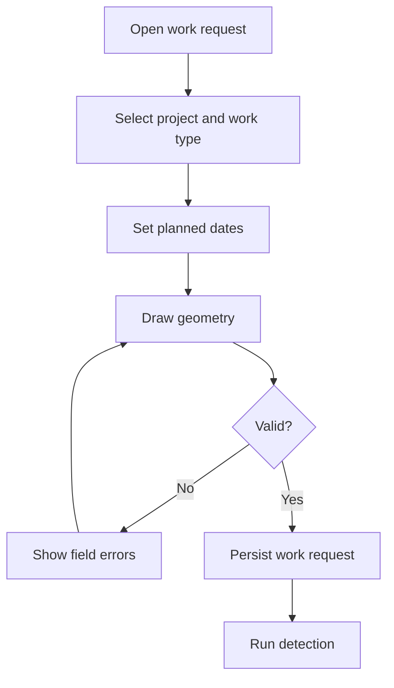

---

## 4. Detect conflict

**Actors:** System on submit/update; user views results  
**Priority:** P0

1. Server runs spatial query (nearby / intersecting).
2. Server filters by relevant date windows.
3. Server assigns type and severity.
4. Conflict records created (DETECTED/OPEN).
5. User sees list + map overlay.

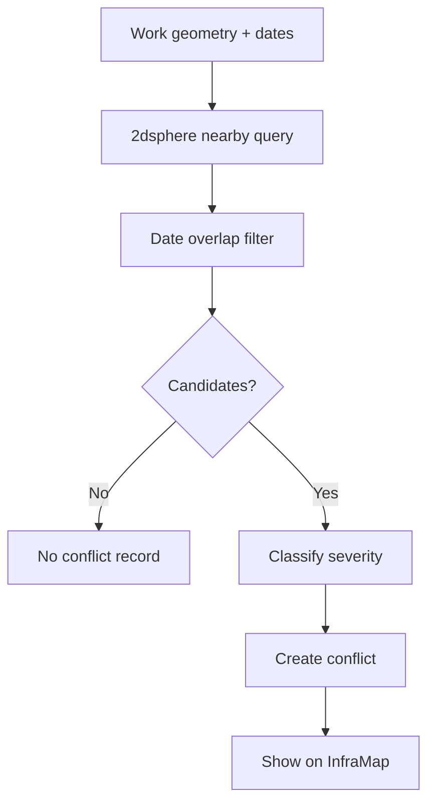

RoadSync **must** complete this path with AI offline.

---

## 5. Coordinate agencies

**Actors:** Originating agency + affected agency officers  
**Priority:** P0

1. System creates coordination request(s) for affected agencies (idempotent per conflict/agency).
2. Target officer is notified (P1 in-app; P0 visible in RoadSync inbox).
3. Target acknowledges and responds: accept, counter-propose, reject.
4. History is stored.

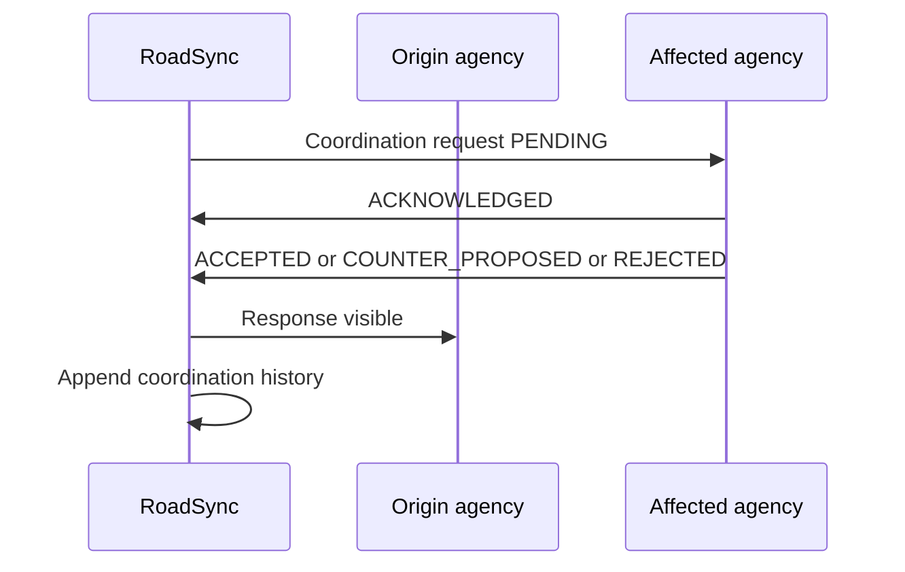

---

## 6. Resolve conflict

**Actors:** Authorized resolver (Gov Admin / authorized agency officer per policy)  
**Priority:** P0

1. Review geometry, dates, responses, and recommendation (P1).
2. Choose RESOLVED (e.g. reschedule, sequence utility-first) or ACCEPTED_RISK with justification, or CLOSED_INVALID if false positive.
3. Update work request / project dates if the resolution requires it.
4. Audit old/new values.
5. Close coordination requests.

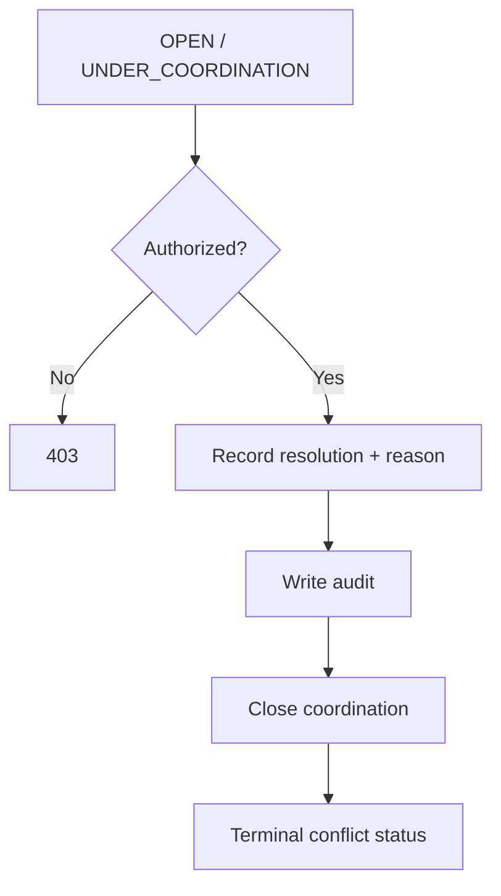

---

## 7. Track milestones

**Actors:** Project Manager  
**Priority:** P0

1. Open ACTIVE (or APPROVED) project.
2. Add milestones with planned dates.
3. Move PLANNED → IN_PROGRESS → COMPLETED (or DELAYED/BLOCKED).
4. Timeline reflects changes.
5. Illegal transitions rejected.

---

## 8. Update physical progress

**Actors:** Contractor (assigned) and/or Project Manager as allowed  
**Priority:** P0

1. Open assigned project progress form.
2. Enter percentage (0–100) and note; optional evidence later via inspection/DocTrace.
3. Server checks assignment.
4. Latest progress displayed; 100% does not auto-complete project.
5. Success toast; history retained.

---

## 9. Inspector verifies progress

**Actors:** Inspector  
**Priority:** P1

1. Inspector is assigned; inspection SCHEDULED.
2. Inspector starts IN_PROGRESS, visits/reviews evidence.
3. Submits report with photos and comments.
4. Outcome: APPROVED, REJECTED, or REVISION_REQUESTED.
5. Project shows **reported vs verified** (not a silent overwrite).
6. Contractor cannot perform this step for their own work.

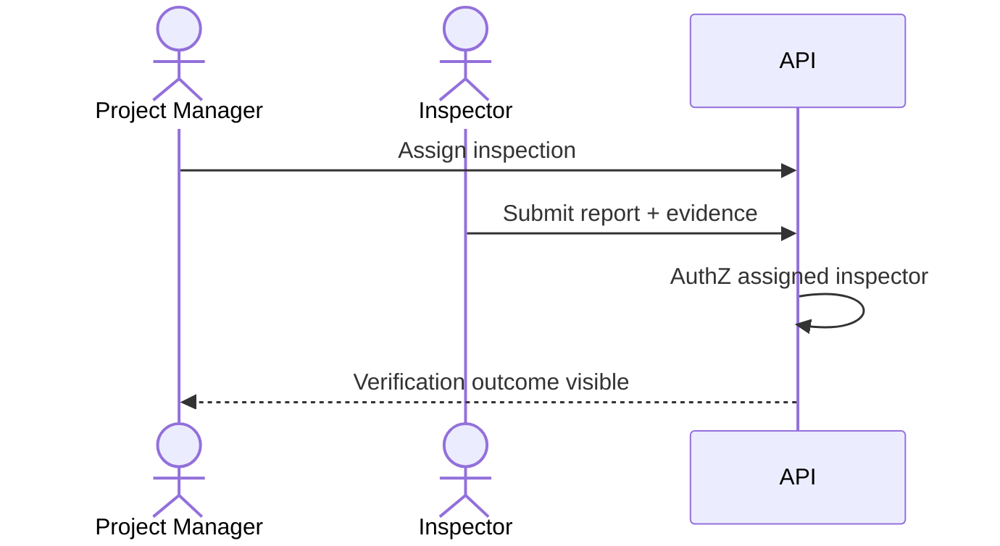

---

## 10. Upload project document

**Actors:** Authorized project member  
**Priority:** P1

1. Select category (contract, drawing, permit, report, other).
2. Client checks type/size; server re-validates.
3. Upload to private storage; metadata in MongoDB.
4. Status UPLOADED; processing may queue.
5. Unauthorized roles cannot preview.

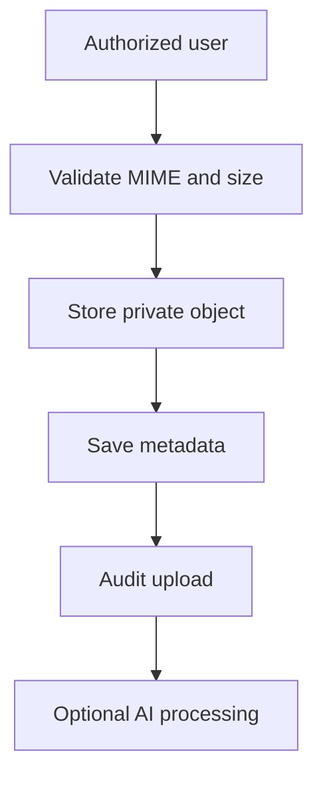

---

## 11. Ask a DocTrace question

**Actors:** Authorized user with document read access  
**Priority:** P1

1. Open project Q&A.
2. Ask a question (e.g. contractual completion deadline).
3. Node authorizes document scope.
4. RAG retrieves chunks; LLM answers with references when possible.
5. If no chunks or AI down: explicit fallback, no fake citations.

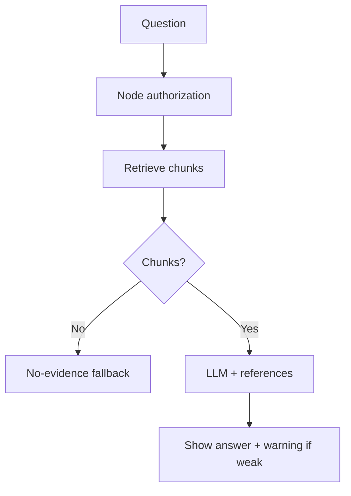

---

## 12. Run risk analysis

**Actors:** Authorized PM / officer / admin  
**Priority:** P1

1. Request analysis on a project.
2. Node collects minimized features.
3. FastAPI returns structured score/factors/explanation/recommendation.
4. Result persisted; official status unchanged.
5. If AI down: error + retry; project remains usable.

---

## 13. Complete project

**Actors:** Authorized PM / Gov Admin  
**Priority:** P0 (completion) with P1 inspection policy when enabled

1. User requests COMPLETED.
2. Server checks state machine, blocking conflicts, and completion rules.
3. If inspections are required for that project and missing/rejected, completion is blocked.
4. On success: COMPLETED + audit + notifications (P1).
5. Prompt conversion to asset (P1).

---

## 14. Convert project to asset

**Actors:** Authorized officer / admin  
**Priority:** P1

1. Project is COMPLETED.
2. User confirms asset details (name, type, location inherited).
3. Asset created with sourceProjectId.
4. Asset appears on asset layer when that layer is enabled.
5. Duplicate conversion is rejected.

---

## 15. Citizen reports an infrastructure issue

**Actors:** Citizen (unauthenticated or lightweight account as later designed)  
**Priority:** P1

1. Open public report form.
2. Pick location on public map, category, description, optional photo.
3. Server validates and rate-limits.
4. Issue SUBMITTED with tracking identifier.
5. Citizen can reopen tracking page; no access to staff notes.

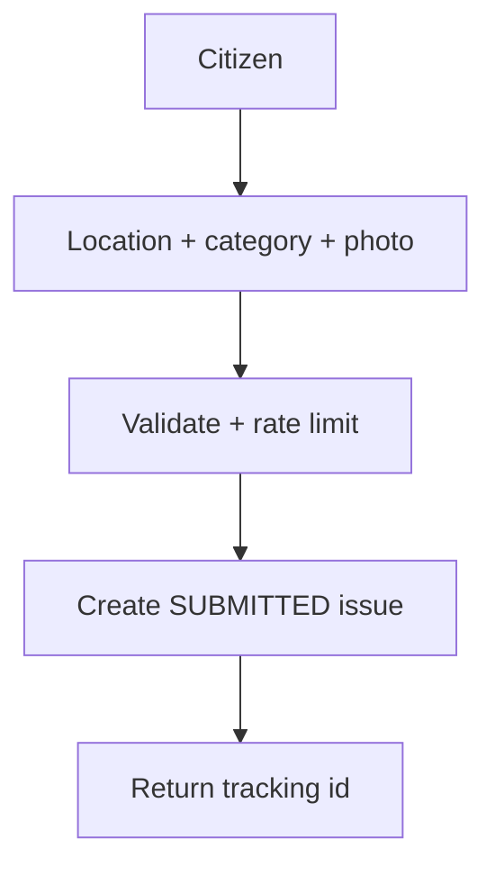

---

## 16. Agency handles a citizen issue

**Actors:** Agency Officer  
**Priority:** P1

1. Officer sees assigned/unassigned issues in agency inbox.
2. ACKNOWLEDGED → ASSIGNED → IN_PROGRESS → RESOLVED (or REJECTED/DUPLICATE).
3. Public-safe status visible to citizen.
4. Internal notes remain internal.
5. Optionally link to an asset or project if identified.

---

## 17. End-to-end P0 spine

This is the demo path evaluators should walk.

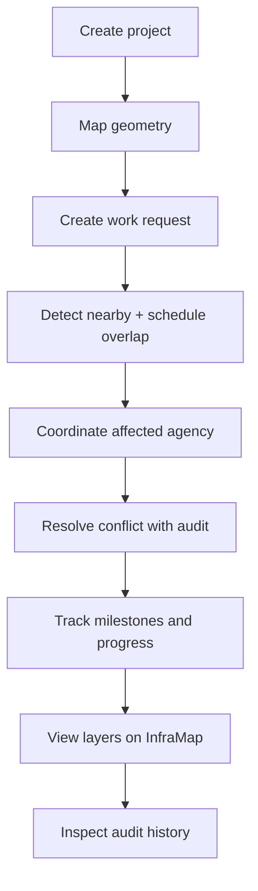

---

## 18. Loading, empty, error, success (all workflows)

| State | Expectation |
|-------|-------------|
| Loading | Skeleton or spinner on list/detail/map fetch |
| Empty | Explain why (no projects in agency, no conflicts, no issues) and offer the next action if permitted |
| Error | Human message + retry where safe |
| Success | Confirmation (toast or inline) and updated data |
| Unauthorized | 403 page/pattern, not a blank dashboard |

---

## 19. Related documents

- [project-scope.md](./project-scope.md)
- [requirements.md](./requirements.md)
- [business-rules.md](./business-rules.md)
- [mvp-priorities.md](./mvp-priorities.md)
