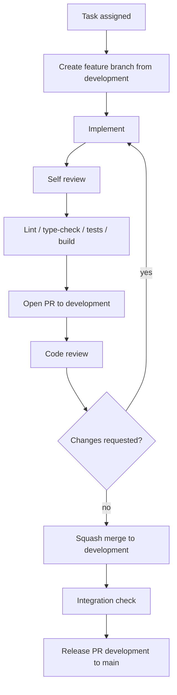

# INFRAOS Git Workflow

**Document:** `/docs/team/git-workflow.md`  
**Step:** 06  
**Status:** Locked

Use this file for day-to-day Git. Ownership: [module-ownership.md](./module-ownership.md). Shared files: [shared-files-policy.md](./shared-files-policy.md). Releases: [release-process.md](./release-process.md).

Remote: `https://github.com/divejikan-yuvarajah/InfraOS.git`

---

## 1. Branch model

```text
main                 submission / production-ready
development          daily integration (create before first feature work)
feature/<task>       new work
fix/<issue>          bug fix
chore/<task>         tooling, lint, CI, ignore files
docs/<topic>         documentation-only
```

Do not use `main` for day-to-day experimentation. Do not commit directly to `development` for feature work.

### `main`

- Stable, reviewed, submission-ready.
- No direct feature commits.
- Merges only from the approved integration flow (`development` after QA, or a documented hotfix).
- Protect on GitHub when the plan allows: PR required, no force-push, required checks, at least one review.

### `development`

- Primary integration branch during the project.
- Must remain runnable (docs-only today; after Step 7, apps must start).
- No intentionally broken experimental work.
- PR preferred. No force-push.

### Feature branches

Start from **latest `development`**. One coherent slice of work — not one branch per button.

Examples:

```text
feature/authentication
feature/project-trace
feature/roadsync
feature/inframap
feature/ai-risk
feature/doctrace
feature/contractor-finance
feature/assets
feature/citizen-portal
feature/notifications
docs/team-workflow
```

Create:

```powershell
git checkout development
git pull
git checkout -b feature/inframap
```

Until `development` exists, create it from `main` once (team leader), then branch from it. After Step 7 the workspace exists on `main`; create `development` before the first feature PR.

---

## 2. Feature-branch lifecycle

```text
Update development
        ↓
Create feature/<task>
        ↓
Implement a small coherent change
        ↓
Self-review + checks
        ↓
Commit (conventional)
        ↓
Push feature branch
        ↓
PR → development
        ↓
Code review + fixes
        ↓
Squash merge
        ↓
Delete the merged feature branch
        ↓
Integration check on development
```

Do not merge a branch that fails lint, type-check, tests, or build (when those exist).

---

## 3. Workflow diagram



---

## 4. Merge / rebase policy (locked)

**Default — keep it simple for a student team:**

```text
feature branch
  → periodically merge latest development into the feature branch
  → open PR
  → squash merge into development
```

Why merge-in rather than rebase-as-default:

- No rewritten shared history.
- No force-push of feature branches that others have checked out.
- Conflict resolution happens on the feature branch, not on `development`.

Rebase is allowed **only** on a private feature branch that nobody else uses, and only if the author understands it. **Never rebase `main` or `development`. Never force-push those branches.**

---

## 5. Merge-conflict strategy

1. Do not accept “ours” or “theirs” blindly.
2. Understand both sides.
3. Preserve locked architecture (stack, envelope, RBAC, routes).
4. Preserve intentional feature work.
5. Run available checks after resolution.
6. Note non-obvious manual resolutions in the PR.

Conflicts in **protected shared files** require the **team leader** (or designated integrator) to participate. See [shared-files-policy.md](./shared-files-policy.md).

---

## 6. Commit convention

Conventional Commits. Scope is the module when useful.

```text
feat: add project lifecycle service
feat(roadsync): implement date overlap detection
fix(auth): reject disabled user sessions
refactor(projects): simplify project query service
test(roadsync): add conflict severity cases
docs: document route access rules
chore: update lint configuration
```

Rules:

- One coherent behavior, bug fix, or document change per commit where practical.
- Meaningful subject; no `update`, `final`, `changes`, or `wip` as the only message.
- Do not mix a feature, an unrelated redesign, and a dependency upgrade in one commit.
- Do not over-fragment trivial one-line fixes into many commits either.

---

## 7. Pull requests

Every PR uses [.github/pull_request_template.md](../../.github/pull_request_template.md).

Target:

| From | Into | Merge style |
|------|------|-------------|
| `feature/*` `fix/*` `chore/*` `docs/*` | `development` | **Squash merge** (recommended) |
| `development` (release) | `main` | Merge commit or squash — team leader chooses; keep history readable |
| `fix/*` hotfix | `main`, then backport | See [release-process.md](./release-process.md) |

PR must name the module owner, database/API/UI/security impact, and tests run.

At least one reviewer. **Team leader must review** PRs that touch shared files, auth/RBAC, API envelope, navigation, CI, or deployment.

---

## 8. Protected-branch recommendations

Configure on GitHub if the plan allows. If it does not, the **team still follows these rules by convention**.

| Branch | Rules |
|--------|--------|
| `main` | PR required; no force-push; required status checks when CI exists; ≥1 review |
| `development` | PR preferred; CI when it exists; no force-push |

Do not delete remote `main` or `development`. Do not rewrite history.

---

## 9. CI strategy (documentation only until Step 7+)

Plan GitHub Actions to run after the workspace exists:

```text
install → lint → type-check → tests → build
```

Later, separate jobs for web / API / AI if useful.

**This step does not add a GitHub Actions workflow.** A workflow that cannot install the project would be noise. Scaffold CI in the project-init / CI step after `package.json` exists.

Pre-merge (when tools exist):

```text
git status
git diff
lint
type-check
tests
build
```

Also: app starts, key page loads, authorization is correct, no secrets in the diff, no debug leftovers, no generated junk.

---

## 10. Secrets and environment files

**Never commit:**

```text
.env
.env.local
.env.production
private keys
API secrets
database credentials
service credentials
```

**Do commit:** `.env.example` with **variable names only**.

If a secret is committed accidentally: rotate it, remove it from the tree in a **new** commit, and treat history rewrite as a last resort requiring explicit team-leader + owner approval (this project forbids casual force-push).

Root `.gitignore` ignores `.env`, `.env.local`, `.env.*.local`, and `.env.*` except `.env.example`. Do not stop ignoring secrets.

---

## 11. Pre-merge and post-merge

**Before merge:** checklist in [code-review-checklist.md](./code-review-checklist.md) and [definition-of-done.md](./definition-of-done.md).

**After important merges into `development`:**

- Pull latest.
- Clean install if dependencies changed.
- Start frontend and backend (when they exist).
- Verify DB connection, a key route, and authentication if available.
- Run integration tests.
- Check browser console and server logs.

Do not wait until the final week to integrate.

---

## 12. Team communication (lightweight)

Keep overhead small. Regularly share:

- short progress
- blockers
- upcoming **shared-file** edits
- PR status
- integration changes

No extra project-management tool is required for V1.

---

## 13. Cursor / AI coding rules

Agents (and humans using them) must:

1. Inspect existing code and docs first.
2. Follow locked architecture, RBAC, and routes.
3. Respect module ownership; do not rewrite unrelated files.
4. Reuse components, clients, validators, and types.
5. Run available checks.
6. Review the diff for secrets and scope creep.
7. Stop after the requested task.

Do not run giant “improve the entire project” rewrites during normal feature work.

---

## 14. Current repository facts (Step 7)

| Fact | Value |
|------|--------|
| Default branch today | `main` (tracks `origin/main`) |
| `development` branch | **Not created yet** — team leader creates it from `main` before first feature branch |
| Package manager | **npm workspaces** (one `package-lock.json`) |
| CI workflows | None (planned after apps exist) |
| Application scaffold | Workspace placeholders; Next.js Step 8; Express Step 9 |
| History rewrite / force-push this step | **Not performed** |
