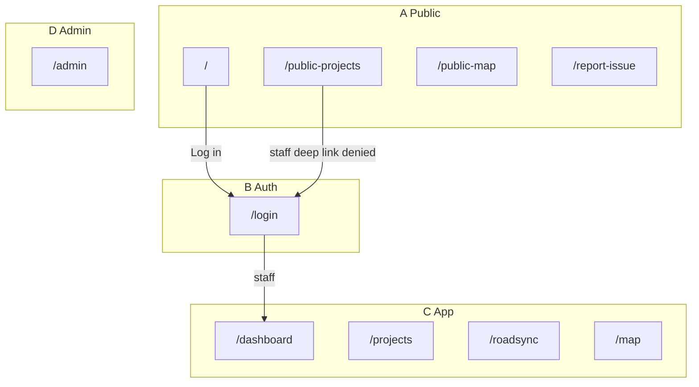

# INFRAOS Information Architecture

**Document:** `/docs/ux/information-architecture.md`  
**Step:** 05  
**Status:** Locked  
**Does not implement pages.** Canonical routes: [page-inventory.md](./page-inventory.md)

---

## 1. Principles

Organize around **jobs**, not a dump of modules:

```text
Overview → Projects → Coordination → Map → Management → Intelligence → System
```

- Show only nav the role can use (UX). **Express still authorizes.**
- Prefer **tabs and drawers** over extra URLs.
- Plural kebab-case resources: `/projects`, `/roadsync/conflicts`.
- `/projects/[id]` **redirects** to `/projects/[id]/overview`.
- Staff **self-register is not V1** (Q-001). No `/register`.
- Do not put tokens, emails, or confidential names in query strings.

---

## 2. Four product surfaces

| Surface | Path prefix | Users | Layout |
|---------|-------------|-------|--------|
| **A. Public website** | `/`, `/public-*`, `/about`, … | Citizens, visitors | Marketing + public map; **no app sidebar** |
| **B. Authentication** | `/login`, recovery | Anyone | Centered auth layout |
| **C. Operational app** | `/dashboard`, `/projects`, … | Staff | App shell: topbar + sidebar (desktop) / sheet (mobile) |
| **D. Administration** | `/admin/*` | SA (+ limited GA) | App shell + admin section |

Surfaces share brand; they do not share the citizen public nav with the staff sidebar.



---

## 3. Navigation groups (desktop sidebar)

Show a group only if it has at least one visible item.

```text
OVERVIEW
  Dashboard

OPERATIONS
  Projects
  RoadSync
  Infrastructure Map

MANAGEMENT
  Contractors
  Inspections
  Assets
  Documents

PUBLIC / SERVICE
  Citizen Issues

INTELLIGENCE
  Reports

SYSTEM
  Notifications
  Administration
```

Role menus: [navigation-by-role.md](./navigation-by-role.md).

---

## 4. Next.js route groups (conceptual — Step 8)

```text
app/
├── (public)/
├── (auth)/
├── (app)/          # operational shell
└── (admin)/        # may nest under (app) with extra guard
```

Error UI: `forbidden.tsx` / `not-found.tsx` / `error.tsx` plus dedicated `/maintenance` if needed. Do not ship stack traces.

---

## 5. Page header (protected)

```text
Breadcrumbs
Title + short description
Status / metadata chips (if any)
Primary action  |  overflow secondary actions
```

Example: title “Projects”, description “Plan and deliver authorized infrastructure work.”, CTA “Create project” if `project.create`.

Max **one** primary button.

---

## 6. Breadcrumbs

Human labels, not raw ObjectIds in the visible trail (code `INF-102` is OK).

```text
Projects
Projects > INF-102
Projects > INF-102 > Milestones
RoadSync > Conflicts > Water vs resurfacing
Assets > Corridor A12 > Maintenance
```

Accessible `nav` + `aria-current="page"`.

---

## 7. URL and query conventions

| Rule | Example |
|------|---------|
| lowercase kebab | `/work-requests` |
| plural collections | `/projects` |
| id in path | `/projects/[id]` |
| filters in query | `?status=ACTIVE&page=1` |
| map layers in query | `/map?layers=projects,conflicts` |
| reserved query keys | `status`, `agency`, `severity`, `layers`, `q`, `page`, `from`, `to` |

**Never:** `?token=`, `?email=`, full citizen names, document titles that are confidential.

---

## 8. Page states (every important view)

| State | Pattern |
|-------|---------|
| Loading | Skeleton matching layout (table vs cards vs map) |
| Empty | Why empty + CTA if permitted (“No projects found. Create your first infrastructure project.”) |
| Error | Message + retry for GET |
| Forbidden | `/403` or inline 403 for capability |
| Not found | `/404` — also used for private IDOR |
| Success | Toast on mutations; list/detail refresh |
| Partial | e.g. AI down: risk tab shows fallback, rest of project works |

---

## 9. Mobile

Do **not** shrink the desktop sidebar.

- Top app bar: menu, title, one primary action
- Nav in a **sheet**
- Filters in a **sheet**
- Tables → **card lists** (or careful horizontal scroll)
- Map: full canvas + compact chips + **bottom sheet** for selection
- Bottom tab bar only if a role has 3–5 constant destinations (optional later; default is sheet)

---

## 10. Accessibility

- Skip link to `#main`
- Landmarks: `banner`, `nav`, `main`, `contentinfo`
- Keyboard: sidebar, tabs, dialogs, map popover/sheet
- Focus move into dialogs/sheets; restore on close
- Headings in order; one `h1` per page
- Status = **color + text + icon** (never color alone)
- `prefers-reduced-motion` (GSAP off)

---

## 11. Status / nav color (Step 5 lock)

Sri Lankan flag-inspired **semantic** use (prompt Steps 4–6). Neutrals remain slate/white.

| Use | Hex | Always pair with |
|-----|-----|------------------|
| Active nav / primary action accent | `#FF5B00` | “Current page” text |
| Pending / attention | `#FEB600` | “Pending” label |
| Critical / severe conflict / rejected | `#8C1F28` | “High” / “Rejected” |
| Completed / healthy / resolved | `#279541` | “Completed” / “Resolved” |
| Surfaces | `#F8FAFC` bg, `#FFFFFF` surface, `#E2E8F0` border | — |

Wrapper navy `#0F172A` / blue `#2563EB` are **not** used as a second active-nav system. Remaining type scale and dark-chrome tokens: **Step 8**. See INC-001 update in assumptions.

---

## 12. Global search

**P1.** Command palette / header search over projects, codes, contractors, agencies, conflicts, assets — **scoped by authorization**. Group results by entity. No confidential snippets in the typeahead.

---

## 13. SEO and privacy

| Pages | Index |
|-------|--------|
| Public marketing + public projects/map | Yes: title, description, OG, canonical |
| Auth, app, admin | `noindex` |

Analytics (if later): page type and role **bucket** only — not document names, issue text, or search queries.

---

## 14. Related

[route-map.md](./route-map.md) · [navigation-by-role.md](./navigation-by-role.md) · [../security/route-access-policy.md](../security/route-access-policy.md)
