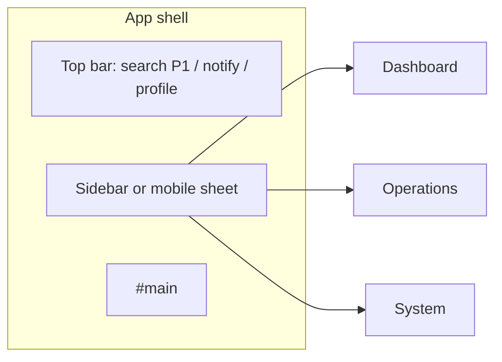

# INFRAOS Navigation by Role

**Document:** `/docs/ux/navigation-by-role.md`  
**Step:** 05  
**Status:** Locked  
**Security:** hiding a link is **not** authorization.

Empty groups are omitted.

---

## Super Admin

Overview: Dashboard  
Operations: Projects (read), RoadSync (read), Map  
Management: Contractors, Assets, Documents  
Intelligence: Reports  
System: Notifications, **Administration** (Users, Agencies, Roles, Audit, System)

No primary “Approve project / Pay / Verify / Resolve” in the header — those belong to operational roles.

---

## Government Admin

Dashboard, Projects, RoadSync, Map, Contractors, Assets, Documents, Issues, Reports, Notifications  
Admin: **Users (org)**, **Agencies (org)**, **Audit (org)** — not System settings

---

## Agency Officer

Dashboard, Projects, RoadSync, Map, Issues, Documents, Notifications  
(Inspections/Assets if they use them — show Assets when `asset.read`)

---

## Project Manager

Dashboard, Projects, RoadSync, Map, Documents, Inspections, Notifications  
(Finance via project tab, not a top-level item unless desired)

---

## Contractor (restricted)

Dashboard, **Assigned projects** (`/projects` filtered), Notifications, Profile  
Optional: Map limited, Documents (granted only)  
**No** RoadSync, Admin, Reports, Issues inbox, Contractors directory, Finance top-level

---

## Inspector

Dashboard, **Inspections**, Projects (context), Map (useful), Notifications, Profile  
**No** RoadSync resolve, Admin, Payments

---

## Citizen

**No app sidebar.** Public header:

```text
Home · Projects · Map · Report an issue · FAQ · Staff login
```

Issue tracking: `/report-issue` success page with tracking code (Q-005). No `/dashboard`.

---

## Mobile sheet order

Same items as desktop, flattened. First items = role’s P0 job (Inspector → Inspections; Officer → RoadSync; PM → Projects).

---

## Mermaid (staff shell)


