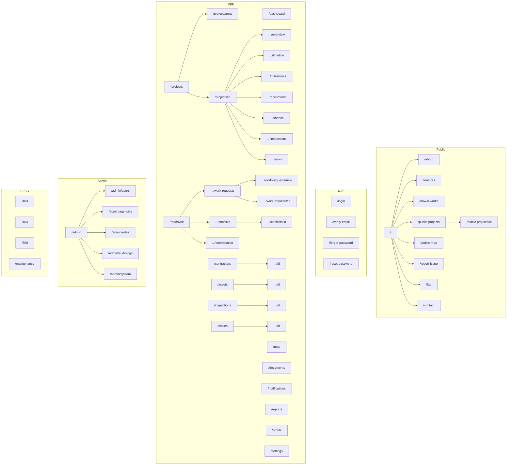

# INFRAOS Route Map

**Document:** `/docs/ux/route-map.md`  
**Step:** 05  
**Status:** Locked  
**Inventory:** [page-inventory.md](./page-inventory.md)

---

## 1. Naming rules

- lowercase, kebab-case, plural collections
- no verb URLs (`/manage-projects` ❌)
- avoid deep nests beyond `/resource/[id]/section`
- stable Mongo id in path; display code in UI

**Supersedes Step 3 sketch:** `/roadsync/new` → `/roadsync/work-requests/new`. Added `/roadsync/work-requests`, `/inspections`, `/issues/[id]`.

**Not V1:** `/register`, `/mfa`, `/auth/callback`, `/admin/feature-flags`.

---

## 2. Hierarchy



---

## 3. Redirects

| From | To |
|------|----|
| `/projects/[id]` | `/projects/[id]/overview` |
| `/admin` | `/admin/users` for SA (or first allowed child) |
| `/roadsync` | stays as hub (not a redirect) |

---

## 4. Query examples (shareable, non-secret)

```text
/projects?status=ACTIVE&page=1
/roadsync/conflicts?severity=HIGH
/map?layers=projects,conflicts&status=ACTIVE
/assets?condition=WARNING
/issues?status=ASSIGNED
```
